# Microduck-CoPush

Two simulated robot ducks learn to push a box into a target together (Cornell Generative AI
club, fall 2026). Here we compare one brain for both ducks with a separate brain in each duck.

[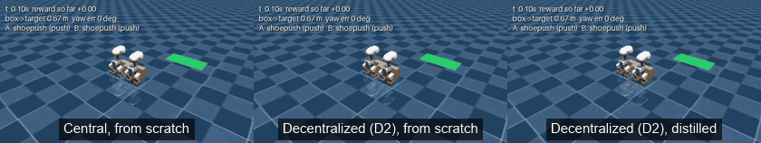](docs/media/central_vs_decentral.mp4)

Same start, three controllers (click for the sharper video). All three push the box into the green
target; the differences show up across many starts, in the results below.

**How it works: see the diagrams → [docs/DIAGRAMS.md](docs/DIAGRAMS.md)** ·
**📈 [Progress timeline, with clips →](docs/TIMELINE.md)**

## Final goal

Two ducks start anywhere within a set distance of the target, facing any direction. The box can
be anywhere, at any angle. Without a script telling them what to do, the ducks learn to walk to
the box and push it into the target together.

## Current status (2026-11-15)

- **Current stage: Stage 1, random box start.** The box starts in a random spot (up to 15 cm off in
  each direction) and at a random angle (up to 45 degrees). The ducks still start touching it.
- **Last finished result:** trained from scratch, ducks that each decide for themselves do as well as
  one central controller (40% against 45% of 200 held-out starts, 10 training runs each; no measurable
  difference). See [Central vs decentralized](#central-vs-decentralized).
- **Still unsolved:** starts where the box is turned more than 15 degrees to the positive side (every
  policy wins 0 to 24% of them on 200 held-out starts). Earlier tries are in [stage 1](experiments/stage1-random-box-pose/README.md) and
  [stage 1b](experiments/stage1b-turn-direction-fix/README.md).

## How it works

Each duck walks and pushes with frozen, pretrained neural networks from Pollen Robotics. On top of
them, a small network (the coordinator, the only part we train) picks each duck's forward speed and
turn rate every 0.2 s. It is trained with reinforcement learning (RL): it tries things in a physics
simulator (MuJoCo) and learns from a score called the reward. The method is PPO (Proximal Policy
Optimization), a standard RL algorithm.

## Central vs decentralized

- **Central:** one brain sees the whole scene and commands both ducks.
- **Decentralized (D2):** each duck decides from its own view of the box and target, plus where its
  partner is and which way it faces. Both ducks run the same network. (D1 is the same without the
  partner.)
- **Distilled:** decentralized ducks that first copy the central brain by imitating its choices, then
  keep training.

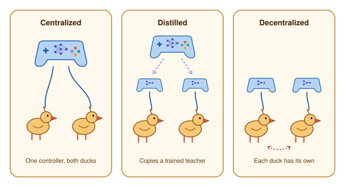

### Main result: trained from scratch, 10 seeds each

Both start from random weights and train on the same fixed start. A seed is one training run with a
different random start. Each is then tested on 200 random box starts it never trained on (one episode
per start; the intervals are across the 10 seeds).

| setup | test starts won (mean) | 95% interval of the mean | range across the 10 seeds |
|---|---|---|---|
| central, from scratch | **45%** | 40% to 51% | 34% to 55% |
| decentralized (D2), from scratch | **40%** | 33% to 47% | 28% to 56% |

*50-start numbers, superseded: 46% and 40% (ranges 28% to 64% and 28% to 60%).*

**No measurable difference:** central minus decentralized is +5.3 points, with a 95% interval of -3.5 to
+14.0, and the two ranges overlap almost completely. The style differs: decentralized ducks idle more (29%
of steps against 10%) and over-turn the box on the long-turn starts (108 degrees of total turn against 18),
but share the pushing more evenly (1 lazy-duck episode in 2,000, against 35).

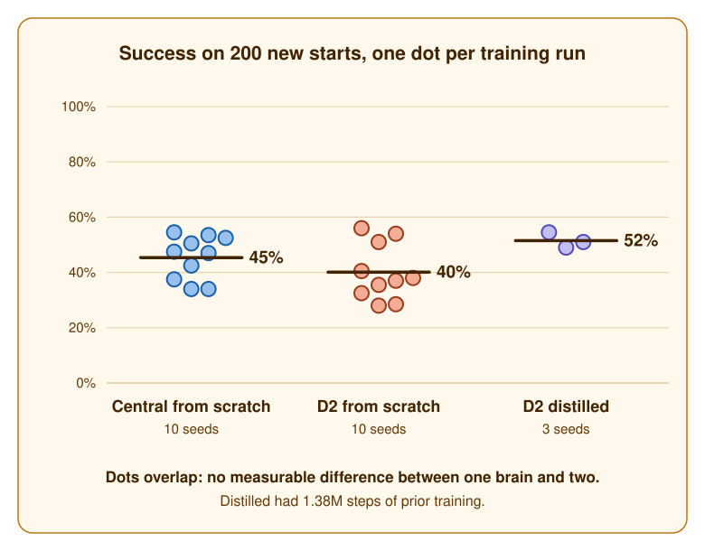

Each dot is one training run, tested on 200 random box starts it never trained on. Per-seed table, the
learning curves and all plots: [experiments/d2-from-scratch-comparison/](experiments/d2-from-scratch-comparison/README.md).
Old against new for every policy, and which earlier claims held:
[experiments/stage1-reevaluation/](experiments/stage1-reevaluation/README.md).

### Earlier result: decentralized ducks that copied the central brain

Distillation (copying the central brain first, then training further on random starts) was first measured on
50 starts: D2 74%, D1 and central 60% (**50-start, superseded**). On 200 held-out starts:

| controller | success, 200 starts (95% interval) | old, 50 starts (superseded) | long-turn side (box turned > +15 deg) | both ducks pushing | lazy-duck episodes |
|---|---|---|---|---|---|
| central stage 1 (one controller for both ducks) | 58% (51 to 65) | 60% | 5% | 87% of steps | 6 of 200 |
| D1: own view only | 64% (57 to 70) | 60% | 9% | 93% | 0 |
| **D2: own view + partner** | **66%** (60 to 73) | 74% | 15% | 89% | 1 |
| central, same extra training (stage 1b A) | 70% (64 to 76) | 72% | 21% | 93% | 0 |

**Seeing the partner: no measurable difference.** D2 minus D1 is +2.5 points (95% interval -2.2 to +7.2), so
the 74% against 60% was noise. D1 and D2 beat the central stage 1 policy, but they had 1.4M more training
steps, and central with similar extra training (stage 1b A) does as well or better (70%): this says
"decentralized control costs nothing here", not "better". One seed each. We plan to use distillation again at
the end of the project.

[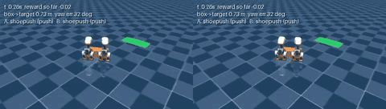](docs/media/decentral_stage1_vs_d2_hard_start.mp4)

Box turned +32 degrees: central (left) runs out of time, D2 (right) finishes in 41 steps (one start, for
illustration). Full results: [experiments/decentralized-control/](experiments/decentralized-control/README.md).

## Behaviors we're teaching

One row per track. Each track updates its own row (rules in [AGENTS.md](AGENTS.md)).

| behavior | status | where |
|---|---|---|
| **Stage 1: random box pose.** Push a box that starts at a random spot and angle. | done: on 200 held-out starts central 58% (51 to 65) and decentralized D2 66% (60 to 73), a difference the data cannot measure (50-start numbers, superseded: 60% and 74%) | [experiments/stage1-random-box-pose/](experiments/stage1-random-box-pose/README.md) |
| **Steering.** Turn the box on hard starts, then at wider angles. | in progress: the long-turn side is still mostly lost (every policy wins 0 to 24% of those starts on 200 held-out starts) | [ROADMAP.md](ROADMAP.md#steering-anmol), [stage 1b](experiments/stage1b-turn-direction-fix/README.md) |
| **Rendezvous.** The ducks start apart and meet at the box. | starting | [ROADMAP.md](ROADMAP.md#rendezvous-winston) |
| **Decentralized pushing (D2).** Each duck runs the same network, starting from wider and wider random duck placements. | in progress: trained on wider duck start noise (L2: heading up to 30 degrees, spacing up to 8 cm), success on those starts rises from 81-82% to 88% overall and from 67% to 79-83% on the long-turn side, with nothing measurable lost on clean or noisy starts (200 held-out starts, 2 seeds). | [experiments/d2-steering/](experiments/d2-steering/README.md) |
| **Rendezvous, decentralized (D2).** Each duck walks from a random start 0.2 to 0.8 m away to its docking spot behind the box, then hands off to the frozen push policy. | done: on 200 held-out starts the learned rendezvous docks 87.0% (81.6 to 91.0) and 75.0% (68.6 to 80.5) of the time (2 seeds) against 48.0% (41.2 to 54.9) for a scripted approach, and the whole rendezvous-then-push pipeline succeeds 90.0% (85.1 to 93.4) and 85.5% (80.0 to 89.7) against 65.0% (58.2 to 71.3), both measurably better. Official policy: `runs/d2-rendezvous-r6-dock-payout/s1/model.zip`. | [experiments/d2-rendezvous/](experiments/d2-rendezvous/r6-dock-payout/SUMMARY.md) |
| **Partner sensing by chirps.** Each duck hears a rough direction to its partner now and then, not its exact position. | tested: no measurable effect when the ducks start side by side (63% against 66% with exact info on 200 held-out starts) | [experiments/chirp-partner-sensing/](experiments/chirp-partner-sensing/README.md) |

## Next steps

The full plan, per track, is in [ROADMAP.md](ROADMAP.md).

- **Steering:** win the hard side (box turned more than 15 degrees the positive way; every policy wins 0 to
  24% of those starts), then widen the box angle range.
- **Rendezvous:** start the ducks away from the box, so they walk to it and push together.
- **Decentralized:** test partner info where it could matter, with the ducks starting apart (on stage 1,
  side by side, it does not measurably matter).

## Progress

Clips play at 2x speed. Click one for the sharper video.

| | |
|---|---|
| [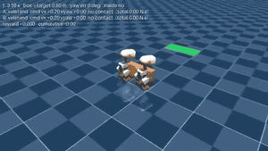](docs/media/two_duck_push.mp4) | [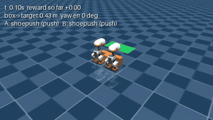](docs/media/push_steer_squaring.mp4) |
| **1. Two ducks and a box in the simulator.** A hand-written script pushes the box straight. | **2. The script gets a "stop" rule.** It straightens the box, then holds still. |
| [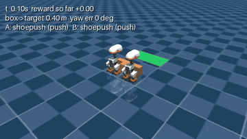](docs/media/ppo_run_a_final.mp4) | [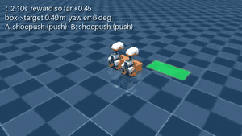](docs/media/steer_overshoot.mp4) |
| **3. First RL success.** The target is straight ahead, and the learned controller pushes it in faster than the script. | **4. A target to the side is out of reach.** The ducks can't turn the box in time. |
| [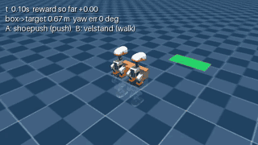](docs/media/overnight_pivot_push_script.mp4) |  |
| **5. A pivot script makes it reachable.** One duck waits while the other turns the box, but it's almost a one-duck push. | **6. RL learns the side target.** Both ducks share the push and finish in 32 steps. |
| [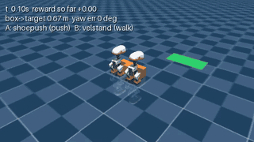](docs/media/overnight_solo_push.mp4) | [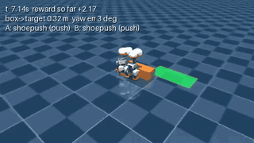](docs/media/overnight_box_lost.mp4) |
| **Bug: one duck quits.** Allowed to stand still, duck B walks away and duck A pushes alone. | **Bug: crooked and lost.** Mid-training, the box reaches the target turned 65 degrees, then both ducks leave. |
| [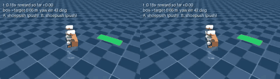](docs/media/stage1_pivot_push_vs_ppo_hard_start.mp4) | |
| **7. Stage 1: random box starts.** On a hard start, the script (left) fails and the learned controller (right) succeeds. 58% on 200 held-out starts (60% on 50 starts, superseded). | |

## The reward function

Every step (0.2 s) the controller gets:

$$
r = w_{pos}\,(d_{before} - d_{after}) + w_{yaw}\,(\theta_{before} - \theta_{after}) - c_{time} + \text{(one-time events)}
$$

In words: points for moving the box closer to the target, points for turning it toward the right
angle, and a small cost for every step that passes. Because it rewards progress, not closeness,
standing next to the target earns nothing.

Current values (reward version v1.1, from [configs/copush.yaml](configs/copush.yaml)):

| Symbol | Meaning | Current value |
|---|---|---|
| $d$ | distance from the box's center to the target's center | in meters |
| $\theta$ | angle between the box and the target (a box turned 180 degrees counts as lined up) | in radians |
| $w_{pos}$ | points per meter the box moves toward the target | 10 |
| $w_{yaw}$ | points per radian the box turns toward the target angle | 1 |
| $c_{time}$ | cost per step | 0.03 |
| $R_{success}$ | bonus for success | +10 |
| $R_{fall}$ | penalty when a duck falls | −10 |
| $R_{box}$ | penalty when the box tips over or is lost | −10 |

**What ends an episode:**
- **Success (+10):** the box's center is inside the 0.40 × 0.20 m target, its angle is within
  15 degrees, and both ducks are standing, all held for 1 s.
- **A duck falls (−10):** its body tilts more than 60 degrees or drops below 7 cm, and it stays down
  for 0.2 s. A quick stumble doesn't count.
- **Box tipped (−10):** the box tilts more than 30 degrees.
- **Box lost (−10):** the box is more than 0.40 m from both ducks.
- **Time runs out:** 100 steps (20 s) with no other ending. There's no extra penalty beyond the
  per-step cost.

Two optional terms exist, but both are off in v1.1:
- a cooperation bonus that pays for both ducks pushing equally
- a penalty for a duck that leaves the box (0.02 per step in v1.2)

Why each value is what it is: [docs/REWARD_LOG.md](docs/REWARD_LOG.md).

## Links

| | |
|---|---|
| [ROADMAP.md](ROADMAP.md) | the plan: tracks, owners, next steps, decisions |
| [SETUP.md](SETUP.md) | install, run the simulator, train, test, troubleshoot |
| [AGENTS.md](AGENTS.md) | shared context and rules for AI coding agents |
| [docs/TIMELINE.md](docs/TIMELINE.md) | every milestone and experiment round, with clips |
| [docs/REWARD_LOG.md](docs/REWARD_LOG.md) | each reward version: what changed, why, and the results |
| [experiments/README.md](experiments/README.md) | the experiment for each stage and its results |
| [docs/DEMO.md](docs/DEMO.md) | a 5-minute demo outline |
