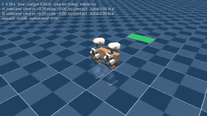
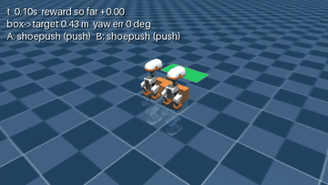
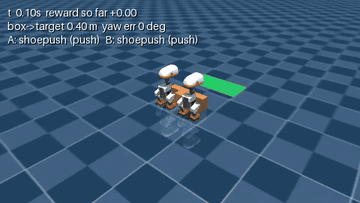
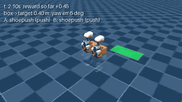

# Microduck-CoPush

Two simulated Pollen MicroDucks push one box into a target area together (Cornell Generative AI club, fall 2026).

**📈 [See our progress timeline, with clips →](docs/TIMELINE.md)**

- **Low level:** each duck walks with frozen, pretrained neural policies. velstand walks, and Shoe
  Push leans into a box.
- **High level:** our code only decides each duck's forward speed and turn rate, five times a
  second. A scripted controller does that today; a reinforcement-learning (RL) coordinator is
  being trained to replace it.

The project plan is in [docs/COPUSH_PLAN.md](docs/COPUSH_PLAN.md).

## Status (2026-11-12)

- **Simulator:** done. Two identical ducks, a 28 × 10 × 9 cm box and a target area in MuJoCo. It
  runs about 20× faster than real time, and 85× with 8 parallel copies.
- **RL environment:** done (Gymnasium). It comes with reward versions v1, v1.1 and v1.2, scripted
  baselines, start layouts, logging, and short evaluation videos.
- **Close target (0.40 m straight ahead):** solved. Every controller that pushes forward
  succeeds. PPO run A reached +13.14 return with 100% success, slightly better than the scripts,
  because it learned to push faster.
- **Stage 1, random box starts (`overnight` layout):** PPO succeeds on 60% of 50 held-out starts with
  the box up to 0.15 m off and turned up to 45 degrees (the policy it started from: 50%, `pivot_push`
  script: 32%). It fails almost every start turned more than 15 degrees to the positive side.
  [experiments/stage1-random-box-pose/](experiments/stage1-random-box-pose/README.md)
- **Stage 1b, fixing that side:** training with half the starts on the hard side raises the score to 72%,
  but that side is still only 4 of 17 (stage 1: 2). A smaller time penalty gives 68% and makes the ducks wait
  on hard starts. [experiments/stage1b-turn-direction-fix/](experiments/stage1b-turn-direction-fix/README.md)
- **Target 0.30 m to the side, 0.60 m ahead (`overnight` layout):** early RL success. PPO gets the
  box in 60 to 80% of the time across 3 seeds when the box starts in a random spot, which ties the
  `pivot_push` script (preliminary, 5 episodes). From the fixed start it trained on, it beats the
  script: 32 vs 54 steps, with both ducks pushing. The closer `steer` layout (0.40 m ahead) is still
  out of reach.
- Timeline with clips, including the buggy runs: [docs/TIMELINE.md](docs/TIMELINE.md). 5-minute
  demo: [docs/DEMO.md](docs/DEMO.md).
- What we changed in the reward and why: [docs/REWARD_LOG.md](docs/REWARD_LOG.md).

## See it

The clips play at 2× speed. Click one for the sharper mp4.

| Two ducks pushing (scripted) | `push_steer` squares the box, then stands still |
|---|---|
| [](docs/media/two_duck_push.mp4) | [](docs/media/push_steer_squaring.mp4) |
| **PPO run A (close target)** | **Steer layout: can't turn in time** |
| [](docs/media/ppo_run_a_final.mp4) | [](docs/media/steer_overshoot.mp4) |

## Quick start

You need `uv`, with this repo cloned next to Pollen's `microduck_rl` (setup below). All commands run
from the repo root.

```sh
sh scripts/fetch_policies.sh                                      # once: the ONNX walking/pushing policies

scripts/copush.sh --viewer                                        # watch + drive both ducks from the terminal
scripts/copush.sh --headless --duration 15 --script push_forward  # scripted push -> runs/<timestamp>/
```

[docs/SIM_GUIDE.md](docs/SIM_GUIDE.md) covers keys, start positions, the Python API and common
problems, and [docs/CHEATSHEET.md](docs/CHEATSHEET.md) is a one-page version.

RL uses `scripts/rl.sh`. It is Python with gymnasium and stable-baselines3 added as a uv overlay,
so microduck_rl's own environment is left alone.

```sh
scripts/rl.sh scripts/rl/baselines.py                             # baselines + gates per layout (~2 min)
scripts/rl.sh scripts/rl/train.py --layout close --steps 100000 --name A   # PPO, ~6 min on a laptop
scripts/rl.sh -m tensorboard.main --logdir runs                   # training curves
scripts/rl.sh -m pytest                                           # all tests
```

Run the tests with `scripts/rl.sh -m pytest`. A plain `uv run pytest` skips the simulation tests,
because that environment has no MuJoCo, so it can look like everything passed when the sim tests
never ran.

Every run writes `runs/<run_id>/`, which is git-ignored. It holds the config, CSV logs, events,
short videos with an `index.md`, and for PPO the TensorBoard logs and `model.zip`. Settings live in
[configs/copush.yaml](configs/copush.yaml):
- the start layout: `close`, `steer` or `hard`
- the reward version
- PPO hyperparameters
- the video settings

## Docs

| | |
|---|---|
| [docs/SIM_GUIDE.md](docs/SIM_GUIDE.md) · [docs/CHEATSHEET.md](docs/CHEATSHEET.md) | running the two-duck sim |
| [docs/REWARD_LOG.md](docs/REWARD_LOG.md) | each reward version: what changed, why, results, videos |
| [docs/TIMELINE.md](docs/TIMELINE.md) · [docs/DEMO.md](docs/DEMO.md) | timeline with clips · 5-minute demo outline |
| [docs/results/b0_single_duck_push.md](docs/results/b0_single_duck_push.md) | one duck + Shoe Push baseline (steering gain, drift) |
| [docs/WEEK1_STATUS.md](docs/WEEK1_STATUS.md) | Week 1: two ducks in duck-sim / robotd |
| [docs/COPUSH_PLAN.md](docs/COPUSH_PLAN.md) | the semester plan |

## Repo layout

```
copush/         sim.py (two-duck MuJoCo world), duck_policy.py (per-duck ONNX runner),
                env.py (Gymnasium env + scripted baselines), rewards.py, rl_eval.py, rl_callbacks.py,
                video.py, config.py; plus the Week 1 duck-sim client (sim_client.py, runner.py, ...)
configs/        copush.yaml (scene, layouts, reward versions, PPO, video)
scripts/        copush.sh / copush_sim.py (sim), rl.sh + rl/ (checks, baselines, train), b0/ (B0 harness),
                sim.sh, check_m1.py, two_duck_demo.py (Week 1 duck-sim path)
scenes/         copush_base.xml (floor/lights for the two-duck world), B0 and Week 1 scenes
tests/          pytest; simulator tests skip outside microduck_rl's environment
docs/           guides, results, media/ (README GIFs + mp4s, < 1 MB each)
```

## Week 1 path: duck-sim / robotd

This repo is a **client** of Pollen's repos and never copies their code. The Week 1 setup ran each duck
as a real `robotd` driving a MuJoCo body: commanded like a robot (`robot.move` JSON-RPC, 10 Hz) and read
back from the simulator's body port. The two-duck sim above replaced it for CoPush experiments (it
runs faster than real time, and Shoe Push misbehaves under robotd; see WEEK1_STATUS.md).

| repo | role | pinned in |
|---|---|---|
| [pollen-robotics/microduck](https://github.com/pollen-robotics/microduck) | `robotd` (the real robot daemon, 50 Hz loop + ONNX policies) and `scripts/duck-sim` | `upstream.lock` |
| [pollen-robotics/microduck_rl](https://github.com/pollen-robotics/microduck_rl) | `duck-body` (MuJoCo body server), scenes, policy runtime | `upstream.lock` |

### Setup (macOS / Linux)

Needs `git`, [`uv`](https://docs.astral.sh/uv/) and Rust (`cargo`). Clone this repo next to the
upstream ones (setup clones them if missing):

```
~/CS_Projects/GenAI/
├── Microduck-CoPush/   (this repo)
├── microduck/
└── microduck_rl/
```

```sh
cd Microduck-CoPush
scripts/setup.sh
```

`setup.sh` is safe to rerun. It clones/pins both upstream repos to `upstream.lock` (never over
local changes; `COPUSH_NO_PIN=1` to skip pinning), runs `uv sync` in microduck_rl and here, builds
the daemons, and installs our scene into microduck_rl as an untracked `scene_copush_box.xml`.
Policies are fetched by duck-sim on the first launch.

### Commands

All simulator commands go through `scripts/sim.sh`, a thin wrapper over `microduck/scripts/duck-sim`
that sets 2 ducks, headless by default, and loads our body-server extension (box pose, spawn
placement; see `copush/_bodyext/sitecustomize.py`). Anything else is passed straight to duck-sim.

**M1 check (headless):**

```sh
uv run python scripts/check_m1.py            # launch, run the 20 s demo, PASS/FAIL table, shut down
uv run python scripts/check_m1.py --runs 3   # three fresh launches
```

**Viewer demo (for watching / screen recording):**

```sh
scripts/sim.sh up --viewer                   # MuJoCo window with two ducks (~30 s to stand up)
uv run python scripts/two_duck_demo.py       # A walks 8 s, B turns 8 s, both stop; CSV in data/runs/
scripts/sim.sh down
```

**Box scene:**

```sh
scripts/sim.sh up --box                      # 2 ducks + 28x10x9 cm, 150 g box 0.6 m ahead of duck A
scripts/sim.sh up --box --viewer             # same, with the window
uv run python scripts/two_duck_demo.py       # CSV now also has box_x, box_y, box_z, box_yaw
```

`--box` is `DUCK_SIM_SCENE=<abs path to scene_copush_box.xml> DUCK_SIM_KEYFRAME=HOME`.

**Plot a run:**

```sh
uv run python scripts/plot_run.py --latest                 # -> data/plots/<run>.png
uv run python scripts/plot_run.py data/runs/<run>.csv
```

**Per-duck tools:**

```sh
DUCK_SIM_DUCK=duck-b scripts/sim.sh ctl health
scripts/sim.sh realtime                      # real-time factor of the shared world
COPUSH_PLACE=";0,0.20,0" scripts/sim.sh up   # spawn duck B at (0, 0.20) instead of (0, 0.5)
```

Do not use `scripts/sim.sh drive` for duck B: upstream `drive` always commands and reads duck A
(see docs/WEEK1_STATUS.md). Use `copush.sim_client` instead.

**Tests:**

```sh
scripts/rl.sh -m pytest
```

A plain `uv run pytest` skips the simulation tests, because that environment has no MuJoCo, so it
can look like everything passed when the sim tests never ran.

## The shared interface

```python
state = {"duck_a": {"position": (x, y), "yaw": rad, "velocity": (vx, vy)},
         "duck_b": {...},
         "box": {...} or None,
         "goal": {"position": (x, y), "yaw": rad} or None}

class MyController(copush.state.Controller):
    def get_actions(self, state):
        return {"duck_a": (vx, vy, vyaw), "duck_b": (vx, vy, vyaw)}   # body frame, robot.move units
```

World frame, metres, radians; yaw wrapped to (-pi, pi]. The sim client adds `trunk_z`, `gravity`
and `time` for health checks; controllers ignore keys they don't use.
