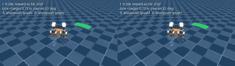
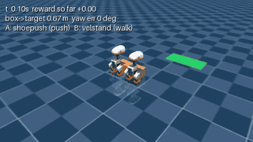
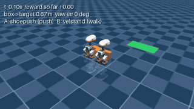
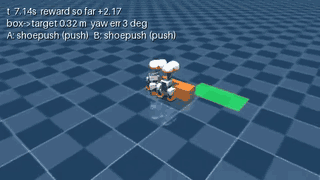
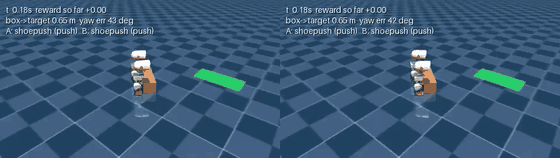

# Microduck-CoPush

Two simulated robot ducks learn to push a box into a target together (Cornell Generative AI
club, fall 2026).

**📈 [See the full progress timeline, with clips →](docs/TIMELINE.md)**

## Final goal

Two ducks start anywhere within a set distance of the target, facing any direction. The box can
be anywhere, at any angle. Without a script telling them what to do, the ducks learn to walk to
the box and push it into the target together.

## Current status (2026-11-13)

- **Current stage: Stage 1, random box start.** The box starts in a random spot (up to 15 cm off in
  each direction) and at a random angle (up to 45 degrees). The ducks still start touching it.
- **Last finished result:** each duck now runs its own controller, and with its partner in view it
  gets the box in on 74% of 50 test starts (one central controller for both: 60%). It's now the
  default. See [Decentralized control](#decentralized-control).
- **Still unsolved:** starts where the box is turned more than 15 degrees to the positive side (5 of
  17 at best). Earlier tries are in [stage 1](experiments/stage1-random-box-pose/README.md) and
  [stage 1b](experiments/stage1b-turn-direction-fix/README.md).

**How it works:** each duck walks and pushes with frozen, pretrained neural networks from Pollen
Robotics. On top of that, a small controller picks each duck's forward speed and turn rate every
0.2 s. Each duck runs its own copy of that controller, using what it sees: the box, the target and
its partner. It's trained with reinforcement learning (RL): it tries things in a physics simulator
(MuJoCo) and learns from a score called the reward. The method is PPO (Proximal Policy
Optimization), a standard RL algorithm.

## Decentralized control

Each duck runs its own controller from its own view, and with the partner in view it matches the
central controller.

| controller | success (50 test starts) | hard-side wins (of 17) | both ducks pushing | lazy-duck episodes |
|---|---|---|---|---|
| central (one controller for both ducks) | 60% | 2 | 86% of steps | 2 |
| D1: own view only | 60% | 1 | 92% of steps | 0 |
| **D2: own view + partner (default)** | **74%** | **5** | **94% of steps** | **0** |

Caveat: one seed each, D2 started by copying the central controller, and central with similar extra
training reached 72%.

Box turned +32 degrees: central (left) runs out of time, D2 (right) finishes in 41 steps. Full
results: [experiments/decentralized-control/](experiments/decentralized-control/README.md).

## Progress

Clips play at 2x speed. Click one for the sharper video.

| | |
|---|---|
|  |  |
| **1. Two ducks and a box in the simulator.** A hand-written script pushes the box straight. | **2. The script gets a "stop" rule.** It straightens the box, then holds still. |
|  |  |
| **3. First RL success.** The target is straight ahead, and the learned controller pushes it in faster than the script. | **4. A target to the side is out of reach.** The ducks can't turn the box in time. |
|  |  |
| **5. A pivot script makes it reachable.** One duck waits while the other turns the box, but it's almost a one-duck push. | **6. RL learns the side target.** Both ducks share the push and finish in 32 steps. |
|  |  |
| **Bug: one duck quits.** Allowed to stand still, duck B walks away and duck A pushes alone. | **Bug: crooked and lost.** Mid-training, the box reaches the target turned 65 degrees, then both ducks leave. |
|  | |
| **7. Stage 1: random box starts.** On a hard start, the script (left) fails and the learned controller (right) succeeds. 60% on 50 test starts. | |

## The reward function

Every step (0.2 s) the controller gets:

$$
r = w_{pos}\,(d_{before} - d_{after}) + w_{yaw}\,(\theta_{before} - \theta_{after}) - c_{time} + \text{(one-time events)}
$$

In words: points for moving the box closer to the target, points for turning it toward the right
angle, and a small cost for every step that passes. Because it rewards progress, not closeness,
standing next to the target earns nothing.

Current values (reward version v1.1, from [configs/copush.yaml](configs/copush.yaml)):

| Symbol | Meaning | Current value |
|---|---|---|
| $d$ | distance from the box's center to the target's center | in meters |
| $\theta$ | angle between the box and the target (a box turned 180 degrees counts as lined up) | in radians |
| $w_{pos}$ | points per meter the box moves toward the target | 10 |
| $w_{yaw}$ | points per radian the box turns toward the target angle | 1 |
| $c_{time}$ | cost per step | 0.03 |
| $R_{success}$ | bonus for success | +10 |
| $R_{fall}$ | penalty when a duck falls | −10 |
| $R_{box}$ | penalty when the box tips over or is lost | −10 |

**What ends an episode:**
- **Success (+10):** the box's center is inside the 0.40 × 0.20 m target, its angle is within
  15 degrees, and both ducks are standing, all held for 1 s.
- **A duck falls (−10):** its body tilts more than 60 degrees or drops below 7 cm, and it stays down
  for 0.2 s. A quick stumble doesn't count.
- **Box tipped (−10):** the box tilts more than 30 degrees.
- **Box lost (−10):** the box is more than 0.40 m from both ducks.
- **Time runs out:** 100 steps (20 s) with no other ending. There's no extra penalty beyond the
  per-step cost.

Two optional terms exist, but both are off in v1.1:
- a cooperation bonus that pays for both ducks pushing equally
- a penalty for a duck that leaves the box (0.02 per step in v1.2)

Why each value is what it is: [docs/REWARD_LOG.md](docs/REWARD_LOG.md).

## Next steps

- **Fix the hard side:** the box turned more than 15 degrees to the positive side still succeeds only
  5 of 17 times. It needs a long turn (about 55 degrees) before the push.
- **Check the decentralized result:** a second seed, and separate (not shared) networks for the two
  ducks.
- **Start the ducks away from the box,** so they have to walk to it first. That's the next step
  toward the final goal.
- **Make the reward ask for teamwork,** so one duck can't quit and leave the other to push alone.

## Links

| | |
|---|---|
| [SETUP.md](SETUP.md) | install, run the simulator, train, test, troubleshoot |
| [docs/TIMELINE.md](docs/TIMELINE.md) | every milestone and experiment round, with clips |
| [docs/REWARD_LOG.md](docs/REWARD_LOG.md) | each reward version: what changed, why, and the results |
| [experiments/README.md](experiments/README.md) | the experiment for each stage and its results |
| [docs/DEMO.md](docs/DEMO.md) | a 5-minute demo outline |
