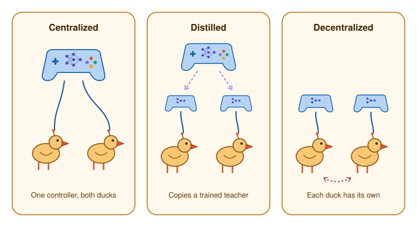
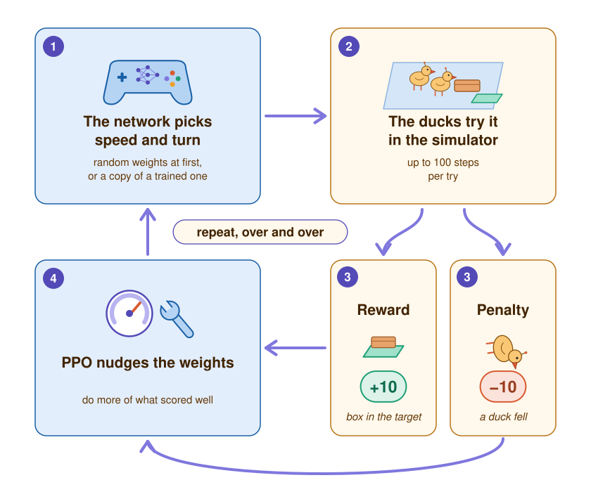
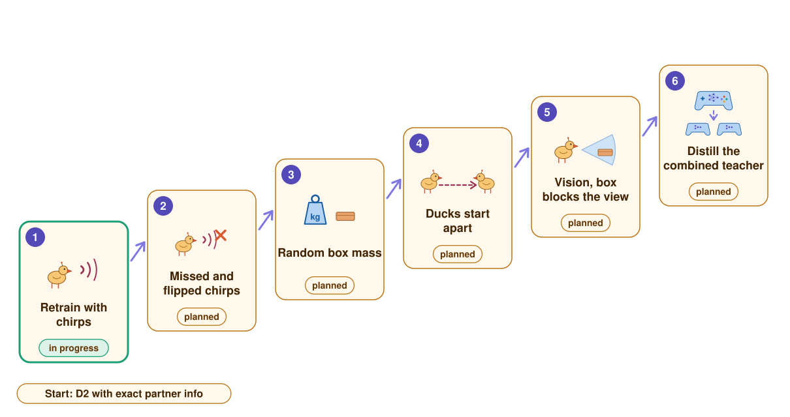
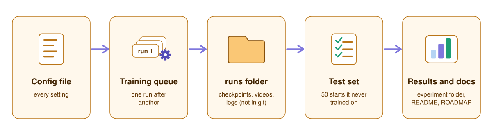

# Diagrams

How the project fits together, in small pictures. Each one is an SVG in
[docs/media/diagrams/](media/diagrams/), drawn in the style of `controllers_gamepad.svg` (cream cards, the
cartoon duck, the gamepad with a small neural net on it). Each has a `make_<name>.py` script next to it that
builds it, so change the script and rebuild rather than editing the SVG. The system loop is also on the
[README](../README.md).

## 1. Central, decentralized, distilled: who sees what, who decides

One gamepad (controller) for both ducks, small gamepads that copied a trained teacher, or a gamepad in each
duck. The pink arrow shows that, in the decentralized case, the ducks also tell each other where they are.

## 2. The training loop: how the reward changes the network

The network starts with random (or copied) weights. Each try ends either well (a reward, for example +10 when
the box reaches the target) or badly (a penalty, for example -10 when a duck falls), and PPO nudges the
weights toward what scored well. Built by [make_training_loop.py](media/diagrams/make_training_loop.py).

## 3. The ladder for the decentralized ducks: from exact partner info to realistic sensing

The order of work for the decentralized track (see [ROADMAP.md](../ROADMAP.md)). The central track (steering and
rendezvous) trains the teacher that step 6 copies into these ducks. Built by
[make_curriculum.py](media/diagrams/make_curriculum.py).

Partner sensing by chirps: tested, no measurable effect when ducks start side by side (details in
[experiments/chirp-partner-sensing/](../experiments/chirp-partner-sensing/README.md)).

## 4. Data flow: from settings to results

Every setting lives in a config file. The queue trains one run after another into the `runs` folder (kept out
of git), each policy is tested on the 50-start test set it never trained on, and the results go in the
experiment folder and the docs. Built by [make_data_flow.py](media/diagrams/make_data_flow.py).
