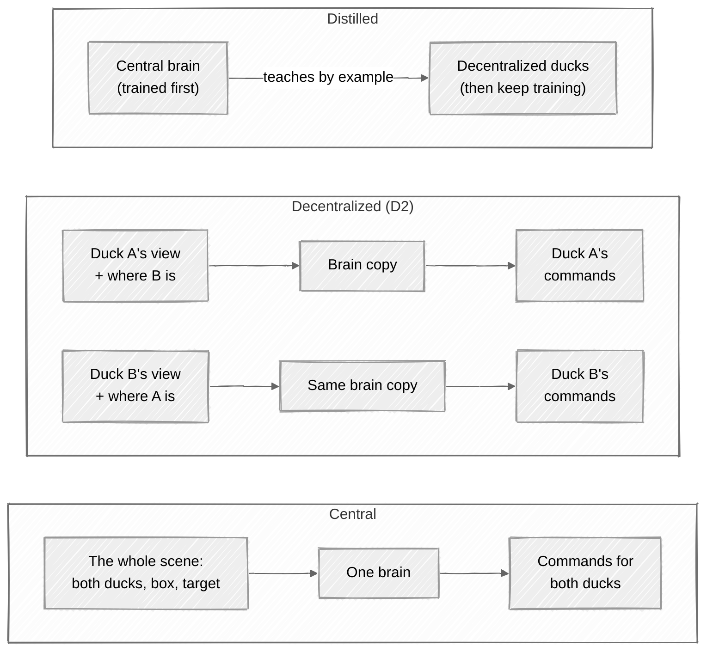
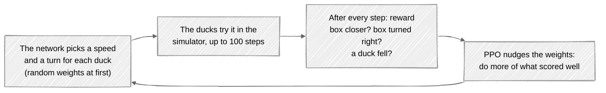
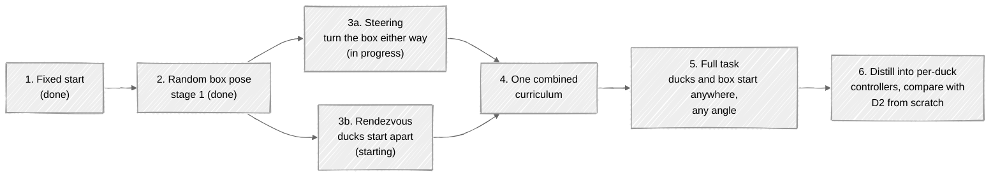
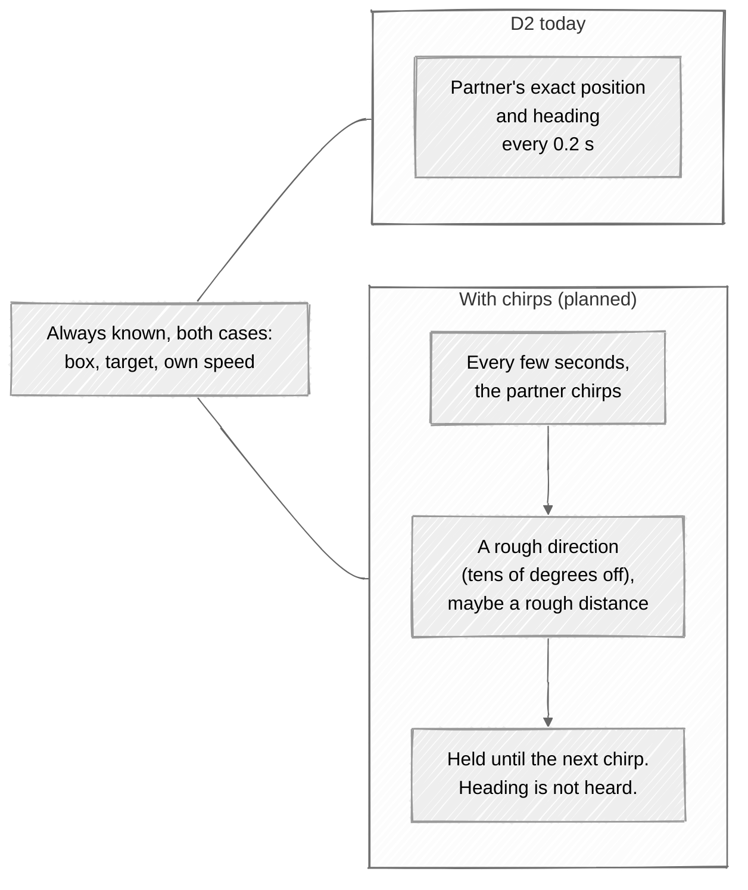
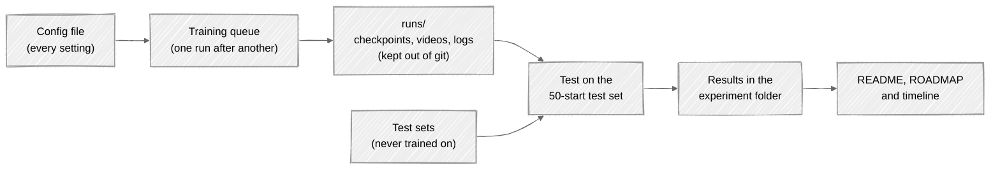

# Diagrams

How the project fits together, in small pictures. Each is a Mermaid diagram (drawn by GitHub from the
text below it, in a hand-drawn style). The system loop is also on the [README](../README.md).

## 1. Central, decentralized, distilled: who sees what, who decides

## 2. The training loop: how the reward changes the network

## 3. The curriculum ladder: from easy starts to the full task

## 4. The chirp experiment: what each duck knows, and when

## 5. Data flow: from settings to results

