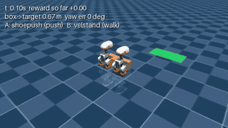
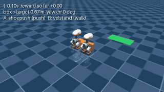
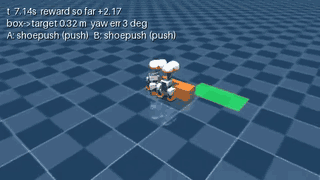

# CoPush progress timeline

Where the project stood at each point, oldest first. Clips play at 2× speed. Click a GIF for the
mp4. Details and numbers are in [REWARD_LOG.md](REWARD_LOG.md).

**Now (2026-11-12):** with both ducks starting against the box, PPO pushes it into a target
0.30 m to the side, which needs a turn. It succeeds every time from the fixed start and in 4 of 5
episodes when the box starts in a random spot.

| date | where we were |
|---|---|
| 11/11 | Two ducks and a box in the sim. A scripted push works. |
| 11/12, early | First reward: standing still beat pushing. Fixed the reward. |
| 11/12, early | Target straight ahead: everything succeeds, including PPO. Too easy. |
| 11/12, early | Target off to the side: nothing succeeds. The ducks can't turn the box in time. |
| 11/12, night | A pivot script makes the side target reachable. |
| **11/12, overnight** | **PPO learns the side target and beats the script.** |

---

## 11/11: two ducks, one box

- Two simulated MicroDucks, a box and a target area in MuJoCo. Each duck walks with frozen,
  pretrained policies, and our code only picks speed and turn rate.
- A scripted controller pushes the box straight.
- Video: [two_duck_push.mp4](media/two_duck_push.mp4)

## 11/12, early: the first reward paid for doing nothing

- Under reward v1, standing still scored −1.0 and every pushing controller scored worse (about
  −5 to −7).
- **Bugs found:**
  - The scripted push overshot and gave back all its progress.
  - Losing the box (−3) was cheaper than trying and missing (−7).
  - A 0.02 s stumble counted as a fall.
- **Fix (v1.1):** start with both ducks against the box. Losing the box now costs as much as a
  fall, and waiting costs more per step.

## 11/12, early: target straight ahead was too easy

- With the target 0.40 m straight ahead, everything succeeded, even random actions (5/5).
- PPO run A: 100% success, +13.14, slightly better than the scripts because it learned to push
  faster.
- Video: [ppo_run_a_final.mp4](media/ppo_run_a_final.mp4)

## 11/12, early: target to the side was impossible

- Target 0.30 m to the right: 0 of 10 for every controller.
- Shoe Push turns only about 5° every 2 s while pushing, so the box passes the target before it's
  turned.
- Video: [steer_overshoot.mp4](media/steer_overshoot.mp4)

## 11/12, night: a pivot script makes it reachable

- New `pivot_push` script: one duck stops, the other pushes alone until the box points at the
  target, then both push.
- A sweep over target positions found the hardest one the script can still do: 0.60 m ahead and
  0.30 m to the right, 4 of 5 episodes. But it's almost a one-duck push (duck A does 97%).

| `pivot_push` (scripted), 54 steps |
|---|
|  |

## 11/12, overnight: early RL success on the side target

- 7 PPO runs (400k steps, about 30 min each): all finished, and all of them learned the task.
- Fixed start: success every time, +15.1 to +15.6, in 32–40 steps. The script scored +12.83 in 54.
  Both ducks share the push about 50/50.
- Random box start: 4 of 5, the same as the script. The policies only trained on the fixed start.
- The four reward and setup tweaks (stand-still action, contact penalty, cooperation bonus,
  curriculum) didn't beat the difference between seeds.

| PPO: both ducks push it in (32 steps) |
|---|
|  |

**Bugs and odd behavior along the way:**

| One duck pushes, the other walks away | Box reaches the target crooked, then both ducks leave |
|---|---|
|  |  |
| Stand-still run, final policy. It still succeeds, because the reward never asks for two ducks. | Contact-penalty run at 130k steps (mid-training). The box ends 65° off, and the episode ends with the box lost. |

- **The cooperation bonus pays for nothing.** It pays +1 to +2 even on failed episodes, so it
  rewards balanced contact, not progress. No run exploited it yet.
- **One seed found the pivot by itself.** In seed 2, duck B barely moves and acts as a pivot while
  A pushes.

**Next:** train with the box starting in a random spot, and evaluate on at least 20 episodes.
