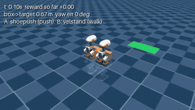
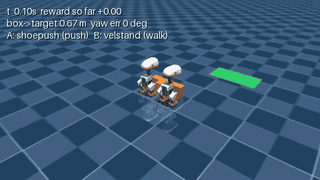
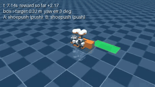
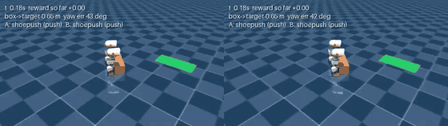
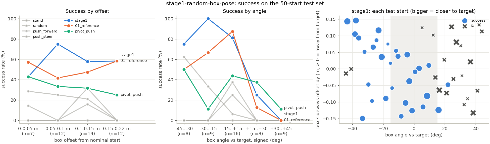

# CoPush timeline

One row per milestone or experiment round, oldest first. Clips play at 2x speed. Reward details
are in [REWARD_LOG.md](REWARD_LOG.md), and the 5-minute demo is in [DEMO.md](DEMO.md).

**Now (2026-11-12):** with both ducks starting against the box, PPO (the reinforcement learning
coordinator) gets the box into a target 0.30 m to the side, which needs a turn. Trained on random box
starts (up to 0.15 m off and 45 degrees turned), it succeeds on 60% of 50 fixed test starts it never
trained on. The policy it started from gets 50%, and the best script gets 32%. It still fails almost
every start where the box is turned more than 15 degrees to the positive side (2 of 17).

| Date | Stage | One change | Result (plain words) | Eval size | Video |
|---|---|---|---|---|---|
| 2026-11-11 | Two ducks and a box in the sim | First two-duck simulation | A scripted controller pushes the box straight | not measured | [mp4](media/two_duck_push.mp4) |
| 2026-11-12 | Walk to the box, far target | First reward (v1) | Standing still scored better than every controller that pushed | 20 per controller | none |
| 2026-11-12 | In contact, target straight ahead | Reward v1.1 and an in-contact start | Every controller succeeds, even random actions, and PPO run A succeeds 100%. Too easy to tell controllers apart | 5 per controller | [mp4](media/ppo_run_a_final.mp4) |
| 2026-11-12 | In contact, target 0.30 m to the side, 0.40 m ahead | Target moved to the side | No controller succeeds. The ducks can't turn the box in time | 10 per controller | [mp4](media/steer_overshoot.mp4) |
| 2026-11-12 | In contact, target 0.30 m to the side, 0.60 m ahead | New `pivot_push` script and a reachability sweep | The script reaches this target 4 of 5 times, but duck A does 97% of the pushing | 5 randomized per target | [gif](media/overnight_pivot_push_script.gif) |
| 2026-11-12 | Same layout, PPO | First PPO training on this layout (7 runs overnight) | PPO succeeds 60 to 80% across 3 seeds with random starts and ties the script. From the fixed start it trained on, it beats the script. None of the 4 tweaks changed results beyond the seed spread | 5 randomized + 1 fixed (preliminary) | [gif](media/overnight_ppo_success.gif) · [side by side](media/overnight_script_vs_ppo_side_by_side.mp4) |
| 2026-11-12 | Stage 1: random box starts | **Box starts up to 0.15 m off and 45 degrees turned, ducks still against it** | PPO succeeds on 60% of test starts (the policy it started from: 50%, `pivot_push`: 32%). Fails almost every start turned more than 15 degrees to the positive side | 50 fixed held-out starts | [gif](media/stage1_pivot_push_vs_ppo_hard_start.gif) · [side by side](media/stage1_pivot_push_vs_ppo_hard_start.mp4) · [failure](media/stage1_failure_positive_angle.mp4) |
| **2026-11-12** | **Stage 1b: why one side fails** | **Diagnosis only, no training** | **Not a physical limit: pivoting turns the box about equally fast both ways, and the policy does turn the right way. The hard side needs about 55 degrees of turning before pushing, the easy side about 1. Stopped before training** | **50 test starts + 60 turning trials** | none |

---

## 2026-11-11: two ducks, one box

- Two simulated MicroDucks, a box and a target area in MuJoCo. Each duck walks with frozen,
  pretrained policies, and our code only picks speed and turn rate.
- A scripted controller pushes the box straight.

## 2026-11-12: the first reward paid for doing nothing

- Under reward v1, standing still scored better than every controller that pushed.
- Bugs found:
  - The scripted push overshot and gave back all its progress.
  - Losing the box was cheaper than trying and missing.
  - A 0.02 s stumble counted as a fall.
- Fix (v1.1): start both ducks against the box. Losing the box now costs as much as a fall, and
  waiting costs more.

## 2026-11-12: target straight ahead was too easy

- Every controller succeeded, including random actions (5 of 5).
- PPO run A succeeded 5 of 5, slightly ahead of the scripts because it learned to push faster.

## 2026-11-12: target to the side was out of reach

- 0 of 10 for every controller. Shoe Push turns only about 5 degrees every 2 s while pushing, so the
  box passes the target before it has turned.

## 2026-11-12: a pivot script makes the side target reachable

- `pivot_push`: one duck stops, the other pushes alone until the box points at the target, then
  both push.
- A sweep over target positions picked the hardest one the script still reaches: 0.60 m ahead and
  0.30 m to the right, 4 of 5 times.

| `pivot_push` script |
|---|
|  |

## 2026-11-12, overnight: early RL success on the side target

- 7 PPO runs of 400k steps each. All finished, and all of them learned the task.
- From the fixed start (the one it trained on), PPO succeeds in 32 to 40 steps with both ducks
  pushing about equally. The script takes 54 steps, with one duck doing almost all the work.
- With the box starting in a random spot, PPO succeeds 4 of 5 times (3 of 5 for seed 2), the same
  as the script. This is preliminary: 5 episodes.
- The stand-still action, contact penalty, cooperation bonus and curriculum had no measurable
  effect: they all stayed inside the spread between 3 seeds.

| PPO: both ducks push it in |
|---|
|  |

Side by side from the same start, script on the left and PPO on the right:
[overnight_script_vs_ppo_side_by_side.mp4](media/overnight_script_vs_ppo_side_by_side.mp4)

**Odd behavior and bugs:**

| One duck pushes, the other walks away | The box reaches the target crooked, then both ducks leave |
|---|---|
|  |  |
| Stand-still run, final policy. It still succeeds, because the reward never asks for two ducks. | Contact-penalty run, mid-training (130k steps). The box ends 65 degrees off and is lost. |

- The cooperation bonus pays even on failed episodes, so it rewards balanced contact, not progress.
  No run exploited it yet.
- In seed 2, duck B barely moves and acts as a pivot while A pushes, the same idea as the script.

**Next:** train with the box starting in a random spot, and evaluate on at least 20 episodes.

## 2026-11-12: stage 1, random box starts

Details: [experiments/stage1-random-box-pose/](../experiments/stage1-random-box-pose/README.md).

- **The one change:** the box starts up to 0.15 m off its usual spot and turned up to 45 degrees.
  The ducks are still placed against it. Training continued from the overnight reference policy.
- **Auto-widen:** the range started at 20% of that and grew one step each time a check passed 70%.
  It reached the full range at 80k steps. Training stopped early at 980k steps (66 min), after 3
  checks in a row at 80% or more.
- **The exam:** 50 fixed starts spread evenly over the full range, never used in training.

| Controller | Success on 50 test starts |
|---|---|
| stand still | 0% |
| random actions | 12% |
| `push_forward` script | 8% |
| `push_steer` script | 18% |
| `pivot_push` script | 32% |
| overnight PPO, not retrained | 50% |
| **stage 1 PPO** | **60%** |

- **Where it fails:** it succeeds on 15 of 17 starts turned more than 15 degrees one way and 2 of 17 the
  other way. The old policy had the same blind spot (10 vs 1), so retraining fixed only the easy half.
- **Odd behavior:** in 11 of its 20 failures it pushes the box past the target and ends farther away than
  it started. It also has 3 falls (all duck A), where the old policy had none.
- **A lesson about checks:** training checks said 80%, the exam says 60%. The 20 check starts happened to
  be easy (12 of them barely turned), and stopping on a lucky streak adds more.

| Hardest start PPO wins: `pivot_push` left, stage 1 PPO right (0.12 m and 0.14 m off, turned 43 degrees) |
|---|
|  |

Failure, nearly the mirror start (turned +38 degrees), old policy left and stage 1 right. Stage 1 gets
within 0.28 m, then pushes the box past the target:
[stage1_failure_positive_angle.mp4](media/stage1_failure_positive_angle.mp4)

**Next:** fix the one-direction blind spot (for example, train on mirrored episodes) and use an evenly
spread check set, before stage 2 (ducks start away from the box).

## 2026-11-12: stage 1b, why one side fails (diagnosis only)

Details: [experiments/stage1b-turn-direction-fix/](../experiments/stage1b-turn-direction-fix/README.md).

- **Can the ducks turn the box both ways?** Yes. When one duck stands and the other pushes alone, the box
  turns 12.7 degrees per second clockwise and 13.9 counter-clockwise. Only the "both ducks turn" command is
  lopsided (4.8 vs 8.7).
- **Does the policy only turn one way?** No. On the hard side it turns the right way, just as fast as the
  pivot.
- **So what's different?** The target is off to the right. A box turned the "positive" way points away from it
  and needs about 55 degrees of turning before the push; a box turned the other way already points at it.
  The policy turns part of the way, then pushes the box past the target.
- The plan said to stop and report if neither "physical" nor "learning" fit, so nothing was trained. The
  suggested fix is to train with half the starts on the hard side.
