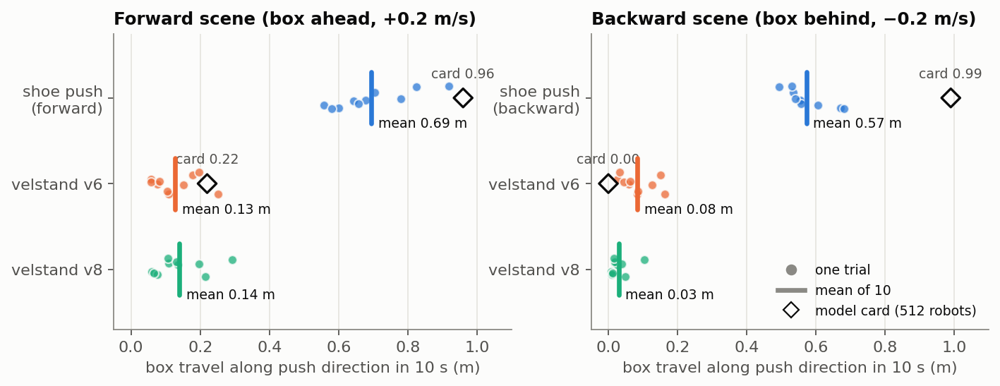
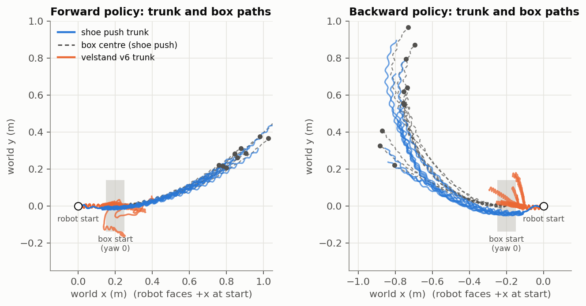
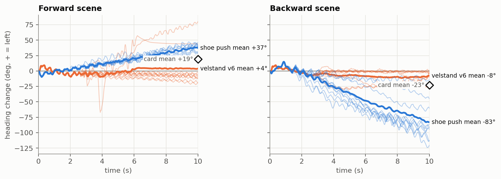
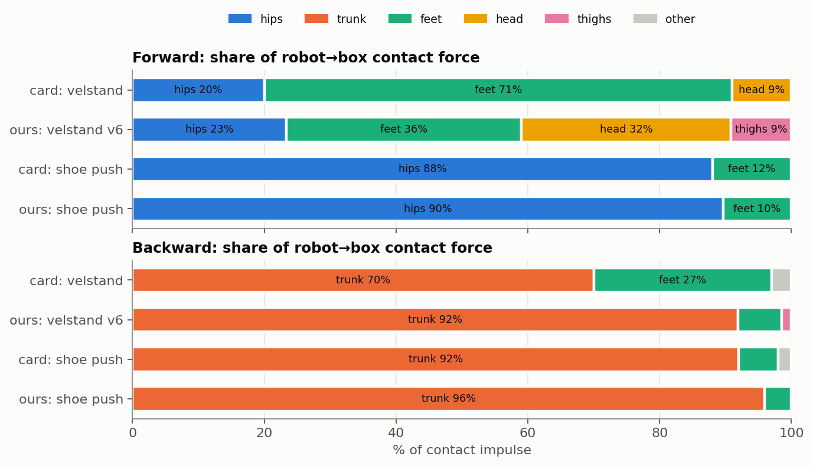
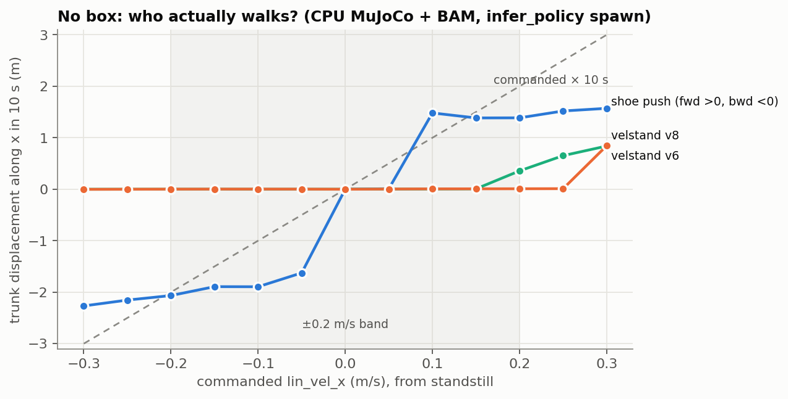
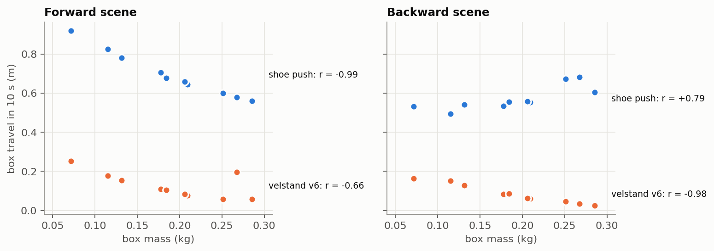

# Shoe Push policies — test results

Tests of `pisdeburra/robert-policies` (shoe_push forward and backward) in CPU MuJoCo, run 2026-11-02 on macOS /
Apple Silicon (MuJoCo 3.10.0, microduck_rl `develop` @ `bae39f59`). The "before" baseline is Pollen's
velstand at Hub tag v6, which is the version the policies were warm-started from. The current velstand (v8)
is included for reference. Setup and viewer commands are in [RUNBOOK.md](RUNBOOK.md).

> Note: RUNBOOK.md, `eval_push.py`, `make_plots.py` and `eval_results.json` live in the local
> `~/CS_Projects/GenAI/robert_policies/` working folder; the figures are copied into `docs/figures/`.

**Colors in every chart:** blue = shoe push policy, orange = velstand v6 (before), aqua = velstand v8.
Hollow black diamonds are the model card's numbers.

## Summary

| | Result |
|---|---|
| Runs as published | ✅ Both ONNX files take the standard 61D obs and give a 14D action. They run unchanged in `infer_policy.py --new-cmd-obs` with the BAM actuator. |
| Pushes the box | ✅ Box travel goes up 5–7×: forward 0.13 → **0.69 m**, backward 0.08 → **0.57 m** along the push line in 10 s. |
| Matches the model card | ⚠️ The qualitative result reproduces. Absolute travel is 20–40% lower (card: 0.96 / 0.99 m). |
| Safety | ✅ 0 falls and 0 lost boxes in 60 trials across all policies. |
| How it pushes | ✅ Forward uses the hips (90%; card 88%). Backward uses the trunk (96%; card 92%). |
| Heading | ❌ Drifts one way every time: forward +37°, backward −83° per 10 s (card: +19° / −23°). |
| Baseline | ⚠️ velstand barely walks from standstill at ±0.2 m/s in this sim, so the "before" numbers mostly show a robot standing or shuffling. |

## Test setup

- **Simulator:** CPU MuJoCo at 200 Hz physics and 50 Hz policy, with the BAM M6 XL330 actuator (vin 7.4 V,
  sag 0.1). `eval_push.py` imports the obs builder and actuator from `scripts/infer_policy.py`, so tests and
  viewer run the same code. A headless run of the real `infer_policy.main()` matched it to the millimetre.
- **Scenes:** `robot_groundcontact.xml` plus a box (28 × 10 × 9 cm), centred 0.20 m in front of the trunk
  (forward) or behind it (backward), long side facing the robot.
- **Trials:** 10 seeded trials of 10 s per condition. Box mass is drawn from 0.05–0.30 kg and box yaw from
  ±45°. Seeds are paired, so every policy sees the same 10 boxes. Command: straight, +0.2 m/s (forward) or
  −0.2 m/s (backward).
- **Metrics:**
  - Box travel = box displacement projected on the robot's initial push direction.
  - Fall = trunk tilt > 60° or trunk height < 7 cm.
  - Box lost = box centre > 40 cm from the trunk.
  - Heading = change in trunk yaw.
  - Contact share = robot→box contact impulse grouped by body part.
- **Reproducibility:** results are deterministic; two full reruns matched exactly. Commands are at the bottom.

## 1. Box travel



| scene | policy | box travel (m), mean ± sd | box straight-line displacement (m) | robot travel (m) | falls | box lost |
|---|---|---|---|---|---|---|
| forward | **shoe push forward** | **0.69 ± 0.11** | 0.76 | 0.84 | 0/10 | 0/10 |
| forward | velstand v6 | 0.13 ± 0.06 | 0.13 | 0.26 | 0/10 | 0/10 |
| forward | velstand v8 | 0.14 ± 0.07 | 0.14 | 0.25 | 0/10 | 0/10 |
| backward | **shoe push backward** | **0.57 ± 0.06** | 0.85 | 0.79 | 0/10 | 0/10 |
| backward | velstand v6 | 0.08 ± 0.05 | 0.09 | 0.19 | 0/10 | 0/10 |
| backward | velstand v8 | 0.03 ± 0.03 | 0.04 | 0.26 | 0/10 | 0/10 |

- **The gain is large and consistent.** Every shoe-push trial beats every velstand trial on the same box.
- **The box moves almost as far as the robot.** Forward's box travels 82% as far as the robot, and backward's
  72%. The card says "~90%".
- **Our numbers are lower than the card's** (0.69 vs 0.96 m, 0.57 vs 0.99 m). Two causes are visible:
  - The robot only reaches ~0.08–0.17 m/s while pushing.
  - Backward curves (section 2). Its box goes 0.85 m in a straight line from the start, but only 0.57 m of
    that is along the push direction.

## 2. Paths: the pushes curve



- **Forward** goes straight for about 0.4 m and then bends left. The box stays in front of the hips the whole
  way: the dashed box paths track the blue trunk paths closely.
- **Backward** bends right almost at once. After 10 s it has turned about 90° and is pushing the box sideways
  relative to where it started.
- **Velstand v6** (orange) walks into the box, stalls against it, and either gets knocked sideways or shuffles
  in place.

## 3. Heading drift



| scene | policy | heading after 10 s: mean (mean abs) | range over 10 trials | card |
|---|---|---|---|---|
| forward | shoe push | +37° (37°) | +28 … +46° | +19° (30°) |
| forward | velstand v6 | +4° (21°) | −19 … +80° | +4° (21°) |
| backward | shoe push | −83° (83°) | −14 … −120° | −23° (45°) |
| backward | velstand v6 | −8° (8°) | −29 … +1° | −3° (4°) |

- **The sign is fixed here:** forward always turns left and backward always turns right. The card says the
  sign is random per robot. Their training randomization most likely spreads it, and this sim doesn't have that.
- Drift grows roughly linearly with time, at about 3.7°/s (forward) and 8°/s (backward). So it's a steady
  bias, not something that builds up suddenly.
- The forward velstand outliers (+44°, +80°, and the −67° spike near 4 s) look like moments where contact
  with the box turned the robot. That reading is inferred from the plots; I didn't check the contacts for these
  trials.

## 4. Where the robot touches the box



| scene | policy | hips | trunk | feet | head | thighs | other |
|---|---|---|---|---|---|---|---|
| forward | card: velstand | 20 | – | 71 | 9 | – | – |
| forward | ours: velstand v6 | 23 | – | 36 | 32 | 9 | – |
| forward | card: shoe push | **88** | – | 12 | – | – | – |
| forward | ours: shoe push | **90** | – | 10 | – | – | – |
| backward | card: velstand | – | 70 | 27 | – | – | 3 |
| backward | ours: velstand v6 | – | 92 | 7 | – | 1 | – |
| backward | card: shoe push | – | **92** | 6 | – | – | 2 |
| backward | ours: shoe push | – | **96** | 4 | – | – | – |

(% of robot→box contact impulse. The card's rows don't sum to 100; the gap is shown as "other".)

**This is the closest match to the card.** Each policy learned one clean contact: hip brackets for forward,
trunk (battery) for backward. In the forward scene, velstand hits the box with feet and head.

Caveat from the card, confirmed here: the front trunk piece has no box collision in this robot model
(`self_collision_only`), and neither do the thigh servos. Real forward contacts will differ.

## 5. Surprise: velstand barely walks from standstill



Trunk displacement along x in 10 s (m), box-less `scene.xml`, starting from infer_policy's standstill:

| cmd (m/s) | −0.3 | −0.2 | −0.1 | −0.05 | +0.05 | +0.1 | +0.15 | +0.2 | +0.25 | +0.3 |
|---|---|---|---|---|---|---|---|---|---|---|
| velstand v6 | 0.00 | 0.00 | 0.00 | 0.00 | 0.00 | 0.01 | 0.01 | **0.01** | 0.01 | 0.85 |
| velstand v8 | 0.00 | 0.00 | 0.00 | 0.00 | 0.00 | 0.00 | 0.01 | **0.36** | 0.65 | 0.84 |
| shoe push (fwd for +, bwd for −) | −2.27 | **−2.07** | −1.89 | −1.63 | 0.01 | 1.48 | 1.39 | **1.39** | 1.52 | 1.57 |
| commanded × 10 s | −3.0 | −2.0 | −1.0 | −0.5 | 0.5 | 1.0 | 1.5 | 2.0 | 2.5 | 3.0 |

- **Velstand doesn't walk backward at all** from standstill, at any speed down to −0.3 m/s. At negative
  speeds the aqua v8 line is hidden under v6 because both are exactly zero.
- **Going forward,** v6 starts only at 0.3 m/s and v8 from 0.2 m/s.
- This was checked across battery voltages (6.5–8.2 V), both robot collision models, joint noise, and a
  1 s stand before the command. It doesn't change.
- With the box present, contact jostles velstand into shuffling, which gives it its 0.1–0.2 m of "robot travel".
- The card's mjlab eval clearly had velstand walking (7.2% falls, 0.22 m box travel). Our before/after gap is
  therefore partly "walks vs stands", not just "pushes well vs pushes badly".
- **The shoe-push policies mostly ignore the commanded speed.** Forward walks at about 0.14–0.16 m/s for any
  command from 0.1 to 0.3. Backward walks at 0.16–0.23 m/s and moves even at −0.05. Forward doesn't respond
  below 0.1, which is the bottom of its training range (0.1–0.3). The card already flags backward's command
  obedience as suspect.

## 6. Box mass



| scene | policy | r(mass, travel) | travel, boxes < 0.15 kg | travel, boxes > 0.20 kg | r(mass, abs heading) |
|---|---|---|---|---|---|
| forward | shoe push | −0.99 | 0.84 m | 0.61 m | −0.70 |
| forward | velstand v6 | −0.66 | 0.19 m | 0.09 m | +0.49 |
| backward | shoe push | **+0.79** | 0.52 m | 0.61 m | **−0.92** |
| backward | velstand v6 | −0.98 | 0.15 m | 0.05 m | +0.16 |

- **Forward:** heavier boxes slow the robot, and travel falls almost linearly with mass.
- **Backward:** heavier boxes go *further* along the push line. A heavy box drags on the trunk and resists the
  turn: the 0.29 kg box gave −14° of drift and the 0.07 kg box −120°. The policy pushes straighter against
  more load. This is an inference from 10 trials.

## How this compares to the model card

| | card: before → after | ours: velstand v6 → shoe push |
|---|---|---|
| Forward box travel | 0.22 → **0.96 m** | 0.13 → **0.69 m** projected (0.76 m straight-line) |
| Backward box travel | 0.00 (stuck) → **0.99 m** | 0.08 → **0.57 m** projected (0.85 m straight-line) |
| Falls / box lost (both) | forward 7.2% / 1.4% → 0 / 0%; backward 0 / 0% → 0 / 0% | 0 / 0% → 0 / 0% |
| Main contact after | hips 88% / trunk 92% | hips 90% / trunk 96% |
| Heading drift after, mean (abs) | +19° (30°) / −23° (45°) | +37° (37°) / −83° (83°) |

**Why the numbers differ** (we can't separate these from the published information):
- The card used 512 robots in mjlab with training-style randomization. We use CPU MuJoCo with fixed physics.
- The card doesn't say how it measured box travel (projected, straight-line, or path length) or how robots
  were spawned.
- velstand starts more easily in their setup (section 5).
- Our backward drift is stronger, which costs projected travel.

## Reproduce

```bash
cd ~/CS_Projects/GenAI/microduck_rl
uv run python ~/CS_Projects/GenAI/robert_policies/eval_push.py --json ~/CS_Projects/GenAI/robert_policies/eval_results.json   # ~15 s
uv run python ~/CS_Projects/GenAI/robert_policies/make_plots.py      # figures/*.png + figures/plot_data.json, ~15 s
```

Files: `eval_results.json` (per-trial rows), `figures/plot_data.json` (speed sweep and final headings),
`eval_push.py`, `make_plots.py`.
