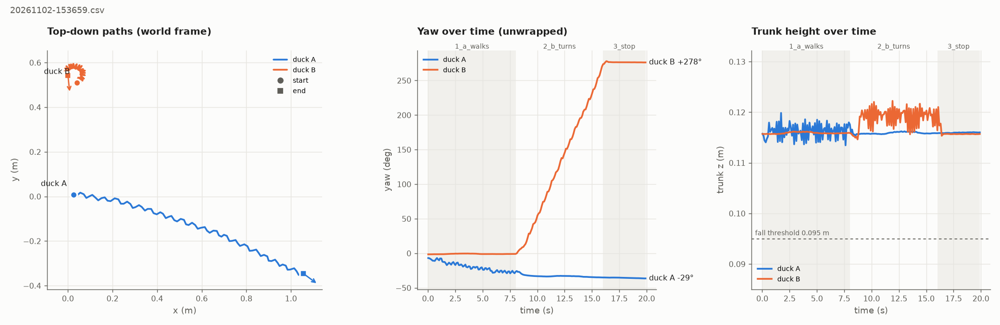

# Week 1 status (Oct 30 – Nov 5): two ducks in one shared MuJoCo world

Tested 2026-11-02 on macOS / Apple Silicon, against `microduck` main @ `997808c` and
`microduck_rl` develop @ `bae39f5` (`upstream.lock`). Plain-mode duck-sim (no `boot`), velstand
walk policy, default `backlash` scene, headless unless stated.

**Checkpoint M1: PASS (3/3 fresh launches).**

## Week 1 tasks from the plan

| Owner | Task | Status | Where |
|---|---|---|---|
| P1 | Inspect the multi-duck simulator implementation | done | findings below; `body_server.build_world` / `Body.place` |
| P1 | Run two independently controlled ducks | done | `scripts/check_m1.py`, M1 table |
| P1 | Begin adding box geometry | done | `scenes/scene_box.xml`, box pose via `{"op":"objects"}` |
| P2 | Reproduce single-duck pushing / run the released pushing ONNX | done (infer_policy); started under robotd | `docs/results/b0_single_duck_push.md`; robotd finding below |
| P2 | Understand the action and observation interfaces | done | 61-D obs → 14-D action for velstand and Shoe Push; `robot.move` {vx, vy, vyaw} body frame; command thresholds below |
| P2 | Implement a simple dual-duck command sender | done | `copush/sim_client.py`, `copush/runner.py` |
| P3 | Define the initial experiment metrics | done | `copush/metrics.py` |
| P3 | Build a CSV recorder and mock-data evaluation tests | done | `copush/recorder.py`, `tests/` (22 tests), `data/sample/mock_run.csv` |
| P3 | Create the first plotting template | done | `scripts/plot_run.py` |
| all | Demo: short recording of both robots receiving different commands | **not done** (needs a human screen recording) | command in README, "Viewer demo" |

## M1 results

Demo (`scripts/two_duck_demo.py`): phase 1 (8 s) A walks at vx 0.3 m/s, B still; phase 2 (8 s) A
still, B turns in place at vyaw 1.2 rad/s commanded; phase 3 (4 s) both stop. 10 Hz, 20 s.

| Criterion | Rule | Run 1 | Run 2 | Run 3 |
|---|---|---|---|---|
| `ctl health` duck-a, before / after | `robot healthy` | PASS / PASS (49.8 / 49.4 Hz) | PASS / PASS (49.9 / 50.0 Hz) | PASS / PASS (50.2 / 50.0 Hz) |
| `ctl health` duck-b, before / after | `robot healthy` | PASS / PASS (49.8 / 50.1 Hz) | PASS / PASS (49.8 / 49.9 Hz) | PASS / PASS (50.2 / 49.9 Hz) |
| Upright duck A, every tick | trunk_z ≥ 0.095 m, gravity_z ≤ −0.90 | PASS (min 0.113, max −0.998) | PASS (0.113, −0.998) | PASS (0.114, −0.998) |
| Upright duck B, every tick | same | PASS (0.115, −0.997) | PASS (0.114, −0.997) | PASS (0.115, −0.997) |
| Phase 1: A walks | ≥ 50 cm | PASS 105.7 cm | PASS 102.1 cm | PASS 103.7 cm |
| Phase 1: B stays put | < 3 cm and < 8° | PASS 0.2 cm, 1.2° | PASS 0.3 cm, 0.4° | PASS 0.2 cm, 1.5° |
| Phase 2: B turns | ≥ 90° | PASS +271° (0.60 rad/s) | PASS +258° (0.57 rad/s) | PASS +247° (0.54 rad/s) |
| Phase 2: A stays put (after 1 s settle) | < 3 cm and < 8° | PASS 0.3 cm, 3.1° | PASS 0.3 cm, 2.2° | PASS 0.2 cm, 4.6° |
| Real time, `duck-sim realtime` during demo | 0.95–1.05 | PASS 1.00x | PASS 1.00x | PASS 1.00x |
| Real time, demo loop sim/wall | 0.95–1.05 | PASS 1.0008 (0 late ticks) | PASS 1.0002 (0) | PASS 1.0005 (0) |

Per-run JSON (all numbers + rules) is written next to each CSV as `data/runs/<ts>.m1.json`.

### Why these thresholds

- **Upright.** Measured healthy values: standing trunk_z 0.116 m, gravity_z −0.999…−1.000; while
  walking/turning trunk_z stayed in 0.113–0.122 and gravity_z ≤ −0.997. A seated duck (SIT
  keyframe) has trunk ≈ 0.07 m. **0.095 m** is duck-sim's own "did it stand" line (halfway
  between STAND 0.12 and SIT 0.07), ~2 cm under the lowest healthy value and ~2.5 cm above sitting.
  **gravity_z ≤ −0.90** allows ~26° of tilt: far beyond the ~4° seen in healthy gait, yet well
  inside the 60° tilt the Shoe Push evaluation calls a fall. Both are required: height alone misses
  a tipped duck; gravity alone passes a duck sitting upright (vertical trunk).
- **Independence.** Active ducks clear their bar by 2–3× (A walks ~1.0 m vs 0.5 m; B turns ~250° vs
  90°); idle ducks stay 10× under theirs in position (0.2–0.3 cm vs 3 cm). Idle yaw is measured as
  the *largest* excursion, not end-to-end.
- **The 1 s settle for A in phase 2.** When A's command drops to zero it finishes one step
  (~2.3 cm) and its yaw creeps ~5° over 2 s. A control run (same phase 1, but B *also* idle in
  phase 2) gave the identical 2.2 cm / −8.6°, so this is A's own stopping transient, not coupling
  from B. Without the settle window, A's whole-phase numbers (2.4–2.8 cm, 5.3–8.3°) sit right at
  the thresholds; they are reported in the check output anyway.
- **Real time.** duck-sim's own "ok" band is ≥ 0.95x; robotd's health gate fails below 45/50 Hz.

## Answers to the Week 2 questions

### 1. Can the ducks be placed closer than 0.5 m without editing upstream code?

**Not with any upstream knob, but yes with our runtime extension (verified).** `SPACING = 0.5` is a
module constant in `body_server.py`, used by both `build_world` and `Body.place`; neither
`duck-body` nor `duck-sim` exposes it.

`scripts/sim.sh` puts `copush/_bodyext` on PYTHONPATH, and its `sitecustomize.py` honours
`COPUSH_PLACE="x,y,yaw_deg;x,y,yaw_deg"`. It re-places each duck right before that duck's port
starts serving, when the duck is placed but cannot have been enabled by robotd yet. No upstream
file is touched.

| Spawn of duck B | Both stand | Centre gap after 3 s |
|---|---|---|
| (0, 0.25) | yes (trunk 0.116 / 0.116) | 0.251 m |
| (0, 0.20) | yes (0.116 / 0.115) | 0.197 m |

0.20 m centres is roughly what two ducks need to share the 28 cm face of the box. Not yet tried
below 0.20 m. Smallest upstream alternative: a `--spacing` flag on `duck-body` plus a
`DUCK_SIM_SPACING` passthrough in duck-sim (about 5 lines).

### 2. Do duck A and duck B have different collision geometry, and does it matter?

**Yes, and it matters.** Duck A is the scene's robot (`robot_groundcontact_backlash.xml` in the
default `backlash` scene and in `scene_box.xml`). Duck B is attached from `robot_allcollisions.xml`.

| | Duck A (groundcontact_backlash) | Duck B (allcollisions) |
|---|---|---|
| Geoms that collide with the box/floor (contype 1) | **10**: feet, legs, hip brackets, rear trunk, jaw | **69**: essentially the whole mesh |
| Self-collision-only (contype 2) | 1 (front trunk piece) | 1 |
| Joint backlash | yes (velstand's training model) | **no** |

Why it matters for pushing:
- The ducks touch the box with different body parts. A's front trunk passes **through** the box,
  so A pushes only with hip brackets, legs and feet. That is the geometry the Shoe Push policy
  trained on (hips 90% of contact). B pushes with its whole front, front trunk and thigh servos
  included. The same command will move the box differently depending on which duck is on which
  side, and B's contacts will not match what a Shoe Push policy expects.
- B has no backlash. velstand still walks on it here (B: 70 cm in 6 s at vx 0.3, vs A: 80 cm), so
  this is not blocking, but the two ducks are not identical robots.
- Options for Week 2 (no upstream edits): (a) put the duck that should match training on the
  side where contact matters; (b) extend `_bodyext` to redirect the attached robot file to the
  scene's own robot (wrap `mujoco.MjSpec.from_file`). This is untested and needs a check that the
  groundcontact robot file attaches cleanly. Upstream alternative: attach extra ducks from the
  scene's robot instead of the fixed `ROBOT_ONLY`.

### 3. Can one duck run a different walk policy (e.g. Shoe Push)?

**Yes, live, per duck. But Shoe Push under robotd does not behave like it does in infer_policy,
and switching back is awkward.**

- `DUCK_SIM_DUCK=duck-b scripts/sim.sh ctl policy load walk ~/CS_Projects/GenAI/robert_policies/shoe_push/forward/policy.onnx`
  was accepted (both ONNX are `obs[1,61] → actions[1,14]`). `policy list` showed B on Shoe Push and
  A still on velstand; B stayed `healthy`. It writes `walk = ...` into `~/.cache/duck-sim/robotd-duck-b.toml`.
- **Behaviour was not usable as-is:**
  - B moved ~1.4 m before any command was sent.
  - At vx 0.15 it covered 3.75 m in 8 s (~0.47 m/s), turning 95°. infer_policy gave
    0.14–0.16 m/s (`docs/results/b0_single_duck_push.md` §2, no-backlash robot).
  - At zero command it spun 68° in 6 s.
  - A likely cause: duck-sim sets `stand = "none"`, so the walk network also runs at zero
    command, and Shoe Push was trained only on 0.1–0.3 m/s with no standing behaviour. An
    observation/command-encoding difference between robotd and `infer_policy --new-cmd-obs` is
    the other suspect. This needs a proper look in Week 2 before Shoe Push is used as a baseline
    under robotd.
- **Gotcha:** `ctl policy reset walk` breaks a simulated duck. It falls back to
  `/opt/robot/policies/current/velstand.onnx`, which does not exist on a laptop. The duck goes
  `degraded`, and a later `policy load walk <velstand path>` is refused too. Recovery:
  `scripts/sim.sh up` (it regenerates the params files). The same regeneration means any `policy
  load` is lost on the next `up`, so re-apply it after each launch.
- Editing `robotd-<name>.toml` by hand is equivalent but is overwritten by every `up` too.

### 4. Real-time factor, 2 ducks, viewer on vs off

| | `duck-sim realtime` | demo loop sim/wall | "behind real time" warnings |
|---|---|---|---|
| Headless (`DUCK_SIM_VIEWER=0`), 3 runs | 1.00x, 1.00x, 1.00x | 1.0008, 1.0002, 1.0005 | 0 |
| Viewer (`mjpython`), 3 samples + 1 demo | 1.00x, 1.01x, 1.00x | 0.9994 | 0 |

On this Mac (Apple Silicon), two ducks with the viewer keep real time. The viewer syncs at 30 fps.
Headless is still what the automated checks use.

## Other findings for Week 2

- **Turning in place has a start threshold.** velstand does not turn in place below ~0.95 rad/s
  commanded. Measured for 6–8 s from rest: 0.6 → 3–5°, 0.8 → 5–7°, 0.9 → 7°; 1.0 → 0.39 rad/s,
  1.2 → 0.62 rad/s, 1.5 → 0.83 rad/s. The demo therefore commands **1.2 rad/s to get ~0.6 rad/s**.
  robotd does no clamping (`intents.set_twist` stores the raw twist), so this is the policy.
  Action bounds for the coordinator have to account for this dead zone.
- **Forward speed is about 43% of the command.** vx 0.3 gives 0.13 m/s, and A drifts right by
  25–29° per 8 s of walking. A straight push needs heading feedback, not open-loop commands.
- **Initial heading depends on the start keyframe.**
  - Default `SIT` start (the M1 setup): ducks finish standing up within ±7° yaw and ~4 cm of their
    spawn.
  - `HOME` start (required by the box scene, which has no keyframes): **29–44° yaw** and 6–10 cm
    forward, different on every launch.
  - So "box 0.6 m ahead of duck A" is not ahead of A once it stands.
  - **A keyframe sized for the box scene works:** 35 robot qpos + 7 box qpos. A temporary
    `scene_box.xml` + `SIT` key gave 2.6° / 9.3°, with the box settled at z 0.0449. Recommend
    adding it in Week 2. The scene_ball.xml warning only applies to copying the robot-only
    keyframes unchanged.
- **Box scene verified.** With `scripts/sim.sh up --box`, both ducks stand (`ctl health` healthy,
  trunk 0.115–0.116 m). The box settles at z = 0.0449 m (half-height 0.045) at (0.600, 0.000),
  yaw 90°, and its pose is logged in the CSV as `box_x, box_y, box_z, box_yaw`.
- **Box pose without editing upstream.** The body protocol has no op for anything but the duck on
  each port. `copush/_bodyext/sitecustomize.py` adds a read-only `{"op":"objects"}` at runtime:
  every free-joint body that is not a duck trunk, read under the world lock. It relies on
  `Handler.dispatch` and `server.body` existing. If upstream refactors those, the op disappears
  quietly (`SimClient.box_supported` becomes False). **Smallest upstream fix:** the same ~15-line
  `objects` op in `Handler.dispatch`; worth proposing to Pollen.
- **`duck-sim drive` ignores `DUCK_SIM_DUCK`, which is worse than suspected.**
  `DUCK_SIM_DUCK=duck-b scripts/duck-sim drive 0.3` **moved duck A** 108 cm and left B where it
  was. `drive()` uses `$SOCK` (the `duck.sock` symlink to duck-a) and `$PORT` (7801) for both the
  command and the pose. Fix (small upstream PR): in `drive`, use `$STATE/${WHO:-duck-a}.sock` and
  that duck's body port (`duck_port <index>`).
- **robotd keeps intents alive for ~500 ms**, and `robot.move` notifications (no `id`) get no
  reply, so a 10 Hz sender never accumulates unread data. The runner sends STOP on exit.
- **The other ducks' daemons:** `duck-sim up` also starts tofd, configd, updaterd and duck-ether
  per duck. None of them interfered.
