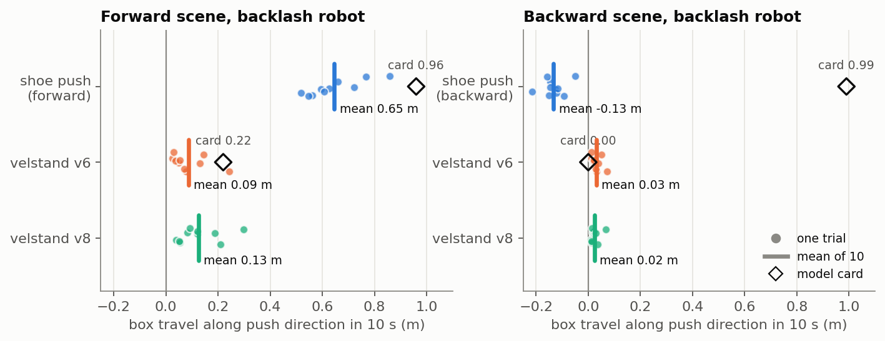
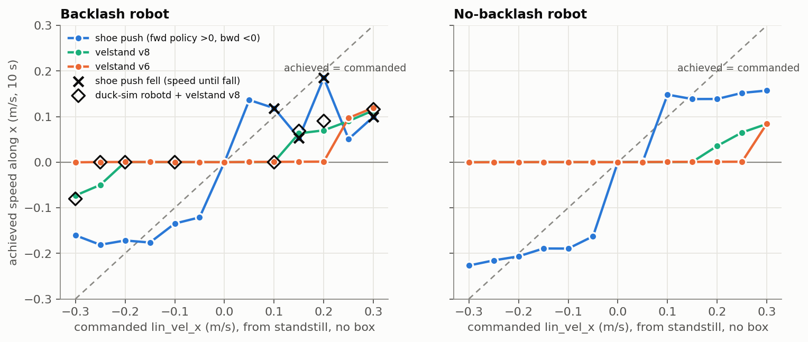
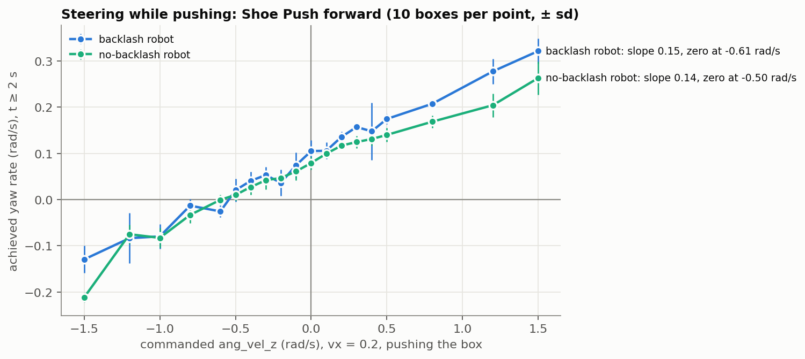
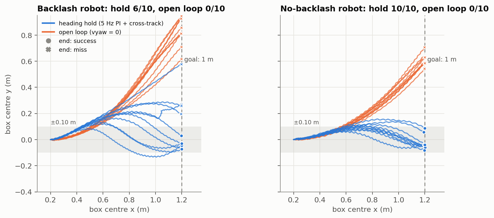
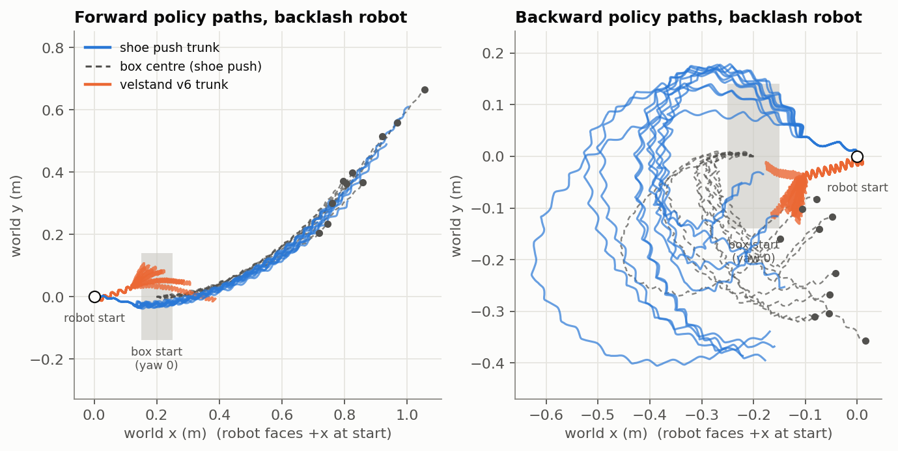
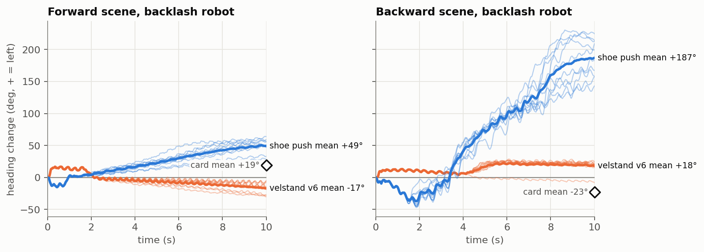
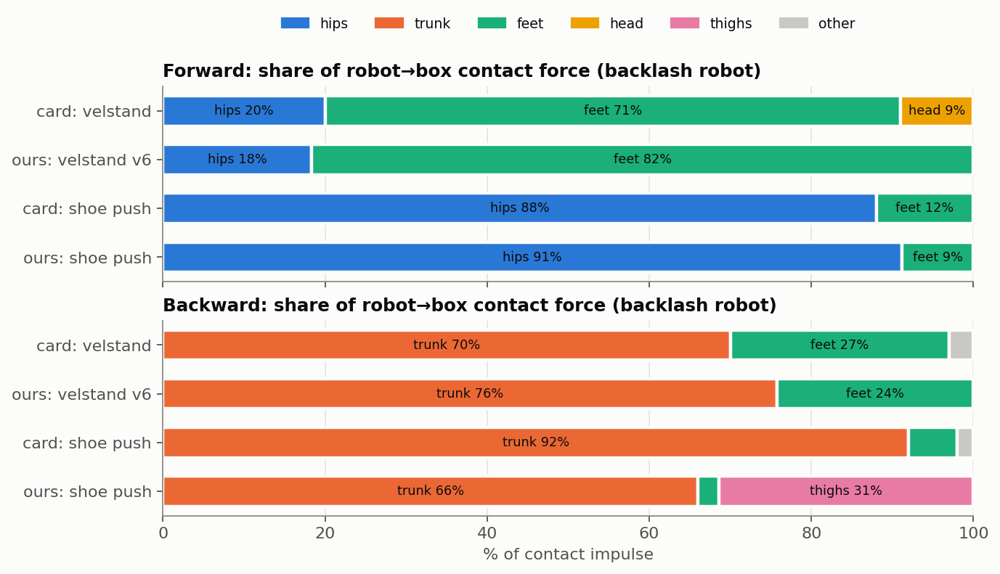
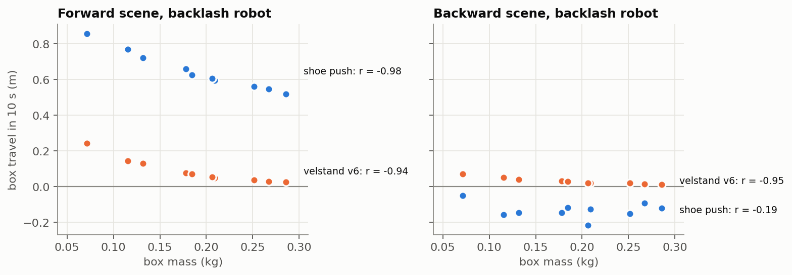

# B0: one duck pushing a box (Shoe Push)

Baseline **B0** from `docs/COPUSH_PLAN.md`: one MicroDuck pushing the 28 × 10 × 9 cm Shoe Push box. It uses
the released pushing policies (`pisdeburra/robert-policies`) and Pollen's velstand walking policy. It also
answers the three questions everything after Week 2 depends on:

1. Can a coordinator steer a pushing duck?
2. Do the earlier backward-walking results hold on the real `robotd` controller?
3. Can one duck push the box 1 m in a straight line?

Run 2026-11-02 on macOS / Apple Silicon, MuJoCo 3.10.0, against the commits in `upstream.lock`
(microduck_rl `develop` @ `bae39f59`, microduck `main` @ `997808c`). The rerun commands are at the bottom,
and setup and viewer commands are in [b0_runbook.md](b0_runbook.md).

**Colors:** blue = Shoe Push policy, orange = velstand v6, aqua = velstand v8. In the steering chart, color
marks the robot model instead. Hollow black diamonds are the model card's numbers or duck-sim measurements.

## Answers

| Question | Answer |
|---|---|
| **Steering while pushing** (Test 1) | **Yes, but weak and biased.** The achieved yaw rate is about 0.15 × the commanded ang_vel_z, with a built-in left drift of +0.08 to +0.1 rad/s. The drift cancels at a command of about −0.5 to −0.6 rad/s. Across the full ±1.5 rad/s range the duck turns from −0.13 to +0.32 rad/s (backlash robot) and never loses the box. A coordinator can steer, but only with high gain and a bias term. |
| **Backward walking under robotd** (Test 2) | **The earlier finding was wrong, because of the robot model.** On duck-sim (real `robotd`, velstand v8, backlash robot), velstand walks backward from rest at −0.3 m/s (3 of 3 starts, about −0.08 m/s) but not at −0.2 or −0.25. Forward needs 0.15. The first report used the robot *without* backlash, where velstand barely walks at all; microduck's simulator doc warns about exactly this. |
| **One duck, 1 m straight** (Test 3) | **Yes, mostly.** A 5 Hz heading hold (`copush.controllers.HeadingHoldPush`) brings the box to 1 m within 10 cm of the line in **6 of 10** trials on the backlash robot and **10 of 10** without backlash. Open loop manages 0 of 10, ending 0.6–0.8 m off the line. No falls and no lost boxes. On backlash it runs out of steering authority with light boxes. |
| **B0 numbers** (backlash robot, CoPush's default) | Shoe Push **forward**: 0.65 m of box travel in 10 s vs 0.09 m for velstand v6, 0 falls, 91% of contact on the hips. Shoe Push **backward** fails on this robot: it turns around (mean abs heading 154°) and moves the box −0.13 m. On the no-backlash robot it works (0.57 m), so it was most likely trained without backlash. |
| **Caveat: not yet the robotd path** | Tests 1 and 3 and the B0 table come from the infer_policy harness (BAM actuators). Under `robotd` in duck-sim, Shoe Push forward misbehaved in a teammate's run (`docs/WEEK1_STATUS.md` §3): it moved before any command, ran about 0.47 m/s at vx 0.15, and spun at zero command. Only velstand has been checked on both paths so far (§2, where they agree). Re-check Shoe Push under robotd before Week 3. |
| **New hazards for CoPush** | (a) Without a box, Shoe Push forward **falls** on the backlash robot in most runs, so approach with velstand and switch to Shoe Push at contact. (b) Shoe Push backward **ignores the command sign** and walks backward for any command. |

## What changed since the first report

The first report (2026-11-02, morning) ran everything on `robot_groundcontact.xml`, which is **the robot
without joint backlash**. velstand was trained as `Mjlab-VelStand-Rough-Backlash`. Microduck's own
`docs/design/simulation.md` §11 records that on the no-backlash robot "it does not take a step", and
duck-sim's default scene is the backlash robot for that reason. So:

- **Withdrawn:** "velstand doesn't walk backward at any speed down to −0.3". That holds for **v6 on either
  robot** and for **v8 without backlash** only. v8 on the backlash robot walks backward at −0.3, in our
  harness and in duck-sim (§2).
- **Changed:** B0 is now measured on the backlash robot, the one duck-sim and `scenes/scene_box.xml` use. The
  first report's numbers are kept alongside as the no-backlash column; the rerun reproduced them exactly.
- **Kept:** the forward Shoe Push results, the heading-drift finding, and the contact signature all hold on
  both robots.

## Test setup

- **Harness:** `scripts/b0/*` run CPU MuJoCo at 200 Hz physics and 50 Hz policy, with the BAM M6 XL330
  actuator (vin 7.4 V, sag 0.1). Obs and actuator code are imported from `microduck_rl/scripts/infer_policy.py`,
  so this is the viewer's code path. A headless run of `infer_policy.main()` matched it to the millimetre.
- **It is not the robotd path.** duck-sim runs `robotd` against MJCF position actuators. Findings that
  matter were checked on duck-sim with `scripts/b0/duck_sim_drive.py` (§2).
- **Scenes:** `scenes/scene_b0_{forward,backward}.xml` use the backlash robot. Each also has an installed
  `_nobacklash` twin that differs only in the robot include. The box is 28 × 10 × 9 cm, centred 0.20 m in
  front of or behind the trunk, with the long face toward the robot.
- **Trials:** 10 paired trials per condition, with box mass drawn from 0.05–0.30 kg and yaw from ±45°.
  Trial *i* uses seed *i* for every policy. Command: ±0.2 m/s straight, 10 s.
- **Metrics:**
  - Box travel = box displacement projected on the initial push direction.
  - Fall = trunk tilt > 60° or trunk height < 7 cm.
  - Box lost = box centre > 40 cm from the trunk.
  - Heading = change in trunk yaw.
  - Contact = share of robot→box contact impulse by body part.
- **Policies:** fetched by `scripts/fetch_policies.sh`. velstand **v6** (== v5) is the version Shoe Push was
  warm-started from: the run dates and weight correlation match it. **v8** is what duck-sim fetches today.
- **Tuning:** heading-hold gains were tuned on seeds 100–109 and are reported on seeds 0–9.

## 1. B0 baseline: box travel



| robot | scene | policy | box travel (m) | box abs disp (m) | robot travel (m) | falls | lost | heading mean (abs) | main contact |
|---|---|---|---|---|---|---|---|---|---|
| **backlash** | forward | **Shoe Push fwd** | **0.65 ± 0.10** | 0.76 | 0.80 | 0/10 | 0/10 | +49° (49°) | hips 91%, feet 9% |
| backlash | forward | velstand v6 | 0.09 ± 0.06 | 0.09 | 0.23 | 0/10 | 0/10 | −17° (17°) | feet 82%, hips 18% |
| backlash | forward | velstand v8 | 0.13 ± 0.08 | 0.13 | 0.24 | 0/10 | 0/10 | +1° (4°) | feet 100% |
| **backlash** | backward | **Shoe Push bwd** | **−0.13 ± 0.04** | 0.25 | 0.19 | 0/10 | 0/10 | −29° (**154°**) | trunk 66%, thighs 31% |
| backlash | backward | velstand v6 | 0.03 ± 0.02 | 0.03 | 0.14 | 0/10 | 0/10 | +18° (20°) | trunk 76%, feet 24% |
| backlash | backward | velstand v8 | 0.02 ± 0.02 | 0.03 | 0.14 | 0/10 | 0/10 | +22° (22°) | trunk 73%, feet 27% |
| no backlash | forward | **Shoe Push fwd** | **0.69 ± 0.11** | 0.76 | 0.84 | 0/10 | 0/10 | +37° (37°) | hips 90%, feet 10% |
| no backlash | forward | velstand v6 | 0.13 ± 0.06 | 0.13 | 0.26 | 0/10 | 0/10 | +4° (21°) | feet 36%, head 32%, hips 23% |
| no backlash | forward | velstand v8 | 0.14 ± 0.07 | 0.14 | 0.25 | 0/10 | 0/10 | −7° (8°) | feet 100% |
| no backlash | backward | **Shoe Push bwd** | **0.57 ± 0.06** | 0.85 | 0.79 | 0/10 | 0/10 | −83° (83°) | trunk 96%, feet 4% |
| no backlash | backward | velstand v6 | 0.08 ± 0.05 | 0.09 | 0.19 | 0/10 | 0/10 | −8° (8°) | trunk 92%, feet 7% |
| no backlash | backward | velstand v8 | 0.03 ± 0.03 | 0.04 | 0.26 | 0/10 | 0/10 | −65° (65°) | trunk 43%, feet 41%, thighs 17% |

- **Forward Shoe Push is the B0 to beat:** 0.65 m in 10 s on the backlash robot, 5–7× velstand, every
  trial, no falls. It pushes with the hip brackets, as the model card says (88% there, 91% here).
- **Backward Shoe Push only works without backlash.** With backlash its heading swings across ±170°, so it
  pivots around and drags the box. That points to training on the no-backlash robot. The card's caveat
  (the front trunk and thigh servos have no collision geometry) also describes that model.
- **velstand doesn't push** on either robot. It walks into the box, stalls at about 0.25 m of robot travel,
  and touches the box mostly with its feet.

The no-backlash chart is [figures/box_travel_nobacklash.png](figures/box_travel_nobacklash.png).

## 2. Who walks: start thresholds, checked on duck-sim



Achieved speed along x (m/s) over 10 s from standstill, no box. This is the BAM harness except the duck-sim row.

| cmd (m/s) | −0.3 | −0.25 | −0.2 | −0.1 | +0.1 | +0.15 | +0.2 | +0.25 | +0.3 |
|---|---|---|---|---|---|---|---|---|---|
| velstand v8, backlash | **−0.073** | −0.050 | 0 | 0 | 0 | 0.063 | 0.070 | 0.090 | 0.114 |
| **duck-sim robotd + v8, backlash** | **−0.080** (3/3) | 0 (0/3) | 0 (0/4) | 0 | 0 | 0.069 (2/2) | 0.090 (3/3) | — | 0.116 |
| velstand v6, backlash | 0 | 0 | 0 | 0 | 0 | 0 | 0 | 0.097 | 0.120 |
| velstand v8, no backlash | 0 | 0 | 0 | 0 | 0 | 0 | 0.036 | 0.065 | 0.084 |
| velstand v6, no backlash | 0 | 0 | 0 | 0 | 0 | 0 | 0 | 0 | 0.085 |
| Shoe Push (fwd for +, bwd for −), backlash | −0.160 | −0.181 | −0.172 | −0.135 | 0.119 ✗ | 0.053 ✗ | 0.185 ✗ | 0.051 | 0.100 ✗ |
| Shoe Push (fwd for +, bwd for −), no backlash | −0.227 | −0.215 | −0.207 | −0.189 | 0.148 | 0.139 | 0.139 | 0.152 | 0.157 |

✗ = fell; the value is the speed until the fall. duck-sim cells give (starts that walked / tries).

**Test 2, duck-sim.** I ran my own one-duck instance (`DUCK_SIM_STATE=~/.cache/duck-sim-b0`, port 7841,
headless, backlash scene, policy set v8). Another duck-sim on this machine was in use and was not touched.

- `scripts/duck-sim drive -0.3 0` moved 73 cm in 8 s.
- `drive` only reports distance, so `scripts/b0/duck_sim_drive.py` measured signed travel from rest with a
  3 s settle:
  - −0.3 m/s: −0.65, −0.69 and −0.66 m in 8.3 s (**walks backward**, about 2° per second of drift).
  - −0.2 and −0.25: 0.000 m in all 7 tries.
  - +0.15 and +0.2: walks every time.
- **The start threshold depends on state.** Right after a −0.3 run, while still in gait, `drive -0.2 0` moved 41 cm (distance only; `drive` doesn't report the sign).
- **The BAM harness agrees with duck-sim on the backlash robot,** with one exception: at −0.25 the harness
  starts slowly (−0.05 m/s) and duck-sim doesn't start. The teammate measurement in `copush/controllers.py`
  ("velstand needs ~0.25 m/s to start walking from rest") is consistent with this.

**Two Shoe Push hazards from the same sweep:**
- **Shoe Push forward falls without a box on the backlash robot:** 4 of 6 forward speeds in this sweep, and
  10 of 15 runs across speed × battery voltage. The runs that stay up spin (+80…+170°). With the box in
  front it fell in 0 of 10 B0 trials and in 2 of 440 steering and heading-hold trials (both at +0.3 rad/s
  on the backlash robot). It was trained with a box always 20 cm ahead.
- **Shoe Push backward ignores the command sign:** at +0.1…+0.3 it still walks backward at 0.10–0.15 m/s on
  both robots. This fits the card's note that a bug turned 20% of its commands into "walk forward".

## 3. Test 1: steering while pushing



Shoe Push forward, vx = 0.2, pushing the B0 box. Yaw rate is a least-squares slope over t ≥ 2 s (after
reaching the box), with 10 paired boxes per command.

| cmd ang_vel_z (rad/s) | −1.5 | −1.0 | −0.6 | −0.3 | 0 | +0.3 | +0.5 | +0.8 | +1.5 |
|---|---|---|---|---|---|---|---|---|---|
| achieved, backlash | −0.129 | −0.080 | −0.026 | +0.053 | **+0.105** | +0.157 | +0.175 | +0.207 | +0.321 |
| achieved, no backlash | −0.212 | −0.083 | −0.000 | +0.042 | **+0.079** | +0.125 | +0.140 | +0.169 | +0.263 |
| falls / box lost (backlash) | 0 / 0 | 0 / 0 | 0 / 0 | 0 / 0 | 0 / 0 | 2 / 0 | 0 / 0 | 0 / 0 | 0 / 0 |

Full tables, including ±0.1 to ±0.5 in 0.1 steps, are in `data/steering_*.json`.

- **Gain ≈ 0.15:** each rad/s commanded adds about 0.15 rad/s of turning (fitted slopes 0.15 and 0.14).
- **Offset:** zero command turns left at +0.08 to +0.1 rad/s, and the turn rate crosses zero at a command of
  about **−0.6** (backlash) or **−0.5** (no backlash). Within ±0.5 rad/s the duck *only turns left*, faster
  or slower.
- **Authority:** at the ±1.5 command limit, achieved turning is −0.13…+0.32 rad/s (backlash) and
  −0.21…+0.26 (no backlash). Turning right is the weak side.
- **The box stays:** 0 box losses in 400 trials, and 2 falls (both at +0.3 rad/s, backlash). The box's heading follows the duck's. Big turns rotate the
  box rather than moving it: box travel falls from 0.65 m to about 0.1 m at +1.5.
- **For the coordinator:** the duck is steerable, but a P-only controller will sit with a steady-state
  error. It needs an integral or bias term and a gain of about 7× the intended rate. With turning capped
  near ±0.2 rad/s, a 30° heading correction takes about 3 s.

## 4. Test 3: one duck with heading hold, 1 m straight



**Controller:** `copush.controllers.HeadingHoldPush`, run at 5 Hz:
- vx = 0.2.
- yaw rate = bias + kp · heading error, with the bias integrated (ki) and anti-windup, clipped to ±1.5.
- The reference heading bends toward the line by atan(k_cross · box cross-track).
- Gains kp 6, ki 3, k_cross 1.5, picked on seeds 100–109 (8/10 there on the backlash robot).

**Success** = box reaches 1 m along the line, ends within 10 cm of it, no fall, never lost. Time limit 25 s.

| robot | controller | success | box cross-track at 1 m (mean abs) | max cross-track | time to 1 m | duck heading at end | falls / lost |
|---|---|---|---|---|---|---|---|
| backlash | open loop | 0/10 | 0.84 m | 0.84 m | 16.6 s | +56° | 0 / 0 |
| backlash | **heading hold** | **6/10** | **0.16 m** | 0.24 m | 17.2 s | +1° | 0 / 0 |
| no backlash | open loop | 0/10 | 0.61 m | 0.61 m | 15.0 s | +50° | 0 / 0 |
| no backlash | **heading hold** | **10/10** | **0.05 m** | 0.10 m | 14.6 s | −4° | 0 / 0 |

- **Heading hold removes the drift.** The duck ends pointing within a few degrees of the line, against
  +50° for open loop, and the box's cross-track error drops 5–11×.
- **On the backlash robot the controller runs out of steering.** The yaw command is saturated at ±1.5 for
  45–81% of each run. The 4 misses are the light boxes (0.07, 0.12, 0.13 and 0.18 kg), which slide off the
  hips sideways and end 0.19–0.58 m off the line. All 6 heavier boxes succeed. This is the policy's steering
  limit from Test 1, not a tuning problem.
- **The Week 2 demo:** the no-backlash run is the clean version, 10/10 within 10 cm. On the backlash robot,
  use a box ≥ 0.2 kg, or accept about 0.15 m of cross-track error.

## 5. B0 details (backlash robot; no-backlash charts linked)






The same charts for the no-backlash robot (the first report's):
[trajectories](figures/trajectories_nobacklash.png) ·
[heading](figures/heading_drift_nobacklash.png) ·
[contact](figures/contact_share_nobacklash.png) ·
[mass](figures/mass_vs_travel_nobacklash.png).

- **Heading drift has a fixed sign.** Forward always curves left: +28…+64° per 10 s with backlash,
  +28…+46° without. Without backlash, backward always curves right (−14…−120°). The model card says the
  sign is random per robot; their training randomization most likely spreads it.
- **Heavier boxes go less far** for forward: r(mass, travel) = −0.98 with backlash and −0.99 without. Boxes
  under 0.15 kg travel 0.78 m and boxes over 0.2 kg travel 0.57 m (backlash).
- **Backward without backlash goes further with heavy boxes** (r = +0.79): a heavy box resists the turn,
  and r(mass, |heading|) = −0.92. With backlash, the backward policy fails regardless of mass.
- **Contact:** forward pushes with the hips on both robots. Backward pushes with the trunk without backlash;
  with backlash, about a third of its contact is with the thighs while it pivots.

## 6. Against the model card (512 robots in mjlab, 10 s, 0.2 m/s)

| | card: before → after | ours, backlash: v6 → Shoe Push | ours, no backlash: v6 → Shoe Push |
|---|---|---|---|
| Forward box travel | 0.22 → **0.96 m** | 0.09 → **0.65 m** | 0.13 → **0.69 m** |
| Backward box travel | 0.00 → **0.99 m** | 0.03 → **−0.13 m** (fails) | 0.08 → **0.57 m** |
| Falls / box lost | fwd 7.2 / 1.4% → 0 / 0%; bwd 0 / 0% → 0 / 0% | 0 / 0% → 0 / 0% | 0 / 0% → 0 / 0% |
| Main contact after | hips 88% / trunk 92% | hips 91% / thighs + trunk | hips 90% / trunk 96% |
| Heading drift after, mean | +19° / −23° | +49° / turns around | +37° / −83° |

We can't separate the sim gap from their unpublished eval settings:
- They used mjlab with training randomization, while our physics is fixed.
- Their robot model isn't stated. The backward policy's behavior suggests no backlash.
- It isn't said how box travel was measured.

## What this means for CoPush

1. **Use Shoe Push forward as the low-level pushing policy, and only while pushing.** Approach with velstand
   v8 at ≥ 0.15 m/s forward (or −0.3 backward) and switch to Shoe Push at contact. Shoe Push falls in free
   walking on the backlash robot.
2. **Don't use Shoe Push backward on the backlash robot.** It turns around, and it ignores the command sign.
3. **B2/B3 action design:** the effective steering range while pushing is about ±0.2 rad/s, reached only
   with commands near ±1.5. Treat ang_vel_z as a biased, low-gain actuator: give the scripted controller an
   integral term. For PPO, consider an action space that maps to the *achieved* yaw rate, or include the
   bias in the observation.
4. **Robot model is a confound to fix project-wide.** duck-sim and `scene_box.xml` use the backlash robot.
   Shoe Push behaves better without it. Pick one per experiment and record it; the B0 scripts take
   `--robot`.
5. **Re-run Tests 1 and 3 under robotd before building on them.** `WEEK1_STATUS.md` §3 found Shoe Push
   under robotd moving without a command and spinning at zero command. The suspects are
   `stand = "none"` (the walk network also runs at zero command, which Shoe Push never trained on), a
   command/obs encoding difference, and the position-vs-BAM actuators. `scripts/b0/duck_sim_drive.py`
   already talks to a duck-sim duck. The heading controller is on the shared interface and needs no change.
6. **Two ducks will need box contact.** Turning rotates the box with the duck instead of translating it, so
   two ducks steering independently will twist the box. That's B1's first experiment.

## Reproduce

```bash
# once: microduck_rl next to this repo with `uv sync` done, then
sh scripts/install_scene.sh          # scenes into microduck_rl (untracked)
sh scripts/fetch_policies.sh         # policies into data/policies/ (gitignored)

b0() { uv run --project ../microduck_rl python "$@"; }   # works in zsh and bash
b0 scripts/b0/eval_push.py --robot backlash   --json docs/results/data/b0_eval_backlash.json     # ~15 s
b0 scripts/b0/eval_push.py --robot nobacklash --json docs/results/data/b0_eval_nobacklash.json
for rb in backlash nobacklash; do
  b0 scripts/b0/steering.py --robot $rb --json docs/results/data/steering_$rb.json
  b0 scripts/b0/steering.py --robot $rb --wz -1.5 -1.2 -1.0 -0.8 -0.6 0.0 0.8 1.2 1.5 --json docs/results/data/steering_wide_$rb.json
  b0 scripts/b0/heading_hold.py --robot $rb --json docs/results/data/heading_hold_$rb.json
done
b0 scripts/b0/make_plots.py                  # all figures, ~40 s

# Test 2 on the real controller (its own duck-sim; does not touch one already running):
DUCK_SIM_STATE=~/.cache/duck-sim-b0 DUCK_SIM_PORT=7841 DUCK_SIM_DUCKS=1 DUCK_SIM_VIEWER=0 \
  DUCK_SIM_RL=$PWD/../microduck_rl ../microduck/scripts/duck-sim up
python3 scripts/b0/duck_sim_drive.py --state ~/.cache/duck-sim-b0 --port 7841 --settle 3 -- -0.3 0 -0.2 0 0.2 0
DUCK_SIM_STATE=~/.cache/duck-sim-b0 DUCK_SIM_PORT=7841 DUCK_SIM_RL=$PWD/../microduck_rl ../microduck/scripts/duck-sim down
```

Everything in the harness is deterministic: reruns reproduce every number. duck-sim runs in wall-clock
time, so its numbers vary by a few centimetres. Raw per-trial data is in `docs/results/data/`.
