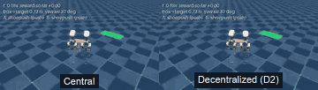

# Experiments

One folder per stage, each changing ONE thing from the stage before. Every stage is tested on a fixed
set of 50 starts the policy never trained on ([test_sets/](test_sets/)), so any policy can be scored on
any earlier stage's test.

The project overview is the [main README](../README.md). The order of work for the decentralized ducks:
[the ladder](../docs/DIAGRAMS.md#3-the-ladder-for-the-decentralized-ducks-from-exact-partner-info-to-realistic-sensing).
What the score means: the [reward function table](../README.md#the-reward-function).

## Finished stages

Click a clip to open the stage's folder. In each clip, the label under a panel says which controller it shows.

| clip | stage and the one change | result, in plain words |
|---|---|---|
|  | **[Stage 1: random box pose](stage1-random-box-pose/).** The box starts up to 0.15 m off and up to 45 degrees turned; the ducks still start against it. | Wins **58%** (51 to 65) of 200 held-out starts (the policy it started from: 50%, the best script, pivot_push: 38%). Blind spot: a box turned more than 15 degrees the positive way (5% won). *50-start numbers, superseded: 60%, 50%, 32%, 2 of 17.* |
|  | **[Stage 1b: the positive-angle blind spot](stage1b-turn-direction-fix/).** Find out why, then try two one-change fixes. | Not a physical limit: the hard starts need about 55 degrees of turning before the push. Fix A (practice more hard starts) wins **70%** (64 to 76) and fix B (a smaller time penalty) **65%** (58 to 71), against 58% for stage 1; both gains are measurable, with 1M extra training steps. The long-turn side is still mostly lost: A 21%, B 12%, stage 1 5% (200 starts). We keep A. *50-start numbers, superseded: 72%, 68%, 60%, and "only 4 of 17 and 1 of 17".* |
|  | **[Decentralized control](decentralized-control/).** Each duck runs the same network on its own view (D1), or its own view plus where its partner is (D2). Copied from the stage 1 controller, then trained further. | On 200 held-out starts D2 wins **66%** (60 to 73), D1 **64%** (57 to 70) and the central stage 1 controller **58%** (51 to 65): no measurable difference between D2 and D1 (+2.5 points, -2.2 to +7.2), and central with similar extra training (stage 1b A) reaches 70%. One seed each. *50-start numbers, superseded: 74%, 60%, 60%.* |
|  | **[D2 from scratch vs central](d2-from-scratch-comparison/).** Central and decentralized (D2) both start from random weights and train on the same fixed start. 10 seeds each (distilled D2: 3). | Central wins **45%** of 200 held-out starts, decentralized **40%**: **no measurable difference** (+5.3 points, -3.5 to +14.0 across seeds; seed ranges 34% to 55% and 28% to 56%). *50-start numbers, superseded: 46% and 40%.* The style differs: decentralized ducks idle more and over-turn the box, but share the pushing more evenly. |

## What is in this folder, in plain words

- **This file** is the index: one row per stage.
- **test_sets/** holds each stage's fixed starts (the "test"). They are written once and never trained on.
- **Each stage folder** has a README (the goal, the one change, status, results, videos and the next
  step), a config file (the stage's settings, on top of the shared ones it names) and a results folder
  with the small outputs we commit: test-set tables, per-episode data and plots.
- **Large outputs** (checkpoints, all videos, logs) stay in the git-ignored runs folder, and each
  stage README links to them.

How to run a stage: [SETUP.md](../SETUP.md#run-a-stage-experiment).

**[Re-evaluation on 200 held-out starts](stage1-reevaluation/README.md)** (eval only): every earlier stage 1 policy
against the old 50-start number, with 95% intervals, and which earlier claims held and which were noise. Results are
reported on `test_sets/stage1_large.json` from now on (rule in [AGENTS.md](../AGENTS.md)).

## Next

The plan for the next stages, per track, is in [ROADMAP.md](../ROADMAP.md).
