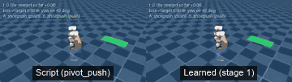
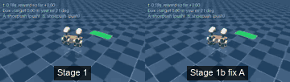
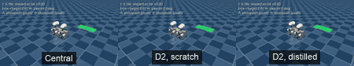

# Experiments

One folder per stage, each changing ONE thing from the stage before. Every stage is tested on a fixed
set of 50 starts the policy never trained on ([test_sets/](test_sets/)), so any policy can be scored on
any earlier stage's test.

The project overview is the [main README](../README.md). How the stages build on each other:
[curriculum ladder](../docs/DIAGRAMS.md#3-the-curriculum-ladder-from-easy-starts-to-the-full-task). What
the score means: the [reward function table](../README.md#the-reward-function).

## Finished stages

Click a clip to open the stage's folder. In each clip, the label under a panel says which controller it shows.

| clip | stage and the one change | result, in plain words |
|---|---|---|
|  | **[Stage 1: random box pose](stage1-random-box-pose/).** The box starts up to 0.15 m off and up to 45 degrees turned; the ducks still start against it. | Wins **60%** of its 50 test starts (the policy it started from: 50%, the best script: 32%). Blind spot: a box turned more than 15 degrees the positive way (2 of 17 won). |
|  | **[Stage 1b: the positive-angle blind spot](stage1b-turn-direction-fix/).** Find out why, then try two one-change fixes. | Not a physical limit: the hard starts need about 55 degrees of turning before the push. Fix A (practice more hard starts) wins **72%** and fix B (a smaller time penalty) **68%**, against 60%, but the long-turn side is still only 4 of 17 and 1 of 17 (stage 1: 2 of 17). We keep A. |
|  | **[Decentralized control](decentralized-control/).** Each duck runs the same network on its own view (D1), or its own view plus where its partner is (D2). Copied from the stage 1 controller, then trained further. | D2 wins **74%** (5 of 17 on the hard side), D1 **60%**, the central controller **60%**; no lazy duck. One seed each, and central with similar extra training reached 72%. |
|  | **[D2 from scratch vs central](d2-from-scratch-comparison/).** Central and decentralized (D2) both start from random weights and train on the same fixed start. 10 seeds each (distilled D2: 3). | Central wins **46%** of the 50 test starts, decentralized **40%**: **no measurable difference** (seed ranges 28% to 64% and 28% to 60%). The style differs: decentralized ducks idle more and over-turn the box, but share the pushing more evenly. |

## What is in this folder, in plain words

- **This file** is the index: one row per stage.
- **test_sets/** holds each stage's fixed starts (the "test"). They are written once and never trained on.
- **Each stage folder** has a README (the goal, the one change, status, results, videos and the next
  step), a config file (the stage's settings, on top of the shared ones it names) and a results folder
  with the small outputs we commit: test-set tables, per-episode data and plots.
- **Large outputs** (checkpoints, all videos, logs) stay in the git-ignored runs folder, and each
  stage README links to them.

How to run a stage: [SETUP.md](../SETUP.md#run-a-stage-experiment).

## Next

The plan for the next stages, per track, is in [ROADMAP.md](../ROADMAP.md).
