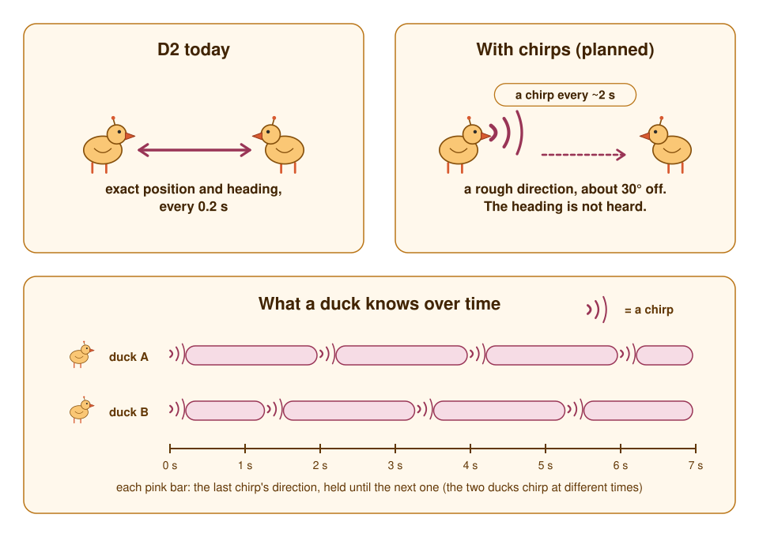
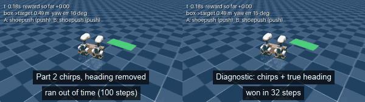

# Chirp partner sensing: can two ducks cooperate when they only hear each other?

**Status:** Parts 1 and 2, two diagnostic runs and a 200-start evaluation done (2026-11-15). The chirp observation is
built and tested, and Part 2 fine-tuned D2 with chirps. **On 200 held-out starts, chirps (63%, both seeds), the true-heading
diagnostic (64%), D1 with no partner info (64%) and D2 with exact info (66%) are all the same within the noise (about +-6
points).** The apparent heading effect on the 50-start test set (72% against 60%) was noise; the heading only changes how
much the ducks idle. Part 3 (sweep) and step 2 (missed chirps) not started; see the proposal below.

## The question

D2 (each duck runs the same network on its own view plus its partner's exact position and heading)
reaches 74% on the stage 1 test set. A real MicroDuck would not know its partner's exact position. It
could hear it: a chirp gives a rough direction (and maybe a rough distance), once in a while. Does
decentralized control still work with that?

## The chirp observation

*The diagram: [make_chirp_experiment.py](make_chirp_experiment.py), in the style of [docs/DIAGRAMS.md](../../docs/DIAGRAMS.md).*

Code: [copush/chirp.py](../../copush/chirp.py); tests: [tests/test_chirp.py](../../tests/test_chirp.py).
Everything is a config setting under `chirp:` in [configs/copush.yaml](../../configs/copush.yaml), off by
default (so every earlier config behaves as before).

| setting | default | meaning |
|---|---|---|
| `enabled` | false | on: a decentral controller with `include_partner` hears chirps instead of seeing its partner |
| `interval_s` | 2.0 | seconds between one duck's chirps |
| `direction_noise_deg` | 30 | standard deviation of the bearing error (Gaussian) |
| `distance` | false | on: each chirp also carries a rough distance |
| `distance_noise` | 0.3 | standard deviation of the relative distance error |
| `nominal_distance_m` | 0.20 | the vector length when distance is off (not asked for; needed to keep the size) |
| `heading` | zero | zero: the partner's heading is not heard (0 in the observation); true: the exact heading is filled in (diagnostic only) |

How it works:
- **Same size as D2 (19 numbers),** so the trained D2 policy is reused directly with no warm-start
  tricks. The two partner-position numbers become the heard direction and distance, as a vector in the
  duck's own frame. With distance off the vector has the nominal length 0.20 m (the ducks are 0.19 m
  apart on average on the stage 1 test set).
- **Partner heading is not available from sound,** so its two numbers (sin, cos) are set to 0.
- **Held until the next chirp,** in the duck's own frame (it does not rotate as the duck turns).
- **Staggered:** each duck's chirp times are shifted by its own random offset in [0, interval), drawn at
  every reset, and both ducks hear one chirp at the start of the episode. A chirp is heard at the
  first 0.2 s control step at or after its time.
- The noise comes from the env's seeded random generator, so evaluation with the same seeds repeats.

## The order of work (decentralized track)

1. **Retrain with chirps (Part 2, done):** the baseline for realistic sensing. It wins 60%, the same as D1.
2. **Missed chirps and front-back direction flips:** the same sense, more realistic.
3. **Randomize the box mass, with observation history:** stops the policy memorizing push timing, and
   the history lets it sense the mass.
4. **Ducks start apart** (reusing the rendezvous settings when available): test chirps until
   performance fails.
5. **Vision, and the box blocking the view:** partner info only when the partner is inside the front
   camera's field of view, within range, and not hidden behind the box. Mix about 30% earlier starts
   into training to avoid forgetting. Vision comes after step 4 because, side by side, the partner is
   about 90 degrees to the side, outside a front camera's view, so vision only matters once the ducks
   start apart.
6. **Final:** distill the combined central controller (from steering and rendezvous) into these
   realistic-sensing ducks.

The idea behind it: the central controller (the privileged teacher) sees everything, and the decentralized
ducks (the students) only get what a real duck could sense. Steps 2, 3 and 5 are built as settings but
**not run yet** (all off by default, with tests):

| setting | default | what it does | value |
|---|---|---|---|
| `chirp.miss_prob` | 0 | chance that a chirp is lost (the duck keeps its last one) | placeholder |
| `chirp.front_back_flip_prob` | 0 | chance that a heard direction is mirrored front to back | placeholder |
| `box.mass_range` | null | the box mass is drawn from [lo, hi] kg each episode | placeholder |
| `obs.history_steps` | 1 | stack the last N observations, newest first (1 = just the current one) | N = 1 keeps the old behavior |
| `vision.enabled`, `vision.fov_deg`, `vision.range_m` | off, 120, 0.8 | partner info only while in the front camera's view and range; otherwise the last chirp (needs chirps on) | placeholders |
| `vision.occlusion` | off | the box blocks the view: the partner is hidden when the line of sight crosses the box (needs vision on) | the box is the real size, 28 by 10 cm |

All "placeholder" values are made up until measured on the real ducks. Code: `copush/chirp.py`,
`copush/vision.py`, `copush/env.py`, `copush/decentral.py`; tests: `tests/test_chirp.py`,
`tests/test_realistic_sensing.py`.

## Runs

| run | what | status |
|---|---|---|
| [zero-shot/](zero-shot/) | trained D2 with chirps, no training, stage 1 test set; plus a diagnostic with the true heading | done |
| [finetune-2s-30deg/](finetune-2s-30deg/) | Part 2: fine-tune D2 with chirps every 2 s, 30 deg, heading removed, stage 1 random box starts, up to 1M steps; plus an information ablation and a clip | done: 60% |
| [visibility-check/](visibility-check/) | how often each duck sees its partner (front camera, no training) | done: under 10% |
| [finetune-true-heading/](finetune-true-heading/) | Run 1, DIAGNOSTIC: Part 2 plus the partner's true heading at each chirp | done: 72% |
| [finetune-2s-30deg-seed2/](finetune-2s-30deg-seed2/) | Run 2: Part 2 repeated with seed 2 | done: 62% |
| [diagnostics/](diagnostics/) | the five-way comparison of these runs on the 50-start test set, the read (superseded) and the clip | done |
| [large-eval/](large-eval/) | the same five policies on 200 new held-out starts, with 95% intervals and paired tests (no training) | done: no heading effect |

## Results so far

**Main evidence: 200 new held-out starts, 95% intervals** ([large-eval/README.md](large-eval/README.md); the set is
`experiments/test_sets/stage1_large.json`, even in box angle, separate from the test and check sets):

| policy | success (200 starts) | < -15 deg | -15 to +15 deg | > +15 deg | idle share |
|---|---|---|---|---|---|
| D2, exact partner info | **66%** (60 to 73) | 97% | 87% | 15% | 15% |
| D1, own view only | **64%** (57 to 70) | 96% | 87% | 9% | 21% |
| Part 2, chirps, seed 1 | **63%** (56 to 69) | 97% | 81% | 11% | 26% |
| Part 2 repeated, seed 2 | **63%** (56 to 69) | 96% | 87% | 6% | 20% |
| Chirps + true heading (DIAGNOSTIC) | **64%** (57 to 70) | 94% | 87% | 9% | 13% |

- **No measurable differences in success.** Chirps against D1: -1 point (interval -6 to +4). D2 with exact info against
  chirps: +3.5 points (interval about -1.5 to +8.5). The true heading against the two heading-removed runs:
  **+0.5 points (-3.6 to +4.6)**, so the heading is not what separates the chirp policy from D2, and the two seeds agree
  (63% and 63%).
- **The 50-start numbers were noise.** On the 50-start test set the same policies read 74% (D2), 60% (D1), 60% and 62%
  (chirps) and 72% (true heading); a rate on 50 starts has an interval of about +-13 points. The zero-shot rows below are
  on that set and carry the same caveat.
- **The heading does change style:** the idle share is 13% with the true heading, 20 to 26% without (intervals about +-2).
- **Where all of them lose:** the long-turn side (box turned more than +15 degrees), 4 to 15%.
- **Partner info is not what limits stage 1:** D1, with none, is at 64%. Realistic sensing needs a setup where partner
  info matters (ducks starting apart) before differences can be measured.

Earlier results on the 50-start stage 1 test set (a rate has a standard error of about 7 points, one run each):

| policy | success | < -15 deg | -15 to +15 | > +15 deg |
|---|---|---|---|---|
| D2, exact partner info | **74%** | 17/17 | 15/16 | 5/17 |
| D1, own view only | **60%** | 15/17 | 14/16 | 1/17 |
| D2 with chirps, zero-shot (heading zeroed) | 34% | 6/17 | 9/16 | 2/17 |
| D2 with chirps, zero-shot, true heading filled in (diagnostic) | 62% | 17/17 | 14/16 | 0/17 |
| D2 fine-tuned with chirps (Part 2, seed 1) | 60% | 15/17 | 12/16 | 3/17 |
| D2 fine-tuned with chirps, seed 2 (Run 2) | 62% | 17/17 | 13/16 | 1/17 |
| Chirps + true partner heading (Run 1, DIAGNOSTIC) | 72% | 16/17 | 15/16 | 5/17 |

- **Zero-shot (no training), the heading was the larger part of the loss** (34% without it, 62% with it): a policy trained
  with the heading input fails when that input is set to zero. That is a different question from fine-tuned policies, which
  learn to do without it. See [zero-shot/README.md](zero-shot/README.md).
- **Part 2 and the two diagnostic runs** ([finetune-2s-30deg/](finetune-2s-30deg/README.md),
  [diagnostics/README.md](diagnostics/README.md)): idle share and overshoots differ between the policies, success does
  not (see the 200-start table above).
- **Vision cannot help yet:** side by side, each duck sees its partner on under 10% of steps (6.5% and 5.1%;
  2.7% for duck B with the box blocking). See [visibility-check/README.md](visibility-check/README.md).
- **Clip (test start 8):** Part 2 (left) against the true-heading diagnostic (right). One start, for illustration only:

**Proposed next steps (not decided):**
1. Re-evaluate the key earlier policies (central stage 1, stage 1b, D2, D1) on the 200-start set; several headline gaps
   measured on 50 starts may be partly noise.
2. Move the ducks-start-apart setup (step 4) ahead of missed chirps and box mass: on stage 1 partner info barely matters
   (D1 = D2), so realistic sensing cannot show an effect there. Compare D1, D2 exact and chirps on it.
3. The heading-in-the-chirp idea is not needed for success; keep it only if idling matters.

## Ideas (not started)

The partner heading cannot be heard, and zero-shot it was the larger part of the loss. Two ways to get it
back without cheating:
- **Estimate the partner's heading from how its heard position changes between chirps.** A walking duck
  moves along its heading, so two chirps give a direction of travel.
- **Encode the heading in the chirp itself:** each chirp carries a coarse heading (a few bits, for
  example 8 compass directions) along with the direction.
