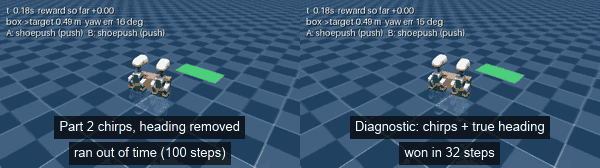

# Two diagnostic runs: does the partner heading explain the gap? Is 60% real?

Run on 2026-11-15, one change each, compared with Part 2 on the stage 1 test set (50 starts, one deterministic
episode each). Queue: `runs/chirp-partner-sensing/diagnostics.sh`; results: [results/comparison.md](results/comparison.md),
[results/comparison.json](results/comparison.json). Same step budget as Part 2 (1M simulator steps), early stopping on
the stage 1 check set (it never fired), only the final policies and videos kept.

- **Run 1, DIAGNOSTIC (not a realistic setting):** Part 2 plus the partner's **true heading** at each chirp, held until
  the next chirp like the direction. [Config](../finetune-true-heading/config.yaml).
- **Run 2:** Part 2 repeated with PPO seed 2 (Part 2 used seed 1), heading removed.
  [Config](../finetune-2s-30deg-seed2/config.yaml).

## Stage 1 test set

| policy | overall | < -15 deg | -15 to +15 deg | > +15 deg |
|---|---|---|---|---|
| D2, exact partner info | **74%** (37/50) | 17/17 | 15/16 | 5/17 |
| D1, own view only | **60%** (30/50) | 15/17 | 14/16 | 1/17 |
| Part 2, seed 1 (chirps, heading removed) | **60%** (30/50) | 15/17 | 12/16 | 3/17 |
| Run 2, seed 2 (chirps, heading removed) | **62%** (31/50) | 17/17 | 13/16 | 1/17 |
| **Run 1: chirps + true heading (diagnostic)** | **72%** (36/50) | 16/17 | 15/16 | 5/17 |

## Behavior (all 50 test starts)

| policy | idle share | overshoots | time-outs | falls | box lost | push share duck A | lazy duck |
|---|---|---|---|---|---|---|---|
| D2, exact info | 14.6% | 1 | 6 | 5 | 2 | 51% | 0 |
| D1 | 20.6% | 4 | 18 | 2 | 0 | 48% | 0 |
| Part 2, seed 1 | 30.3% | 11 | 17 | 3 | 0 | 53% | 0 |
| Run 2, seed 2 | 20.9% | 10 | 16 | 3 | 0 | 50% | 1 |
| Run 1, true heading | **8.8%** | 4 | 11 | 1 | 2 | 46% | 0 |

With the true heading the policy behaves like D2 again: it idles less than any other policy, overshoots about as
rarely as D1 and wins the hard long-turn side 5 of 17 times (D2: 5; the heading-removed runs: 3 and 1). The two
heading-removed runs both overshoot 10 to 11 times and time out 16 to 17 times, like each other and like D1.

## Read

By the rule set before the runs: **Run 1 is near D2 (72% against 74%) and Run 2 is near Part 2 (62% against 60%), so
the partner heading looks like the bottleneck**, and the seed matters little (2 points between seeds).

**But the evidence is weaker than it looks.** Each rate is 50 starts (a standard error of about 7 points), and each
policy is one run:
- The same three policies on the stage 1 **check set** (a different 50 starts, logged at the end of training) give the
  opposite order: Run 1 64%, Part 2 68%, Run 2 72%. Over the 100 starts of both sets together: Run 1 68%, Run 2 67%,
  Part 2 64%, with no measurable difference.
- The earlier zero-shot diagnostic is stronger evidence for the heading (restoring it brought a D2 policy trained with
  the heading from 34% back to 62%), but that is a different question from fine-tuned policies.

So: heading is the best-supported explanation (and the behavior numbers above agree: idle share, time-outs and the
long-turn side all move with it), but it is **suggestive, not established**. A larger evaluation of these same policies
(no training, minutes) would settle it before anything is built.

## Proposed next step (not decided)

Two realistic ways to get the heading, and which to build first:
1. **Heading encoded in the chirp itself (build this first).** The chirping duck knows its own heading (it has an IMU)
   and sends a coarse version with the chirp (say 8 compass bins, 3 bits); the listener subtracts its own heading. It is
   a small extension of the diagnostic (quantize the held heading, optionally add bit errors), and the diagnostic already
   shows that a heading held between chirps is enough. Cost: the chirp has to carry a few bits.
2. **Estimate the heading from how the chirp direction changes over time.** Weaker: ducks pushing together keep the same
   bearing to each other, and a duck pivoting in place changes its heading without moving, so the bearing barely changes
   in exactly the cases where the heading matters, and a 30 degree noise on a chirp every 2 s hides small changes. It needs
   no extra signal, and `obs.history_steps` (already built) would let a network try it, so it is a cheap long shot to
   test after (1).

## Clip

Part 2 (left) against the diagnostic with the true heading (right) on test start 8 (box turned +15.9 degrees): Part 2
runs out of time, the diagnostic wins in 32 steps. Made by `scripts/rl/side_by_side_policies.py`.

