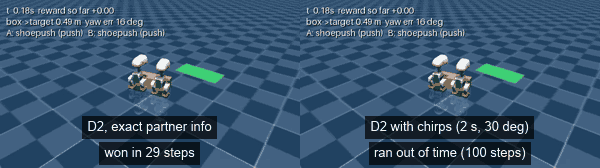

# Part 2: fine-tune D2 with chirps (2 s, 30 degrees, heading removed)

**Result (2026-11-15): 60% on the stage 1 test set, the same as D1 (no partner info), below D2 with exact
info (74%).** One seed, 50 test starts (a rate has a standard error of about 7 points).

## The one change

From the trained D2 stage 1 policy (`runs/decentral-p2-d2`), train with chirps on: each duck hears a noisy
direction to its partner every 2 s (30 degree standard deviation, no distance) instead of the partner's exact
position and heading, and the heading is removed (zeros), since sound cannot give it. Stage 1's random box
starts, 1M simulator steps (2,002,944 duck steps, 68 min); early stopping on the stage 1 check set never fired
(check-set success 54 to 68%, never 80%). Settings: [config.yaml](config.yaml); queue: `runs/chirp-partner-sensing/part2.sh`
(only the final policy and the videos are kept).

## Stage 1 test set (50 starts)

| policy | overall | < -15 deg | -15 to +15 deg | > +15 deg |
|---|---|---|---|---|
| D2, exact partner info | **74%** (37/50) | 17/17 | 15/16 | 5/17 |
| D1, own view only | **60%** (30/50) | 15/17 | 14/16 | 1/17 |
| D2 with chirps, zero-shot (no training) | 34% (17/50) | 6/17 | 9/16 | 2/17 |
| **D2 with chirps, fine-tuned (Part 2)** | **60%** (30/50) | 15/17 | 12/16 | 3/17 |

Full tables and per-episode data: [results/comparison.md](results/comparison.md), [results/comparison.json](results/comparison.json).

## Behavior: Part 2 against D2 with exact info

| | D2, exact info | Part 2, chirps |
|---|---|---|
| falls / box lost | 5 / 2 | 3 / 0 |
| overshoots / time-outs | 1 / 6 | 11 / 17 |
| push share of duck A, both ducks touching the box | 51%, 94% | 53%, 94% |
| lazy-duck episodes | 0 | 0 |
| idle share of steps (both ducks below 0.05 m/s) | 14.6% | 30.3% |
| mean episode length | 45 steps | 59 steps |
| monitor flags (episodes) | bad_part_duck_a 6, bad_part_duck_b 3, contact_share 17, edge 1, fall_duck_a 4, fall_duck_b 2, reward_vs_dist 2 | bad_part_duck_a 1, contact_share 15, fall_duck_a 5, reward_vs_dist 4 |

Cooperation is fine (both ducks push evenly, no lazy duck). The chirp policy idles twice as much and overshoots
the target far more often, and it times out on 17 starts. That is D1's style (D1: 20.6% idle, 4 overshoots,
18 time-outs) more than D2's.

## What does the fine-tuned policy rely on? (no training)

The same policy with the chirp information changed ([run_ablation.sh](run_ablation.sh),
[results-ablation/](results-ablation/comparison.md)):

| chirp information given to the fine-tuned policy | overall | < -15 | -15 to +15 | > +15 |
|---|---|---|---|---|
| every 2 s, 30 deg off (as trained) | 60% | 15/17 | 12/16 | 3/17 |
| **random direction** (uninformative) | **22%** | 6/17 | 5/16 | 0/17 |
| exact direction, every 2 s | 66% | 17/17 | 13/16 | 3/17 |
| exact partner vector, every step (heading still zero) | 64% | 17/17 | 14/16 | 1/17 |
| D1, no partner info (reference) | 60% | 15/17 | 14/16 | 1/17 |

- **It does read the chirps:** random directions drop it to 22%, far below D1, so it is not ignoring them.
- **But chirps add little over no partner info:** with perfect direction, even every step, it reaches only
  64 to 66%, inside the error of D1's 60%. A partner direction without the partner's heading is worth about
  +5 points over knowing nothing, and D2's 74% needs more than that.
- **The missing heading looked like the rest:** the exact partner position every step gets 64%, 10 points below
  D2 exact (74%); the zero-shot diagnostic gave the same message (true heading restored 20 to 32 points).
  *Update: on 200 new starts the heading adds nothing measurable to the fine-tuned policies, and D2 exact is only
  about 3 points above them; see [../large-eval/README.md](../large-eval/README.md).*

## Clip

D2 with exact info against the fine-tuned chirp policy on the same start (test start 8, box turned +15.9 deg).
D2 wins in 29 steps; the chirp policy runs out of time. Made by [make_gif.sh](make_gif.sh).

