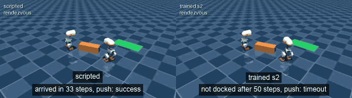
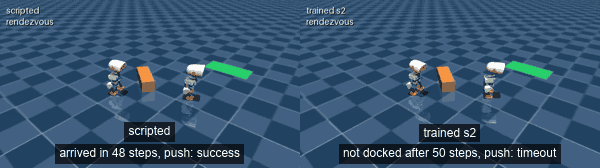
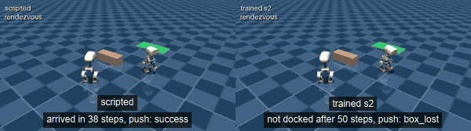
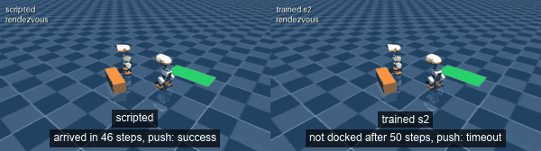
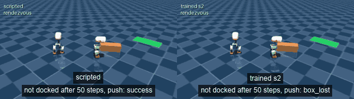
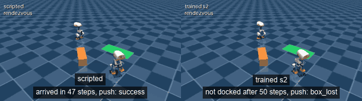
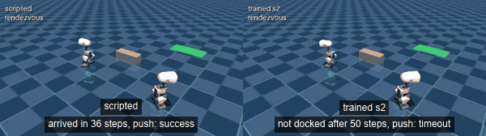
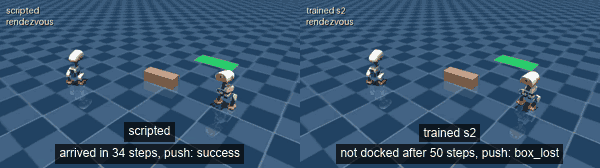
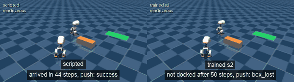
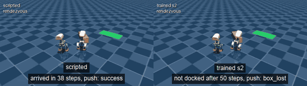

# D2 rendezvous, night 1: a learned rendezvous coordinator against the scripted one

*Written 2026-11-23 01:54 by `scripts/rl/overnight_rendezvous_1.py`.*

## Steps

| step | status | finished |
|---|---|---|
| scripted | done | 2026-11-22 23:15:16 |
| s1 | done | 2026-11-23 00:23:42 |
| s2 | done | 2026-11-23 01:44:17 |
| eval | done | 2026-11-23 01:48:30 |
| gifs | done | 2026-11-23 01:54:48 |

## Setup

- **The one change:** the rendezvous phase is a trained policy (PPO from scratch, one shared network per duck, each duck seeing its spot, its partner and the box in its own frame) instead of the scripted coordinator (copush.rendezvous.ScriptedRendezvous). Everything after the handoff is the same: the night 5 L2-s2 push policy (`runs/d2-steering-night5/l2-s2/model.zip`, sha256 `ab82e344b275ce61...`).
- **Reward per duck per step:** 10 x (decrease in distance to its spot) + 1 x (decrease in heading error, rad) - 0.03 - 1.0 if it touched the box or its partner; +5 to both when both are within 3 cm and 15 deg for 0.25 s (episode ends), -5 at 100 steps or on a fall.
- **Training:** 2,000,000 duck steps (2 per simulator step) per seed, seeds 1 and 2, configs/copush.yaml's PPO (8 envs, n_steps 256, ent_coef 0.01), starts drawn like the eval set (box over stage 1's range, 80% uniform / 10% near-symmetric / 10% wrong-side duck placements).
- **Eval set:** `experiments/test_sets/rendezvous_large.json`, 200 starts on stage1_large's 200 box poses (160 uniform, 20 near-symmetric, 20 wrong-side), seed 10000 + i, deterministic. Pipeline: rendezvous until both ducks are within 3 cm and 15 deg of their spots and upright (checked every 0.2 s), at most 50 steps, then the push policy for 100 steps; push success = box in the target, yaw within 15 deg, both up, held 1 s.
- **Rule for "measurable":** the paired 95% interval (same starts, seeds averaged) excludes 0 **and** both seed rates are on the same side of the scripted rate (the scripted controller is deterministic, one rate).

**Training curve, s1** (rendezvous alone on the eval set, 100-step training ending)

| duck steps | arrived | mean steps to arrive | position error (cm) | heading error (deg) | duck-box hits | duck-duck hits | falls |
|---|---|---|---|---|---|---|---|
| 200000 | 0/200 | n/a | 47.6 | 82.6 | 739 | 91 | 2 |
| 400000 | 0/200 | n/a | 40.8 | 79.7 | 131 | 121 | 0 |
| 600000 | 0/200 | n/a | 44.0 | 71.5 | 376 | 183 | 1 |
| 800000 | 0/200 | n/a | 50.1 | 61.9 | 499 | 174 | 0 |
| 1000000 | 0/200 | n/a | 48.6 | 71.2 | 446 | 212 | 0 |
| 1200000 | 0/200 | n/a | 51.9 | 62.9 | 323 | 127 | 0 |
| 1400000 | 0/200 | n/a | 53.5 | 74.3 | 349 | 39 | 0 |
| 1600000 | 0/200 | n/a | 57.2 | 67.2 | 405 | 36 | 0 |
| 1800000 | 0/200 | n/a | 48.8 | 54.2 | 412 | 106 | 0 |
| 2000000 | 0/200 | n/a | 52.9 | 63.1 | 383 | 48 | 0 |
| 2002944 | 0/200 | n/a | 52.9 | 65.7 | 385 | 84 | 0 |

**Training curve, s2** (rendezvous alone on the eval set, 100-step training ending)

| duck steps | arrived | mean steps to arrive | position error (cm) | heading error (deg) | duck-box hits | duck-duck hits | falls |
|---|---|---|---|---|---|---|---|
| 200000 | 0/200 | n/a | 40.8 | 80.9 | 720 | 125 | 2 |
| 400000 | 0/200 | n/a | 50.0 | 69.8 | 116 | 435 | 0 |
| 600000 | 0/200 | n/a | 49.3 | 75.5 | 292 | 45 | 0 |
| 800000 | 0/200 | n/a | 48.0 | 65.3 | 747 | 195 | 0 |
| 1000000 | 0/200 | n/a | 52.0 | 74.6 | 668 | 54 | 0 |
| 1200000 | 0/200 | n/a | 54.7 | 66.5 | 499 | 153 | 0 |
| 1400000 | 0/200 | n/a | 55.8 | 75.3 | 291 | 160 | 0 |
| 1600000 | 0/200 | n/a | 53.9 | 71.0 | 392 | 73 | 0 |
| 1800000 | 0/200 | n/a | 48.2 | 71.9 | 371 | 100 | 0 |
| 2000000 | 0/200 | n/a | 49.8 | 70.8 | 400 | 84 | 0 |
| 2002944 | 0/200 | n/a | 50.1 | 68.9 | 327 | 97 | 0 |

## Results on the 200 starts (full pipeline)

| controller | arrived in 50 steps | end-to-end push success | push success when arrived | mean steps to arrive | position / heading error at handoff (mean) | duck-box hits (episodes) | duck-duck hits (episodes) |
|---|---|---|---|---|---|---|---|
| scripted | 48.0% (41.2% to 54.9%) | 65.0% (58.2% to 71.3%) | 91 of 96 | 38.5 | 4.9 cm / 26.9 deg | 494 (120) | 150 (21) |
| s1 | 0.0% (0.0% to 1.9%) | 0.0% (0.0% to 1.9%) | 0 of 0 | n/a | 49.9 cm / 65.7 deg | 89 (18) | 23 (5) |
| s2 | 0.0% (0.0% to 1.9%) | 0.5% (0.1% to 2.8%) | 0 of 0 | n/a | 49.1 cm / 68.5 deg | 82 (18) | 21 (7) |

**By start kind** (end-to-end push success)

| controller | uniform | near_symmetric | wrong_side |
|---|---|---|---|
| scripted | 70.0% (62.5% to 76.6%) | 45.0% (25.8% to 65.8%) | 45.0% (25.8% to 65.8%) |
| s1 | 0.0% (0.0% to 2.3%) | 0.0% (0.0% to 16.1%) | 0.0% (0.0% to 16.1%) |
| s2 | 0.6% (0.1% to 3.5%) | 0.0% (0.0% to 16.1%) | 0.0% (0.0% to 16.1%) |

## Verdict (fixed rule)

- end-to-end push success: trained (seeds averaged) minus scripted -64.8 points (-71.4 to -58.1); seed rates 0.0%, 0.5% vs scripted 65.0%: **trained is measurably worse**
- arrival within 50 steps: trained (seeds averaged) minus scripted -48.0 points (-54.9 to -41.1); seed rates 0.0%, 0.0% vs scripted 48.0%: **trained is measurably worse**

## Clips (scripted left, trained s2 right; then the same push policy)

**start000**

**start001**

**start002**

**start003**

**start004**

**start005**

**start007**

**start008**

**start011**

**start013**

Per-episode results: `runs/d2-rendezvous-night1/eval_<controller>/results.json` (git-ignored); the tables above come from them, and `results/<controller>/results.md` has the full per-kind breakdown.
