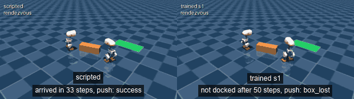
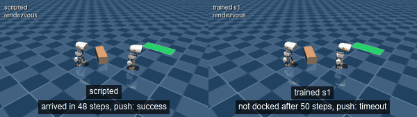
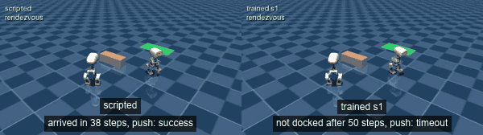
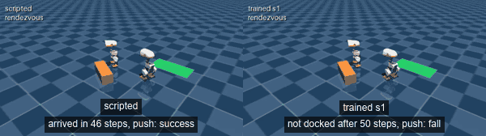
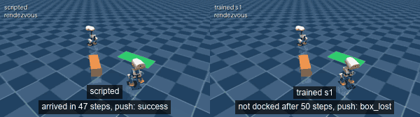
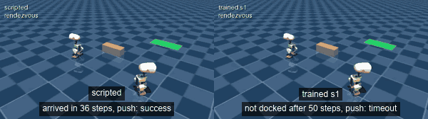
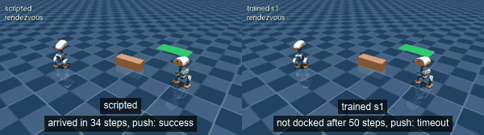
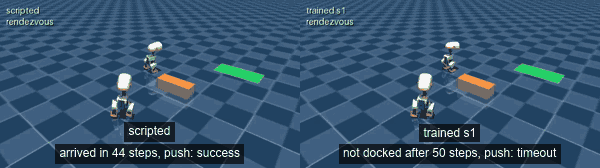
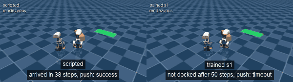
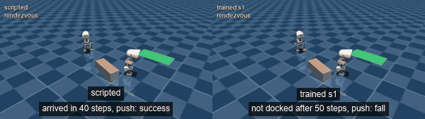

# D2 rendezvous, r2-curriculum: absolute-distance reward, a partial bonus, shorter episodes, a curriculum

*Written 2026-11-23 03:02 by `scripts/rl/run_r2_curriculum.py`.*

## Steps

| step | status | finished |
|---|---|---|
| scripted | done | 2026-11-23 02:37:02 |
| s1 | done | 2026-11-23 02:55:46 |
| s2 | skipped (s1 aborted early (docking rate 0% (0/200) at step 400000 (early-stop step 400000)); the same from-scratch reward would likely do the same) |  |
| eval | done | 2026-11-23 02:57:40 |
| gifs | done | 2026-11-23 03:02:14 |

## Setup

- **Why this run:** r1's reward (10 x decrease in distance to the spot per step) never docked once in 2,000,000 steps on either seed: at the fastest walking speed the per-step reward (about 0.24) barely cleared the 0.03 time penalty, and standing still made the reward (and its gradient) vanish. See `experiments/d2-rendezvous/r1-delta-reward/SUMMARY.md`.
- **The change (one named reward/schedule, several settings; `experiments/d2-rendezvous/config.yaml`):** reward is now absolute distance/heading, not their improvement, so it never vanishes while a duck is still far away: -1.0 x (distance to its spot / 0.8 m) - 0.3 x (heading error / pi) - 0.02 per step - 1.0 if it touched the box or its partner, +2.0 the first time within 10 cm of its spot (once per duck per episode), +5 to both on handoff (episode end), -2 at 50 steps (down from 100) or on a fall.
- **Curriculum (new):** training starts begin at 15-20 cm from the box and widen to 20-40, 40-60, then the full 60-80 cm once the docking rate over the last 50,000 duck steps exceeds 60%, per worker (bearing and heading stay uniform over 360 deg at every level).
- **Early stop:** a seed whose docking rate is still 0% at 400000 steps aborts there instead of running to 2,000,000 (not a crash); if s1 aborts, s2 is skipped rather than repeat it.
- **Everything else as r1:** PPO from scratch, seeds 1 and 2, configs/copush.yaml's PPO (8 envs, n_steps 256, ent_coef 0.01), the same push policy after handoff (`runs/d2-steering-night5/l2-s2/model.zip`, sha256 `ab82e344b275ce61...`), the same 200-start eval set (`experiments/test_sets/rendezvous_large.json`) and pipeline (rendezvous up to 50 steps, then the push policy for 100 steps), the same "measurable" rule (the paired 95% interval excludes 0 and both seed rates are on the same side of the scripted rate).

**Training curve, s1** (aborted: docking rate 0% (0/200) at step 400000 (early-stop step 400000)) (rendezvous alone on the eval set, 50-step training ending)

| duck steps | arrived | mean steps to arrive | position error (cm) | heading error (deg) | duck-box hits | duck-duck hits | falls |
|---|---|---|---|---|---|---|---|
| 200000 | 0/200 | n/a | 25.9 | 78.6 | 5154 | 505 | 34 |
| 400000 | 0/200 | n/a | 29.8 | 82.2 | 3176 | 172 | 85 |

## Results on the 200 starts (full pipeline)

| controller | arrived in 50 steps | end-to-end push success | push success when arrived | mean steps to arrive | position / heading error at handoff (mean) | duck-box hits (episodes) | duck-duck hits (episodes) |
|---|---|---|---|---|---|---|---|
| scripted | 48.0% (41.2% to 54.9%) | 65.0% (58.2% to 71.3%) | 91 of 96 | 38.5 | 4.9 cm / 26.9 deg | 494 (120) | 150 (21) |
| curriculum (s1) | 0.5% (0.1% to 2.8%) | 3.5% (1.7% to 7.0%) | 0 of 1 | 22.0 | 29.5 cm / 78.7 deg | 4166 (175) | 244 (43) |

**By start kind** (end-to-end push success)

| controller | uniform | near_symmetric | wrong_side |
|---|---|---|---|
| scripted | 70.0% (62.5% to 76.6%) | 45.0% (25.8% to 65.8%) | 45.0% (25.8% to 65.8%) |
| curriculum (s1) | 3.1% (1.3% to 7.1%) | 5.0% (0.9% to 23.6%) | 5.0% (0.9% to 23.6%) |

## Verdict (fixed rule)

- end-to-end push success: trained (seeds averaged) minus scripted -61.5 points (-68.5 to -54.5); seed rates 3.5% vs scripted 65.0%: **no measurable difference** (one seed only)
- arrival within 50 steps: trained (seeds averaged) minus scripted -47.5 points (-54.4 to -40.6); seed rates 0.5% vs scripted 48.0%: **no measurable difference** (one seed only)

## Clips (scripted left, trained s1 right; then the same push policy)

**start000**

**start001**

**start002**

**start003**

**start005**

**start007**

**start008**

**start011**

**start013**

**start014**

Per-episode results: `runs/d2-rendezvous-r2-curriculum/eval_<controller>/results.json` (git-ignored); the tables above come from them, and `results/<controller>/results.md` has the full per-kind breakdown.
