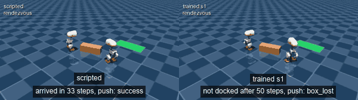
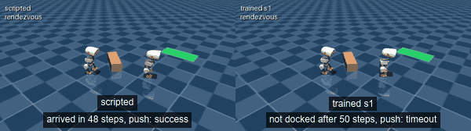
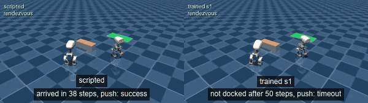
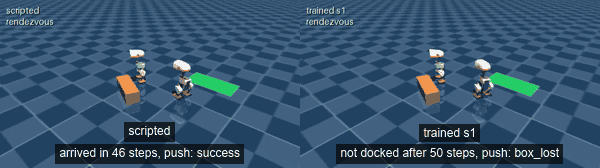
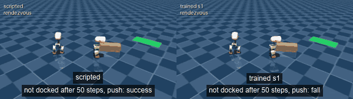
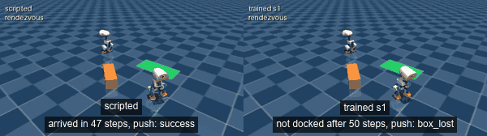
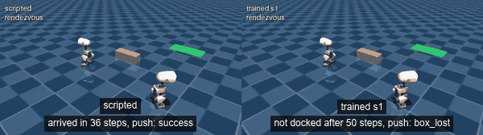
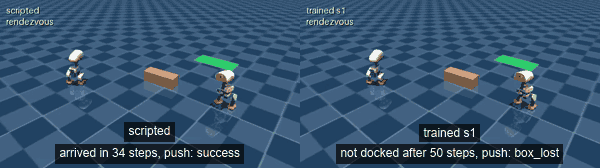
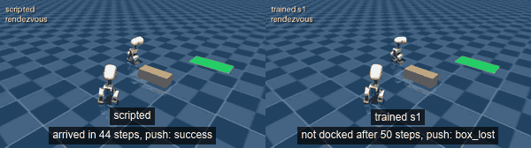
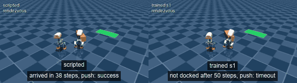

# D2 rendezvous, r3-heading-bonus: heading weight 0.3 -> 0.8 and a heading-holding bonus

*Written 2026-11-23 03:58 by `scripts/rl/run_r3_heading_bonus.py`.*

## Steps

| step | status | finished |
|---|---|---|
| scripted | done | 2026-11-23 03:40:43 |
| s1 | done | 2026-11-23 03:54:04 |
| s2 | skipped (s1 aborted early (docking rate 0% (0/200) at step 400000 (early-stop step 400000)); the same from-scratch reward would likely do the same) |  |
| eval | done | 2026-11-23 03:54:54 |
| gifs | done | 2026-11-23 03:58:18 |

## Setup

- **Why this run:** r2 halved position error but never docked (0/200 at 400k steps, seed 1), and heading error stayed close to random (about 80 deg). Replays showed ducks passing through the right heading and straight back out of it; velstand itself can turn while walking (`experiments/d2-rendezvous/r2-curriculum/heading-investigation.md`).
- **The change (heading part of the reward only; `experiments/d2-rendezvous/r3-heading-bonus.yaml`):** heading weight 0.3 -> 0.8, and a holding bonus of +0.1 per step once a duck's heading error has stayed under 15 deg for 3 consecutive steps (the count resets as soon as it reaches 15 deg). Per duck per step: -1.0 x (distance to its spot / 0.8 m) - 0.8 x (heading error / pi) - 0.02 - 1.0 if it touched the box or its partner, +2.0 the first time within 10 cm of its spot, +0.1 while holding heading; +5 to both on handoff, -2 at 50 steps or on a fall.
- **Same as r2:** the curriculum (15-20 cm starts, widening to 20-40, 40-60, 60-80 cm once the docking rate over 50,000 duck steps exceeds 60%, per worker), observations, 50-step episodes, and early stop (a seed still at 0% docking at 400000 steps aborts; if s1 aborts, s2 is skipped).
- **Checkpoint evaluated:** each seed's best.zip, the 200-start eval with the most arrivals (ties: lower heading error, then position error); s1: step 400000 (0/200 arrived, 50.0 cm, 51.1 deg).
- **r2 row:** r2's seed 1 (400k steps, its only seed) through the same pipeline, from `runs/d2-rendezvous-r2-curriculum/eval_s1/results.json`.
- **Everything else as runs r1 and r2:** PPO from scratch, seeds 1 and 2, configs/copush.yaml's PPO (8 envs, n_steps 256, ent_coef 0.01), the same push policy after handoff (`runs/d2-steering-night5/l2-s2/model.zip`, sha256 `ab82e344b275ce61...`), the same 200-start eval set (`experiments/test_sets/rendezvous_large.json`) and pipeline (rendezvous up to 50 steps, then the push policy for 100 steps), the same "measurable" rule (the paired 95% interval excludes 0 and both seed rates are on the same side of the scripted rate).

**Training curve, s1** (aborted: docking rate 0% (0/200) at step 400000 (early-stop step 400000)) (rendezvous alone on the eval set, 50-step training ending)

| duck steps | arrived | mean steps to arrive | position error (cm) | heading error (deg) | duck-box hits | duck-duck hits | falls |
|---|---|---|---|---|---|---|---|
| 200000 | 0/200 | n/a | 39.4 | 60.9 | 2665 | 235 | 20 |
| 400000 | 0/200 | n/a | 50.0 | 51.1 | 1937 | 437 | 53 |

## Results on the 200 starts (full pipeline)

| controller | arrived in 50 steps | end-to-end push success | push success when arrived | mean steps to arrive | position / heading error at handoff (mean) | duck-box hits (episodes) | duck-duck hits (episodes) |
|---|---|---|---|---|---|---|---|
| scripted | 48.0% (41.2% to 54.9%) | 65.0% (58.2% to 71.3%) | 91 of 96 | 38.5 | 4.9 cm / 26.9 deg | 494 (120) | 150 (21) |
| curriculum (s1) | 0.5% (0.1% to 2.8%) | 3.5% (1.7% to 7.0%) | 0 of 1 | 22.0 | 29.5 cm / 78.7 deg | 4166 (175) | 244 (43) |
| heading bonus (s1) | 0.5% (0.1% to 2.8%) | 1.5% (0.5% to 4.3%) | 1 of 1 | 15.0 | 51.3 cm / 50.8 deg | 2463 (94) | 564 (49) |

**By start kind** (end-to-end push success)

| controller | uniform | near_symmetric | wrong_side |
|---|---|---|---|
| scripted | 70.0% (62.5% to 76.6%) | 45.0% (25.8% to 65.8%) | 45.0% (25.8% to 65.8%) |
| curriculum (s1) | 3.1% (1.3% to 7.1%) | 5.0% (0.9% to 23.6%) | 5.0% (0.9% to 23.6%) |
| heading bonus (s1) | 1.2% (0.3% to 4.4%) | 5.0% (0.9% to 23.6%) | 0.0% (0.0% to 16.1%) |

## Verdict (fixed rule)

- end-to-end push success: trained (seeds averaged) minus scripted -63.5 points (-70.2 to -56.8); seed rates 1.5% vs scripted 65.0%: **no measurable difference** (one seed only)
- arrival within 50 steps: trained (seeds averaged) minus scripted -47.5 points (-54.4 to -40.6); seed rates 0.5% vs scripted 48.0%: **no measurable difference** (one seed only)

## Against curriculum (the previous policy; same 200 starts, paired)

- arrival within 50 steps: heading bonus (seeds averaged) minus curriculum +0.0 points (-1.4 to +1.4); heading bonus seeds 0.5 vs curriculum 0.5: **no measurable difference**
- heading error at handoff (mean of the two ducks): heading bonus (seeds averaged) minus curriculum -27.9 deg (-36.1 to -19.7); heading bonus seeds 50.8 vs curriculum 78.7: **measurable difference (one seed only: preliminary)**
- position error at handoff (mean of the two ducks): heading bonus (seeds averaged) minus curriculum +21.8 cm (+18.7 to +24.9); heading bonus seeds 51.3 vs curriculum 29.5: **measurable difference (one seed only: preliminary)**

## Clips (scripted left, trained s1 right; then the same push policy)

**start000**

**start001**

**start002**

**start003**

**start004**

**start005**

**start007**

**start008**

**start011**

**start013**

Per-episode results: `runs/d2-rendezvous-r3-heading-bonus/eval_<controller>/results.json` (git-ignored); the tables above come from them, and `results/<controller>/results.md` has the full per-kind breakdown.
