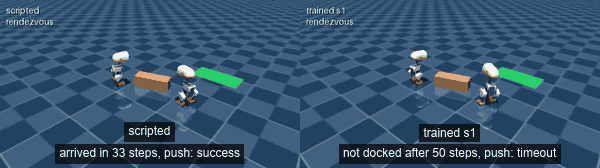
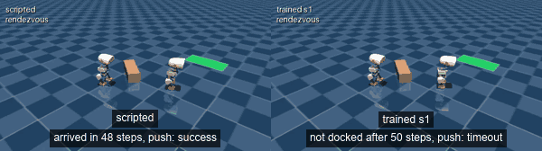
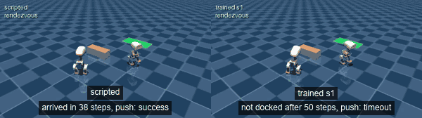
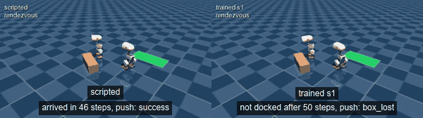
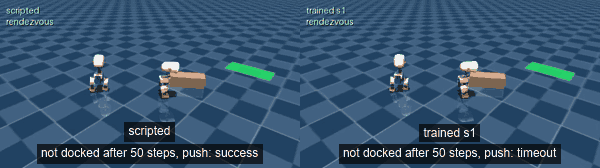
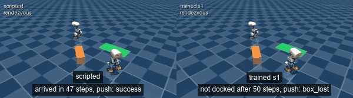
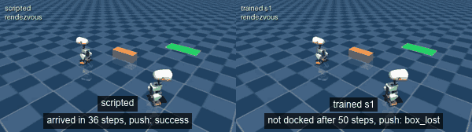
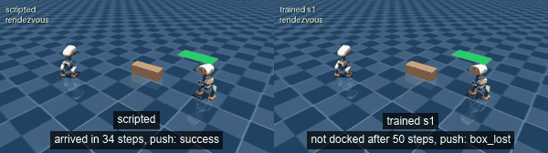
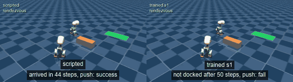
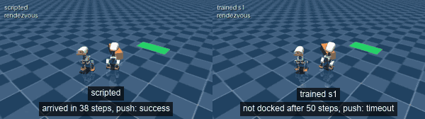

# D2 rendezvous, r4-approach-bonus: a shaped final-approach reward in place of the binary partial and arrival bonuses

*Written 2026-11-23 12:43 by `scripts/rl/run_r4_approach_bonus.py`.*

## Steps

| step | status | finished |
|---|---|---|
| scripted | done | 2026-11-23 12:26:39 |
| s1 | done | 2026-11-23 12:37:57 |
| s2 | skipped (s1 aborted early (docking rate 0% (0/200) at step 400000 (early-stop step 400000)); the same from-scratch reward would likely do the same) |  |
| eval | done | 2026-11-23 12:39:15 |
| gifs | done | 2026-11-23 12:43:23 |

## Setup

- **Why this run:** runs r1-r3 never docked. r3 cut heading error by 28 deg against r2 but position error grew by 22 cm, and in runs r2 and r3 the curriculum never left its first level (15-20 cm starts): the ducks did not dock even from close, so they never collected the arrival bonus and had no pull through the last few cm (`experiments/d2-rendezvous/r3-heading-bonus/SUMMARY.md`).
- **The change (final-approach reward only; `experiments/d2-rendezvous/r4-approach-bonus.yaml`):** +0.5 x max(0, 1 - distance / 0.10 m) x max(0, 1 - heading error / 0.35 rad) per duck per step, nonzero only inside 10 cm and about 20 deg of its spot, replaces the binary +2 (first time within 10 cm) and +5 (handoff) bonuses. Per duck per step: -1.0 x (distance / 0.8 m) - 0.8 x (heading error / pi) - 0.02 - 1.0 if it touched the box or its partner, +0.1 while holding heading (under 15 deg for 3 or more steps), + the approach term; -2 at 50 steps or on a fall. Handoff (both within 3 cm and 15 deg for 0.25 s) still ends the episode, now with no bonus.
- **Same as r3:** heading weight 0.8 and the holding bonus, the curriculum (15-20 cm starts, widening to 20-40, 40-60, 60-80 cm once the training docking rate over 50,000 duck steps exceeds 60%, per worker), observations, 50-step episodes, and early stop (a seed still at 0% docking at 400000 steps aborts; if s1 aborts, s2 is skipped).
- **Checkpoint evaluated:** each seed's best.zip, the 200-start eval with the most arrivals (ties: lower heading error, then position error); s1: step 200000 (0/200 arrived, 37.5 cm, 38.3 deg).
- **r3 and r2 rows:** each run's seed 1 best checkpoint (400k steps; both aborted there and skipped seed 2) through the same pipeline, from `runs/d2-rendezvous-r3-heading-bonus/eval_s1/results.json`, `runs/d2-rendezvous-r2-curriculum/eval_s1/results.json`.
- **Everything else as runs r1 and r2:** PPO from scratch, seeds 1 and 2, configs/copush.yaml's PPO (8 envs, n_steps 256, ent_coef 0.01), the same push policy after handoff (`runs/d2-steering-night5/l2-s2/model.zip`, sha256 `ab82e344b275ce61...`), the same 200-start eval set (`experiments/test_sets/rendezvous_large.json`) and pipeline (rendezvous up to 50 steps, then the push policy for 100 steps), the same "measurable" rule (the paired 95% interval excludes 0 and both seed rates are on the same side of the scripted rate).

**Training curve, s1** (aborted: docking rate 0% (0/200) at step 400000 (early-stop step 400000)) (rendezvous alone on the eval set, 50-step training ending)

| duck steps | arrived | mean steps to arrive | position error (cm) | heading error (deg) | duck-box hits | duck-duck hits | falls |
|---|---|---|---|---|---|---|---|
| 200000 | 0/200 | n/a | 37.5 | 38.3 | 2709 | 152 | 6 |
| 400000 | 0/200 | n/a | 36.4 | 39.3 | 2319 | 310 | 33 |

**Curriculum, s1** (training episodes' docking rate per level, between evals; level 0 = 15-20 cm starts)

| duck steps | level 0 (15-20 cm) |
|---|---|
| 200000 | 5/2769 (0.2%) |
| 400000 | 13/3118 (0.4%) |

- **Advanced past the first level (15-20 cm)?** no: every training episode stayed at level 0 (15-20 cm starts).

## Results on the 200 starts (full pipeline)

| controller | arrived in 50 steps | end-to-end push success | push success when arrived | mean steps to arrive | position / heading error at handoff (mean) | duck-box hits (episodes) | duck-duck hits (episodes) |
|---|---|---|---|---|---|---|---|
| scripted | 48.0% (41.2% to 54.9%) | 65.0% (58.2% to 71.3%) | 91 of 96 | 38.5 | 4.9 cm / 26.9 deg | 494 (120) | 150 (21) |
| heading bonus (s1) | 0.5% (0.1% to 2.8%) | 1.5% (0.5% to 4.3%) | 1 of 1 | 15.0 | 51.3 cm / 50.8 deg | 2463 (94) | 564 (49) |
| curriculum (s1) | 0.5% (0.1% to 2.8%) | 3.5% (1.7% to 7.0%) | 0 of 1 | 22.0 | 29.5 cm / 78.7 deg | 4166 (175) | 244 (43) |
| approach bonus (s1) | 0.0% (0.0% to 1.9%) | 5.0% (2.7% to 9.0%) | 0 of 0 | n/a | 37.6 cm / 38.2 deg | 2742 (111) | 152 (21) |

**By start kind** (end-to-end push success)

| controller | uniform | near_symmetric | wrong_side |
|---|---|---|---|
| scripted | 70.0% (62.5% to 76.6%) | 45.0% (25.8% to 65.8%) | 45.0% (25.8% to 65.8%) |
| heading bonus (s1) | 1.2% (0.3% to 4.4%) | 5.0% (0.9% to 23.6%) | 0.0% (0.0% to 16.1%) |
| curriculum (s1) | 3.1% (1.3% to 7.1%) | 5.0% (0.9% to 23.6%) | 5.0% (0.9% to 23.6%) |
| approach bonus (s1) | 4.4% (2.1% to 8.8%) | 15.0% (5.2% to 36.0%) | 0.0% (0.0% to 16.1%) |

## Verdict (fixed rule)

- end-to-end push success: trained (seeds averaged) minus scripted -60.0 points (-67.1 to -52.9); seed rates 5.0% vs scripted 65.0%: **no measurable difference** (one seed only)
- arrival within 50 steps: trained (seeds averaged) minus scripted -48.0 points (-54.9 to -41.1); seed rates 0.0% vs scripted 48.0%: **no measurable difference** (one seed only)

## Against heading bonus (same 200 starts, paired)

- arrival within 50 steps: approach bonus (seeds averaged) minus heading bonus -0.5 points (-1.5 to +0.5); approach bonus seeds 0.0 vs heading bonus 0.5: **no measurable difference**
- end-to-end push success: approach bonus (seeds averaged) minus heading bonus +3.5 points (-0.0 to +7.0); approach bonus seeds 5.0 vs heading bonus 1.5: **no measurable difference**
- heading error at handoff (mean of the two ducks): approach bonus (seeds averaged) minus heading bonus -12.7 deg (-20.7 to -4.6); approach bonus seeds 38.2 vs heading bonus 50.8: **measurable difference (one seed only: preliminary)**
- position error at handoff (mean of the two ducks): approach bonus (seeds averaged) minus heading bonus -13.7 cm (-16.1 to -11.3); approach bonus seeds 37.6 vs heading bonus 51.3: **measurable difference (one seed only: preliminary)**

## Against curriculum (same 200 starts, paired)

- arrival within 50 steps: approach bonus (seeds averaged) minus curriculum -0.5 points (-1.5 to +0.5); approach bonus seeds 0.0 vs curriculum 0.5: **no measurable difference**
- end-to-end push success: approach bonus (seeds averaged) minus curriculum +1.5 points (-2.5 to +5.5); approach bonus seeds 5.0 vs curriculum 3.5: **no measurable difference**
- heading error at handoff (mean of the two ducks): approach bonus (seeds averaged) minus curriculum -40.6 deg (-49.0 to -32.1); approach bonus seeds 38.2 vs curriculum 78.7: **measurable difference (one seed only: preliminary)**
- position error at handoff (mean of the two ducks): approach bonus (seeds averaged) minus curriculum +8.1 cm (+5.7 to +10.6); approach bonus seeds 37.6 vs curriculum 29.5: **measurable difference (one seed only: preliminary)**

## Clips (scripted left, trained s1 right; then the same push policy)

**start000**

**start001**

**start002**

**start003**

**start004**

**start005**

**start007**

**start008**

**start011**

**start013**

Per-episode results: `runs/d2-rendezvous-r4-approach-bonus/eval_<controller>/results.json` (git-ignored); the tables above come from them, and `results/<controller>/results.md` has the full per-kind breakdown.
