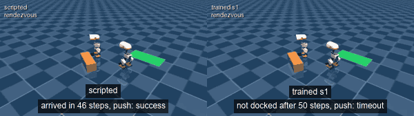
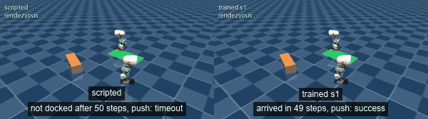
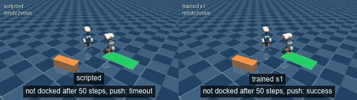
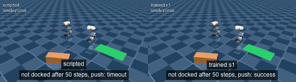
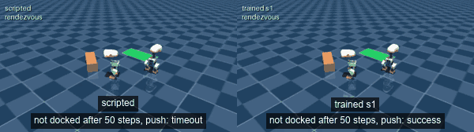
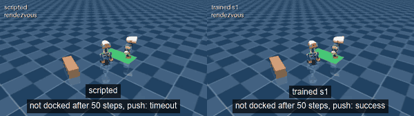
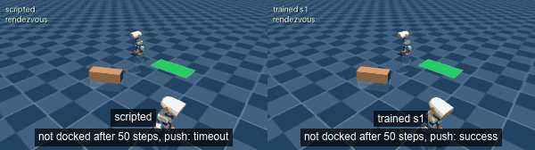
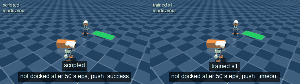
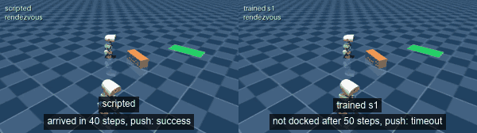
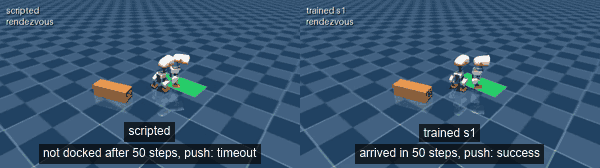

# D2 rendezvous, r5-bc-warmstart: behavioral cloning of the scripted coordinator, then PPO fine-tuning

*Written 2026-11-23 16:56 by `scripts/rl/run_r5_bc_warmstart.py`.*

## Steps

| step | status | finished |
|---|---|---|
| scripted | done | 2026-11-23 13:56:03 |
| collect | done | 2026-11-23 14:16:43 |
| bc | done | 2026-11-23 14:19:49 |
| bc_eval | done | 2026-11-23 14:22:02 |
| s1 | done | 2026-11-23 15:45:30 |
| s2 | done | 2026-11-23 16:46:42 |
| eval | done | 2026-11-23 16:49:42 |
| gifs | done | 2026-11-23 16:56:52 |

## Setup

- **Why this run:** runs r1-r4 trained PPO from random weights and never docked, with four reward designs; in runs r2-r4 the curriculum never left its first level (15-20 cm starts), where training docked under 0.5% of episodes. Random exploration does not find the 3 cm / 15 deg docking target (`experiments/d2-rendezvous/r4-approach-bonus/SUMMARY.md`).
- **The change (the starting policy only):** behavioral cloning (BC) first. The scripted coordinator drives randomized training starts (never the 200 eval starts; 15-80 cm), every step's per-duck (observation, action) pair is recorded, and the same network as runs r1-r4 is trained to output the scripted action (MSE; its value head is also fit to the demonstrations' returns). PPO then fine-tunes from those weights, with the action noise starting at std 0.37 instead of PPO's default 1.0 (`experiments/d2-rendezvous/r5-bc-warmstart.yaml`, `bc:`).
- **Same as r4:** the reward (distance and heading shaping with heading weight 0.8, the holding bonus, the smooth final-approach term, collision and timeout penalties, no partial or arrival bonus), the curriculum (15-20 cm starts, widening to 20-40, 40-60, 60-80 cm once the training docking rate over 50,000 duck steps exceeds 60%, per worker), observations, 50-step episodes, and early stop (a seed still at 0% docking at 400000 PPO steps aborts, the BC phase not counted; if s1 aborts, s2 is skipped).
- **Checkpoint evaluated:** each seed's best.zip, the 200-start eval with the most arrivals (ties: lower heading error, then position error); s1: step 400000 (119/200 arrived, 6.3 cm, 20.7 deg); s2: step 200000 (93/200 arrived, 6.5 cm, 29.4 deg).
- **Runs r4, r3 and r2 rows:** each run's seed 1 best checkpoint (400k steps; all aborted there and skipped seed 2) through the same pipeline, from `runs/d2-rendezvous-r4-approach-bonus/eval_s1/results.json`, `runs/d2-rendezvous-r3-heading-bonus/eval_s1/results.json`, `runs/d2-rendezvous-r2-curriculum/eval_s1/results.json`.
- **Everything else as runs r1 and r2:** PPO from scratch, seeds 1 and 2, configs/copush.yaml's PPO (8 envs, n_steps 256, ent_coef 0.01), the same push policy after handoff (`runs/d2-steering-night5/l2-s2/model.zip`, sha256 `ab82e344b275ce61...`), the same 200-start eval set (`experiments/test_sets/rendezvous_large.json`) and pipeline (rendezvous up to 50 steps, then the push policy for 100 steps), the same "measurable" rule (the paired 95% interval excludes 0 and both seed rates are on the same side of the scripted rate).

**Training curve, s1** (rendezvous alone on the eval set, 50-step training ending)

| duck steps | arrived | mean steps to arrive | position error (cm) | heading error (deg) | duck-box hits | duck-duck hits | falls |
|---|---|---|---|---|---|---|---|
| 0 | 76/200 | 39.2 | 6.1 | 35.2 | 627 | 245 | 1 |
| 200000 | 114/200 | 39.2 | 4.4 | 21.0 | 220 | 226 | 1 |
| 400000 | 119/200 | 38.2 | 6.3 | 20.7 | 268 | 234 | 0 |
| 600000 | 108/200 | 38.9 | 5.9 | 16.6 | 246 | 215 | 1 |
| 800000 | 54/200 | 38.6 | 5.4 | 13.8 | 259 | 196 | 2 |
| 1000000 | 8/200 | 39.9 | 5.8 | 8.9 | 213 | 131 | 0 |
| 1200000 | 11/200 | 35.0 | 6.3 | 9.2 | 214 | 163 | 0 |
| 1400000 | 9/200 | 37.3 | 5.4 | 6.9 | 265 | 155 | 1 |
| 1600000 | 4/200 | 38.8 | 5.2 | 7.9 | 215 | 166 | 2 |
| 1800000 | 2/200 | 44.5 | 6.1 | 9.5 | 160 | 150 | 2 |
| 2000000 | 4/200 | 38.8 | 5.9 | 9.0 | 214 | 136 | 3 |
| 2002944 | 5/200 | 36.6 | 5.6 | 7.4 | 185 | 174 | 3 |

**Training curve, s2** (rendezvous alone on the eval set, 50-step training ending)

| duck steps | arrived | mean steps to arrive | position error (cm) | heading error (deg) | duck-box hits | duck-duck hits | falls |
|---|---|---|---|---|---|---|---|
| 0 | 76/200 | 39.2 | 6.1 | 35.2 | 627 | 245 | 1 |
| 200000 | 93/200 | 38.8 | 6.5 | 29.4 | 628 | 244 | 1 |
| 400000 | 82/200 | 38.2 | 6.3 | 20.8 | 481 | 281 | 2 |
| 600000 | 81/200 | 38.9 | 6.9 | 18.8 | 243 | 223 | 1 |
| 800000 | 71/200 | 38.5 | 7.6 | 20.5 | 399 | 217 | 0 |
| 1000000 | 44/200 | 39.0 | 8.5 | 27.1 | 501 | 251 | 2 |
| 1200000 | 39/200 | 38.5 | 8.3 | 21.2 | 364 | 186 | 0 |
| 1400000 | 28/200 | 38.6 | 8.4 | 20.6 | 417 | 207 | 1 |
| 1600000 | 13/200 | 37.0 | 7.6 | 16.9 | 543 | 152 | 1 |
| 1800000 | 11/200 | 35.7 | 7.3 | 16.4 | 568 | 136 | 1 |
| 2000000 | 17/200 | 40.9 | 6.8 | 13.6 | 618 | 128 | 2 |
| 2002944 | 16/200 | 40.1 | 6.6 | 12.6 | 516 | 125 | 1 |

## Behavioral cloning

- **Demonstrations:** 6000 scripted episodes on randomized training starts (0.15-0.80 m), 546336 per-duck (observation, action) pairs; the scripted coordinator docked 38.6% of them (outcomes {'arrived': 2315, 'timeout': 3640, 'fall': 45}); 20.6 min.
- **Training:** 437400 train / 108936 validation pairs (split by episode, 1200 validation episodes); stopped after 300 epochs (the epoch limit); best epoch 298: validation action MSE 0.0560 (train 0.0551; for scale, the scripted actions' variance is 0.5731), validation value MSE 15.36.

**BC loss curve** (every epoch in `results/bc/loss.jsonl`)

| epoch | train action MSE | val action MSE | train value MSE | val value MSE |
|---|---|---|---|---|
| 1 | 0.3368 | 0.3339 | 187.35 | 180.25 |
| 31 | 0.1041 | 0.1025 | 24.41 | 21.60 |
| 61 | 0.0855 | 0.0847 | 20.86 | 18.60 |
| 91 | 0.0762 | 0.0758 | 19.58 | 17.51 |
| 121 | 0.0701 | 0.0701 | 18.72 | 16.77 |
| 151 | 0.0663 | 0.0667 | 18.12 | 16.42 |
| 181 | 0.0628 | 0.0633 | 17.58 | 16.12 |
| 211 | 0.0603 | 0.0611 | 17.14 | 15.80 |
| 241 | 0.0586 | 0.0594 | 16.86 | 15.67 |
| 271 | 0.0566 | 0.0575 | 16.59 | 15.49 |
| 298 | 0.0551 | 0.0560 | 16.40 | 15.36 |
| 300 | 0.0552 | 0.0561 | 16.41 | 15.32 |

- **BC alone, before PPO (full pipeline, 200 starts):** docked within 50 steps 44.0% (37.3% to 50.9%), end-to-end push success 56.0% (49.1% to 62.7%), position / heading error at handoff 6.2 cm / 36.1 deg.

**Curriculum, s1** (training episodes' docking rate per level, between evals; level 0 = 15-20 cm starts)

| duck steps | level 0 (15-20 cm) | level 1 (20-40 cm) |
|---|---|---|
| 0 |  |  |
| 200000 | 715/2213 (32.3%) |  |
| 400000 | 1568/2414 (65.0%) |  |
| 600000 | 1686/2494 (67.6%) |  |
| 800000 | 1399/2440 (57.3%) |  |
| 1000000 | 116/296 (39.2%) | 690/1949 (35.4%) |
| 1200000 | 51/271 (18.8%) | 336/1855 (18.1%) |
| 1400000 | 51/277 (18.4%) | 374/1880 (19.9%) |
| 1600000 | 42/279 (15.1%) | 278/1856 (15.0%) |
| 1800000 | 57/287 (19.9%) | 311/1875 (16.6%) |
| 2000000 | 48/285 (16.8%) | 270/1857 (14.5%) |
| 2002944 | 1/4 (25.0%) | 2/26 (7.7%) |

- **Advanced past the first level (15-20 cm)?** yes: training episodes reached level 1 (20-40 cm); 7 level changes across workers.

**Curriculum, s2** (training episodes' docking rate per level, between evals; level 0 = 15-20 cm starts)

| duck steps | level 0 (15-20 cm) |
|---|---|
| 0 |  |
| 200000 | 432/2152 (20.1%) |
| 400000 | 1182/2336 (50.6%) |
| 600000 | 1349/2448 (55.1%) |
| 800000 | 1169/2399 (48.7%) |
| 1000000 | 980/2360 (41.5%) |
| 1200000 | 899/2332 (38.6%) |
| 1400000 | 716/2294 (31.2%) |
| 1600000 | 584/2237 (26.1%) |
| 1800000 | 384/2190 (17.5%) |
| 2000000 | 477/2217 (21.5%) |
| 2002944 | 8/32 (25.0%) |

- **Advanced past the first level (15-20 cm)?** no: every training episode stayed at level 0 (15-20 cm starts).

## Results on the 200 starts (full pipeline)

| controller | arrived in 50 steps | end-to-end push success | push success when arrived | mean steps to arrive | position / heading error at handoff (mean) | duck-box hits (episodes) | duck-duck hits (episodes) |
|---|---|---|---|---|---|---|---|
| scripted | 48.0% (41.2% to 54.9%) | 65.0% (58.2% to 71.3%) | 91 of 96 | 38.5 | 4.9 cm / 26.9 deg | 494 (120) | 150 (21) |
| approach bonus (s1) | 0.0% (0.0% to 1.9%) | 5.0% (2.7% to 9.0%) | 0 of 0 | n/a | 37.6 cm / 38.2 deg | 2742 (111) | 152 (21) |
| heading bonus (s1) | 0.5% (0.1% to 2.8%) | 1.5% (0.5% to 4.3%) | 1 of 1 | 15.0 | 51.3 cm / 50.8 deg | 2463 (94) | 564 (49) |
| curriculum (s1) | 0.5% (0.1% to 2.8%) | 3.5% (1.7% to 7.0%) | 0 of 1 | 22.0 | 29.5 cm / 78.7 deg | 4166 (175) | 244 (43) |
| BC alone (before PPO) | 44.0% (37.3% to 50.9%) | 56.0% (49.1% to 62.7%) | 84 of 88 | 38.8 | 6.2 cm / 36.1 deg | 599 (110) | 251 (23) |
| BC warm start (s1) | 64.5% (57.7% to 70.8%) | 71.5% (64.9% to 77.3%) | 115 of 129 | 37.8 | 6.6 cm / 21.2 deg | 260 (27) | 234 (18) |
| BC warm start (s2) | 52.0% (45.1% to 58.8%) | 62.5% (55.6% to 68.9%) | 96 of 104 | 37.9 | 6.6 cm / 29.7 deg | 562 (80) | 244 (18) |

**By start kind** (end-to-end push success)

| controller | uniform | near_symmetric | wrong_side |
|---|---|---|---|
| scripted | 70.0% (62.5% to 76.6%) | 45.0% (25.8% to 65.8%) | 45.0% (25.8% to 65.8%) |
| approach bonus (s1) | 4.4% (2.1% to 8.8%) | 15.0% (5.2% to 36.0%) | 0.0% (0.0% to 16.1%) |
| heading bonus (s1) | 1.2% (0.3% to 4.4%) | 5.0% (0.9% to 23.6%) | 0.0% (0.0% to 16.1%) |
| curriculum (s1) | 3.1% (1.3% to 7.1%) | 5.0% (0.9% to 23.6%) | 5.0% (0.9% to 23.6%) |
| BC alone (before PPO) | 62.5% (54.8% to 69.6%) | 35.0% (18.1% to 56.7%) | 25.0% (11.2% to 46.9%) |
| BC warm start (s1) | 72.5% (65.1% to 78.8%) | 70.0% (48.1% to 85.5%) | 65.0% (43.3% to 81.9%) |
| BC warm start (s2) | 68.8% (61.2% to 75.4%) | 45.0% (25.8% to 65.8%) | 30.0% (14.5% to 51.9%) |

## Verdict (fixed rule)

- end-to-end push success: trained (seeds averaged) minus scripted +2.0 points (-3.9 to +7.9); seed rates 71.5%, 62.5% vs scripted 65.0%: **no measurable difference**
- arrival within 50 steps: trained (seeds averaged) minus scripted +10.2 points (+4.8 to +15.7); seed rates 64.5%, 52.0% vs scripted 48.0%: **trained is measurably better**

## Against BC alone (same 200 starts, paired)

- arrival within 50 steps: BC warm start (seeds averaged) minus BC alone +14.2 points (+9.4 to +19.1); BC warm start seeds 64.5, 52.0 vs BC alone 44.0: **measurable difference**
- end-to-end push success: BC warm start (seeds averaged) minus BC alone +11.0 points (+5.3 to +16.7); BC warm start seeds 71.5, 62.5 vs BC alone 56.0: **measurable difference**
- heading error at handoff (mean of the two ducks): BC warm start (seeds averaged) minus BC alone -10.7 deg (-14.1 to -7.2); BC warm start seeds 21.2, 29.7 vs BC alone 36.1: **measurable difference**
- position error at handoff (mean of the two ducks): BC warm start (seeds averaged) minus BC alone +0.4 cm (-0.6 to +1.3); BC warm start seeds 6.6, 6.6 vs BC alone 6.2: **no measurable difference**

## Against approach bonus (same 200 starts, paired)

- arrival within 50 steps: BC warm start (seeds averaged) minus approach bonus +58.2 points (+52.2 to +64.3); BC warm start seeds 64.5, 52.0 vs approach bonus 0.0: **measurable difference**
- end-to-end push success: BC warm start (seeds averaged) minus approach bonus +62.0 points (+56.0 to +68.0); BC warm start seeds 71.5, 62.5 vs approach bonus 5.0: **measurable difference**
- heading error at handoff (mean of the two ducks): BC warm start (seeds averaged) minus approach bonus -12.7 deg (-18.2 to -7.3); BC warm start seeds 21.2, 29.7 vs approach bonus 38.2: **measurable difference**
- position error at handoff (mean of the two ducks): BC warm start (seeds averaged) minus approach bonus -31.0 cm (-33.4 to -28.7); BC warm start seeds 6.6, 6.6 vs approach bonus 37.6: **measurable difference**

## Against heading bonus (same 200 starts, paired)

- arrival within 50 steps: BC warm start (seeds averaged) minus heading bonus +57.8 points (+51.7 to +63.8); BC warm start seeds 64.5, 52.0 vs heading bonus 0.5: **measurable difference**
- end-to-end push success: BC warm start (seeds averaged) minus heading bonus +65.5 points (+60.0 to +71.0); BC warm start seeds 71.5, 62.5 vs heading bonus 1.5: **measurable difference**
- heading error at handoff (mean of the two ducks): BC warm start (seeds averaged) minus heading bonus -25.4 deg (-32.5 to -18.3); BC warm start seeds 21.2, 29.7 vs heading bonus 50.8: **measurable difference**
- position error at handoff (mean of the two ducks): BC warm start (seeds averaged) minus heading bonus -44.7 cm (-47.6 to -41.8); BC warm start seeds 6.6, 6.6 vs heading bonus 51.3: **measurable difference**

## Against curriculum (same 200 starts, paired)

- arrival within 50 steps: BC warm start (seeds averaged) minus curriculum +57.8 points (+51.7 to +63.8); BC warm start seeds 64.5, 52.0 vs curriculum 0.5: **measurable difference**
- end-to-end push success: BC warm start (seeds averaged) minus curriculum +63.5 points (+57.7 to +69.3); BC warm start seeds 71.5, 62.5 vs curriculum 3.5: **measurable difference**
- heading error at handoff (mean of the two ducks): BC warm start (seeds averaged) minus curriculum -53.3 deg (-61.6 to -45.0); BC warm start seeds 21.2, 29.7 vs curriculum 78.7: **measurable difference**
- position error at handoff (mean of the two ducks): BC warm start (seeds averaged) minus curriculum -22.9 cm (-24.7 to -21.1); BC warm start seeds 6.6, 6.6 vs curriculum 29.5: **measurable difference**

## Clips (scripted left, trained s1 right; then the same push policy)

**start003**

**start006**

**start009**

**start010**

**start015**

**start016**

**start018**

**start027**

**start028**

**start035**

Per-episode results: `runs/d2-rendezvous-r5-bc-warmstart/eval_<controller>/results.json` (git-ignored); the tables above come from them, and `results/<controller>/results.md` has the full per-kind breakdown.
