# D2 rendezvous, r6-dock-payout: a docking payout so docking always beats hovering near the spot

*Written 2026-11-23 19:42 by `scripts/rl/run_r6_dock_payout.py`.*

## Steps

| step | status | finished |
|---|---|---|
| scripted | done | 2026-11-23 17:17:02 |
| collect | done | 2026-11-23 17:36:01 |
| bc | done | 2026-11-23 17:44:55 |
| bc_eval | done | 2026-11-23 17:46:16 |
| s1 | done | 2026-11-23 18:42:02 |
| s2 | done | 2026-11-23 19:35:45 |
| eval | done | 2026-11-23 19:37:36 |
| gifs | done | 2026-11-23 19:42:04 |

## Checkpoint selection (official r6 numbers)

r6 first picked each seed's best.zip by most dockings on the test set (`experiments/test_sets/rendezvous_large.json`), the same 200 starts the results are reported on. That is selection on the test set (AGENTS.md: checkpoints are picked on a separate check set). The numbers in this section replace the test-set pick and are the official r6 numbers.

- **Check set:** `experiments/test_sets/rendezvous_check.json`, 200 new starts from the same distribution as the test set (same box range as a Latin hypercube, same 0.2-0.8 m duck distances and any bearing and heading, the same 160 uniform / 20 near-symmetric / 20 wrong-side split), with their own seeds (box poses 20261124, ducks 20261125, episode seeds 20000 + i). No start and no box pose repeats a test-set one (checked when the set is made, and by a test).
- **Candidates:** training kept only the newest checkpoint, so the every-200k checkpoints are gone. What is left per seed is the final checkpoint (step 2002944) and best.zip (the old test-set pick). The final checkpoint is the only one not chosen with the test set, so it is the official pick (as the re-selection plan says when intermediate checkpoints were not saved). best.zip's check-set score is shown for information.

**Check set, rendezvous alone** (50 steps, the training ending, as the training evals)

| seed | checkpoint | docked | position / heading error (mean) | used |
|---|---|---|---|---|
| s1 | final, step 2002944 (also the old best.zip) | 82.0% (76.1% to 86.7%) | 3.0 cm / 8.0 deg | **yes** |
| s2 | final, step 2002944 | 72.5% (65.9% to 78.2%) | 2.9 cm / 6.5 deg | **yes** |
| s2 | old best.zip, step 2000000 (picked on the test set) | 69.0% (62.3% to 75.0%) | 3.5 cm / 9.0 deg | no |

- **s1:** step 2002944, unchanged (the old pick was already the final checkpoint); **s2:** step 2002944, changed from step 2000000.

**Test set, full pipeline** (200 starts; rendezvous up to 50 steps, then the frozen push policy; 95% intervals)

| controller | docked in 50 steps | end-to-end push success | position error at handoff | heading error at handoff |
|---|---|---|---|---|
| **dock payout s1, check-set pick = final (official)** | 87.0% (81.6% to 91.0%) | 90.0% (85.1% to 93.4%) | 2.6 cm (2.1 to 3.0) | 5.9 deg (4.2 to 7.5) |
| **dock payout s2, check-set pick = final (official)** | 75.0% (68.6% to 80.5%) | 85.5% (80.0% to 89.7%) | 3.7 cm (2.9 to 4.4) | 7.5 deg (5.6 to 9.5) |
| dock payout s1, old test-set pick | same checkpoint as the final one; re-run gives identical episodes | | | |
| dock payout s2, old test-set pick (step 2000000, superseded) | 78.5% (72.3% to 83.6%) | 86.5% (81.1% to 90.6%) | 3.6 cm (2.8 to 4.3) | 7.8 deg (5.5 to 10.2) |
| scripted | 48.0% (41.2% to 54.9%) | 65.0% (58.2% to 71.3%) | 4.9 cm (4.3 to 5.5) | 26.9 deg (22.8 to 31.0) |
| r5 BC warm start s1 (test-set pick, not re-picked) | 64.5% (57.7% to 70.8%) | 71.5% (64.9% to 77.3%) | 6.6 cm (5.2 to 8.0) | 21.2 deg (16.5 to 26.0) |
| r5 BC warm start s2 (test-set pick, not re-picked) | 52.0% (45.1% to 58.8%) | 62.5% (55.6% to 68.9%) | 6.6 cm (5.5 to 7.7) | 29.7 deg (24.7 to 34.6) |

Position and heading error: mean over the 200 starts of the two ducks' mean, with a 95% interval for that mean.

**Against scripted (the fixed rule: the paired interval excludes 0 and both seed rates are on the same side)** (same 200 starts, paired; seeds averaged per start)

- docked in 50 steps: dock payout minus scripted +33.0 points (+25.8 to +40.2); seeds 87.0, 75.0 vs scripted 48.0: **measurably better**
- end-to-end push success: dock payout minus scripted +22.8 points (+15.7 to +29.8); seeds 90.0, 85.5 vs scripted 65.0: **measurably better**
- heading error at handoff: dock payout minus scripted -20.2 deg (-24.2 to -16.3); seeds 5.9, 7.5 vs scripted 26.9: **measurable difference**
- position error at handoff: dock payout minus scripted -1.8 cm (-2.5 to -1.0); seeds 2.6, 3.7 vs scripted 4.9: **measurable difference**

**Against r5, BC warm start (both seeds averaged)** (same 200 starts, paired; seeds averaged per start)

- docked in 50 steps: dock payout minus r5 +22.8 points (+16.2 to +29.3); seeds 87.0, 75.0 vs r5 58.2: **measurable difference**
- end-to-end push success: dock payout minus r5 +20.8 points (+15.2 to +26.3); seeds 90.0, 85.5 vs r5 67.0: **measurable difference**
- heading error at handoff: dock payout minus r5 -18.7 deg (-23.0 to -14.5); seeds 5.9, 7.5 vs r5 25.4: **measurable difference**
- position error at handoff: dock payout minus r5 -3.4 cm (-4.6 to -2.3); seeds 2.6, 3.7 vs r5 6.6: **measurable difference**

r5 has the same flaw: its best.zip was also picked on the test set, and its checkpoints were not re-picked (they are gone too, and only its final checkpoints remain). Its numbers above are its old test-set picks, which favor r5, so the gap to r5 is if anything understated.

*Everything below is the run as first written: its seed rows use best.zip picked on the test set (s1 is the same checkpoint as the official pick; s2's row is superseded by the table above).*

## Setup

- **Why this run:** r5 (BC warm start, then PPO) was the first run to dock, 64.5% (s1) and 52.0% (s2) on the 200 starts, but both seeds peaked early (s1 119/200 at 400k PPO steps, s2 93/200 at 200k) and collapsed (s1 8/200 at 1M, s2 17/200 at 2M) while heading error kept falling. Docking ends the episode and paid nothing, while staying near the spot earns up to +0.5 per step from the approach term (`experiments/d2-rendezvous/r5-bc-warmstart/SUMMARY.md`).
- **The change (reward):** a docking payout. When both ducks dock (the episode ends), each also gets 0.5 x (50 - steps taken), the approach term's maximum for every step it gives up, so docking at step 20 pays 15. Hovering just outside the docking tolerance (3 cm / 15 deg) earns under 0.45 per step (approach term plus holding bonus, minus the time and distance terms) and then -2 at the time limit, so docking always pays more (`experiments/d2-rendezvous/r6-dock-payout.yaml`, `dock_payout`).
- **Also changed (BC only):** max_epochs 300 -> 1000 and patience 15 -> 50, since r5's BC hit its epoch limit while validation loss was still falling. This is a second change: the BC alone row against r5's shows its effect by itself, but PPO results against r5 mix both changes.
- **Same as r5:** the demonstrations (same scripted coordinator, seed and settings), the BC warm start (action noise std 0.37 at the start of PPO), the rest of the reward (distance and heading shaping with heading weight 0.8, the holding bonus, the smooth final-approach term, collision and timeout penalties, no partial or arrival bonus), the curriculum (15-20 cm starts, widening to 20-40, 40-60, 60-80 cm once the training docking rate over 50,000 duck steps exceeds 60%, per worker), observations, 50-step episodes, and early stop (a seed still at 0% docking at 400000 PPO steps aborts, the BC phase not counted; if s1 aborts, s2 is skipped).
- **Checkpoint evaluated (superseded, see Checkpoint selection above):** each seed's best.zip, the 200-start eval with the most arrivals (ties: lower heading error, then position error); s1: step 2002944 (171/200 arrived, 2.3 cm, 6.1 deg); s2: step 2000000 (147/200 arrived, 3.4 cm, 6.7 deg).
- **Earlier rows:** r5's two seeds and its BC alone; r4, r3 and r2's seed 1 (each aborted at 400k steps and skipped seed 2); all best checkpoints through the same pipeline, from `runs/d2-rendezvous-r5-bc-warmstart/eval_s1/results.json`, `runs/d2-rendezvous-r5-bc-warmstart/eval_s2/results.json`, `runs/d2-rendezvous-r5-bc-warmstart/eval_bc/results.json`, `runs/d2-rendezvous-r4-approach-bonus/eval_s1/results.json`, `runs/d2-rendezvous-r3-heading-bonus/eval_s1/results.json`, `runs/d2-rendezvous-r2-curriculum/eval_s1/results.json`.
- **Everything else as earlier runs:** seeds 1 and 2, configs/copush.yaml's PPO (8 envs, n_steps 256, ent_coef 0.01), the same push policy after handoff (`runs/d2-steering-night5/l2-s2/model.zip`, sha256 `ab82e344b275ce61...`), the same 200-start eval set (`experiments/test_sets/rendezvous_large.json`) and pipeline (rendezvous up to 50 steps, then the push policy for 100 steps), the same "measurable" rule (the paired 95% interval excludes 0 and both seed rates are on the same side of the scripted rate).

**Training curve, s1** (rendezvous alone on the eval set, 50-step training ending)

| duck steps | arrived | mean steps to arrive | position error (cm) | heading error (deg) | duck-box hits | duck-duck hits | falls |
|---|---|---|---|---|---|---|---|
| 0 | 72/200 | 39.2 | 5.7 | 30.9 | 521 | 185 | 0 |
| 200000 | 105/200 | 38.8 | 4.9 | 21.8 | 438 | 234 | 1 |
| 400000 | 126/200 | 38.7 | 4.2 | 16.2 | 326 | 173 | 1 |
| 600000 | 115/200 | 39.7 | 6.8 | 19.2 | 105 | 145 | 0 |
| 800000 | 109/200 | 39.4 | 7.0 | 18.7 | 154 | 167 | 0 |
| 1000000 | 105/200 | 38.5 | 9.1 | 20.2 | 103 | 178 | 1 |
| 1200000 | 129/200 | 38.3 | 8.1 | 17.0 | 169 | 112 | 1 |
| 1400000 | 148/200 | 36.9 | 4.7 | 11.6 | 152 | 120 | 1 |
| 1600000 | 152/200 | 36.9 | 3.4 | 8.4 | 246 | 111 | 0 |
| 1800000 | 166/200 | 35.0 | 3.3 | 6.2 | 321 | 125 | 4 |
| 2000000 | 162/200 | 34.2 | 2.5 | 6.6 | 513 | 167 | 2 |
| 2002944 | 171/200 | 34.5 | 2.3 | 6.1 | 351 | 116 | 4 |

**Training curve, s2** (rendezvous alone on the eval set, 50-step training ending)

| duck steps | arrived | mean steps to arrive | position error (cm) | heading error (deg) | duck-box hits | duck-duck hits | falls |
|---|---|---|---|---|---|---|---|
| 0 | 72/200 | 39.2 | 5.7 | 30.9 | 521 | 185 | 0 |
| 200000 | 58/200 | 40.7 | 7.0 | 27.1 | 715 | 290 | 2 |
| 400000 | 81/200 | 40.8 | 6.0 | 19.3 | 550 | 222 | 2 |
| 600000 | 80/200 | 39.7 | 9.0 | 24.0 | 647 | 234 | 0 |
| 800000 | 83/200 | 38.6 | 8.1 | 22.0 | 441 | 267 | 2 |
| 1000000 | 87/200 | 38.0 | 6.8 | 17.9 | 505 | 189 | 0 |
| 1200000 | 103/200 | 37.7 | 5.5 | 15.4 | 288 | 112 | 0 |
| 1400000 | 130/200 | 36.6 | 4.3 | 11.0 | 191 | 132 | 1 |
| 1600000 | 140/200 | 36.0 | 3.5 | 8.7 | 277 | 147 | 3 |
| 1800000 | 145/200 | 34.7 | 3.2 | 6.0 | 84 | 101 | 1 |
| 2000000 | 147/200 | 34.4 | 3.4 | 6.7 | 219 | 95 | 2 |
| 2002944 | 138/200 | 33.6 | 3.5 | 7.2 | 114 | 138 | 1 |

## Did docking stay stable? (r5 collapsed after its peak)

r5 for reference: s1 peaked at 119/200 (400k) and fell to 8/200 by 1M; s2 peaked at 93/200 (200k) and ended at 17/200 (2M). Here, on the same 200-start training evals:

- **s1:** docking peaked at 171/200 (step 2002944) and was 171/200 at the last eval (step 2002944): still at its peak at the last eval.
- **s2:** docking peaked at 147/200 (step 2000000) and was 138/200 at the last eval (step 2002944), lowest after the peak 138/200 (step 2002944): stayed near its peak (the last eval's 95% interval overlaps the peak's).

## Behavioral cloning

- **Demonstrations:** 6000 scripted episodes on randomized training starts (0.15-0.80 m), 546336 per-duck (observation, action) pairs; the scripted coordinator docked 38.6% of them (outcomes {'arrived': 2315, 'timeout': 3640, 'fall': 45}); 19.0 min.
- **Training:** 437400 train / 108936 validation pairs (split by episode, 1200 validation episodes); stopped after 1000 epochs (the epoch limit); best epoch 992: validation action MSE 0.0447 (train 0.0430; for scale, the scripted actions' variance is 0.5731), validation value MSE 19.40.

**BC loss curve** (every epoch in `results/bc/loss.jsonl`)

| epoch | train action MSE | val action MSE | train value MSE | val value MSE |
|---|---|---|---|---|
| 1 | 0.3368 | 0.3339 | 196.29 | 189.17 |
| 101 | 0.0740 | 0.0737 | 24.67 | 22.48 |
| 201 | 0.0611 | 0.0618 | 22.63 | 21.03 |
| 301 | 0.0551 | 0.0560 | 21.64 | 20.43 |
| 401 | 0.0514 | 0.0525 | 20.90 | 20.18 |
| 501 | 0.0491 | 0.0504 | 20.41 | 19.87 |
| 601 | 0.0471 | 0.0486 | 20.03 | 19.68 |
| 701 | 0.0459 | 0.0474 | 19.73 | 19.52 |
| 801 | 0.0447 | 0.0462 | 19.62 | 19.56 |
| 901 | 0.0439 | 0.0456 | 19.36 | 19.38 |
| 992 | 0.0430 | 0.0447 | 19.23 | 19.40 |
| 1000 | 0.0431 | 0.0449 | 19.18 | 19.36 |

- **BC alone, before PPO (full pipeline, 200 starts):** docked within 50 steps 44.5% (37.8% to 51.4%), end-to-end push success 61.0% (54.1% to 67.5%), position / heading error at handoff 5.8 cm / 31.6 deg.

**Curriculum, s1** (training episodes' docking rate per level, between evals; level 0 = 15-20 cm starts)

| duck steps | level 0 (15-20 cm) | level 1 (20-40 cm) | level 2 (40-60 cm) | level 3 (60-80 cm) |
|---|---|---|---|---|
| 0 |  |  |  |  |
| 200000 | 616/2198 (28.0%) |  |  |  |
| 400000 | 1559/2407 (64.8%) |  |  |  |
| 600000 | 1728/2505 (69.0%) |  |  |  |
| 800000 | 1849/2531 (73.1%) |  |  |  |
| 1000000 | 9/11 (81.8%) | 1714/2532 (67.7%) |  |  |
| 1200000 |  | 2103/2717 (77.4%) |  |  |
| 1400000 |  | 9/11 (81.8%) | 1956/2501 (78.2%) |  |
| 1600000 |  |  | 2142/2603 (82.3%) |  |
| 1800000 |  |  | 16/19 (84.2%) | 1751/2332 (75.1%) |
| 2000000 |  |  |  | 2108/2481 (85.0%) |
| 2002944 |  |  |  | 32/37 (86.5%) |

- **Advanced past the first level (15-20 cm)?** yes: training episodes reached level 3 (60-80 cm); 24 level changes across workers.

**Curriculum, s2** (training episodes' docking rate per level, between evals; level 0 = 15-20 cm starts)

| duck steps | level 0 (15-20 cm) | level 1 (20-40 cm) | level 2 (40-60 cm) | level 3 (60-80 cm) |
|---|---|---|---|---|
| 0 |  |  |  |  |
| 200000 | 387/2163 (17.9%) |  |  |  |
| 400000 | 1187/2340 (50.7%) |  |  |  |
| 600000 | 1586/2521 (62.9%) |  |  |  |
| 800000 | 1720/2611 (65.9%) |  |  |  |
| 1000000 | 7/13 (53.8%) | 1632/2520 (64.8%) |  |  |
| 1200000 |  | 1765/2603 (67.8%) |  |  |
| 1400000 |  | 10/16 (62.5%) | 1602/2376 (67.4%) |  |
| 1600000 |  |  | 1962/2524 (77.7%) |  |
| 1800000 |  |  | 16/19 (84.2%) | 1478/2258 (65.5%) |
| 2000000 |  |  |  | 1790/2383 (75.1%) |
| 2002944 |  |  |  | 31/38 (81.6%) |

- **Advanced past the first level (15-20 cm)?** yes: training episodes reached level 3 (60-80 cm); 24 level changes across workers.

## Results on the 200 starts (full pipeline)

| controller | arrived in 50 steps | end-to-end push success | push success when arrived | mean steps to arrive | position / heading error at handoff (mean) | duck-box hits (episodes) | duck-duck hits (episodes) |
|---|---|---|---|---|---|---|---|
| scripted | 48.0% (41.2% to 54.9%) | 65.0% (58.2% to 71.3%) | 91 of 96 | 38.5 | 4.9 cm / 26.9 deg | 494 (120) | 150 (21) |
| BC warm start (s1) | 64.5% (57.7% to 70.8%) | 71.5% (64.9% to 77.3%) | 115 of 129 | 37.8 | 6.6 cm / 21.2 deg | 260 (27) | 234 (18) |
| BC warm start (s2) | 52.0% (45.1% to 58.8%) | 62.5% (55.6% to 68.9%) | 96 of 104 | 37.9 | 6.6 cm / 29.7 deg | 562 (80) | 244 (18) |
| r5 BC alone (300 epochs) | 44.0% (37.3% to 50.9%) | 56.0% (49.1% to 62.7%) | 84 of 88 | 38.8 | 6.2 cm / 36.1 deg | 599 (110) | 251 (23) |
| approach bonus (s1) | 0.0% (0.0% to 1.9%) | 5.0% (2.7% to 9.0%) | 0 of 0 | n/a | 37.6 cm / 38.2 deg | 2742 (111) | 152 (21) |
| heading bonus (s1) | 0.5% (0.1% to 2.8%) | 1.5% (0.5% to 4.3%) | 1 of 1 | 15.0 | 51.3 cm / 50.8 deg | 2463 (94) | 564 (49) |
| curriculum (s1) | 0.5% (0.1% to 2.8%) | 3.5% (1.7% to 7.0%) | 0 of 1 | 22.0 | 29.5 cm / 78.7 deg | 4166 (175) | 244 (43) |
| BC alone (before PPO) | 44.5% (37.8% to 51.4%) | 61.0% (54.1% to 67.5%) | 82 of 89 | 39.3 | 5.8 cm / 31.6 deg | 494 (114) | 185 (19) |
| dock payout (s1) | 87.0% (81.6% to 91.0%) | 90.0% (85.1% to 93.4%) | 163 of 174 | 33.3 | 2.6 cm / 5.9 deg | 335 (48) | 117 (19) |
| dock payout (s2) | 78.5% (72.3% to 83.6%) | 86.5% (81.1% to 90.6%) | 149 of 157 | 33.0 | 3.6 cm / 7.8 deg | 258 (33) | 97 (21) |

**By start kind** (end-to-end push success)

| controller | uniform | near_symmetric | wrong_side |
|---|---|---|---|
| scripted | 70.0% (62.5% to 76.6%) | 45.0% (25.8% to 65.8%) | 45.0% (25.8% to 65.8%) |
| BC warm start (s1) | 72.5% (65.1% to 78.8%) | 70.0% (48.1% to 85.5%) | 65.0% (43.3% to 81.9%) |
| BC warm start (s2) | 68.8% (61.2% to 75.4%) | 45.0% (25.8% to 65.8%) | 30.0% (14.5% to 51.9%) |
| r5 BC alone (300 epochs) | 62.5% (54.8% to 69.6%) | 35.0% (18.1% to 56.7%) | 25.0% (11.2% to 46.9%) |
| approach bonus (s1) | 4.4% (2.1% to 8.8%) | 15.0% (5.2% to 36.0%) | 0.0% (0.0% to 16.1%) |
| heading bonus (s1) | 1.2% (0.3% to 4.4%) | 5.0% (0.9% to 23.6%) | 0.0% (0.0% to 16.1%) |
| curriculum (s1) | 3.1% (1.3% to 7.1%) | 5.0% (0.9% to 23.6%) | 5.0% (0.9% to 23.6%) |
| BC alone (before PPO) | 67.5% (59.9% to 74.3%) | 35.0% (18.1% to 56.7%) | 35.0% (18.1% to 56.7%) |
| dock payout (s1) | 91.2% (85.8% to 94.7%) | 90.0% (69.9% to 97.2%) | 80.0% (58.4% to 91.9%) |
| dock payout (s2) | 85.6% (79.4% to 90.2%) | 85.0% (64.0% to 94.8%) | 95.0% (76.4% to 99.1%) |

## Verdict (fixed rule)

- end-to-end push success: trained (seeds averaged) minus scripted +23.2 points (+16.0 to +30.5); seed rates 90.0%, 86.5% vs scripted 65.0%: **trained is measurably better**
- arrival within 50 steps: trained (seeds averaged) minus scripted +34.8 points (+27.4 to +42.1); seed rates 87.0%, 78.5% vs scripted 48.0%: **trained is measurably better**

## BC alone: 1000-epoch limit (this run) against r5's 300 (same 200 starts, paired)

- arrival within 50 steps: BC alone minus r5 BC alone +0.5 points (-3.8 to +4.8); BC alone 44.5 vs r5 BC alone 44.0: **no measurable difference**
- end-to-end push success: BC alone minus r5 BC alone +5.0 points (-0.5 to +10.5); BC alone 61.0 vs r5 BC alone 56.0: **no measurable difference**
- heading error at handoff (mean of the two ducks): BC alone minus r5 BC alone -4.5 deg (-7.0 to -2.0); BC alone 31.6 vs r5 BC alone 36.1: **measurable difference**
- position error at handoff (mean of the two ducks): BC alone minus r5 BC alone -0.5 cm (-1.0 to +0.1); BC alone 5.8 vs r5 BC alone 6.2: **no measurable difference**

## Against BC alone (same 200 starts, paired)

- arrival within 50 steps: dock payout (seeds averaged) minus BC alone +38.2 points (+30.8 to +45.7); dock payout seeds 87.0, 78.5 vs BC alone 44.5: **measurable difference**
- end-to-end push success: dock payout (seeds averaged) minus BC alone +27.2 points (+19.8 to +34.7); dock payout seeds 90.0, 86.5 vs BC alone 61.0: **measurable difference**
- heading error at handoff (mean of the two ducks): dock payout (seeds averaged) minus BC alone -24.7 deg (-29.6 to -19.9); dock payout seeds 5.9, 7.8 vs BC alone 31.6: **measurable difference**
- position error at handoff (mean of the two ducks): dock payout (seeds averaged) minus BC alone -2.7 cm (-3.5 to -1.9); dock payout seeds 2.6, 3.6 vs BC alone 5.8: **measurable difference**

## Against r5, BC warm start (seeds averaged) (same 200 starts, paired)

- arrival within 50 steps: dock payout (seeds averaged) minus r5 +24.5 points (+18.0 to +31.0); dock payout seeds 87.0, 78.5 vs r5 58.2: **measurable difference**
- end-to-end push success: dock payout (seeds averaged) minus r5 +21.2 points (+15.5 to +27.0); dock payout seeds 90.0, 86.5 vs r5 67.0: **measurable difference**
- heading error at handoff (mean of the two ducks): dock payout (seeds averaged) minus r5 -18.6 deg (-22.9 to -14.3); dock payout seeds 5.9, 7.8 vs r5 25.4: **measurable difference**
- position error at handoff (mean of the two ducks): dock payout (seeds averaged) minus r5 -3.5 cm (-4.6 to -2.4); dock payout seeds 2.6, 3.6 vs r5 6.6: **measurable difference**

## Against approach bonus (same 200 starts, paired)

- arrival within 50 steps: dock payout (seeds averaged) minus approach bonus +82.8 points (+78.7 to +86.8); dock payout seeds 87.0, 78.5 vs approach bonus 0.0: **measurable difference**
- end-to-end push success: dock payout (seeds averaged) minus approach bonus +83.2 points (+78.7 to +87.8); dock payout seeds 90.0, 86.5 vs approach bonus 5.0: **measurable difference**
- heading error at handoff (mean of the two ducks): dock payout (seeds averaged) minus approach bonus -31.3 deg (-36.8 to -25.8); dock payout seeds 5.9, 7.8 vs approach bonus 38.2: **measurable difference**
- position error at handoff (mean of the two ducks): dock payout (seeds averaged) minus approach bonus -34.6 cm (-36.8 to -32.3); dock payout seeds 2.6, 3.6 vs approach bonus 37.6: **measurable difference**

## Against heading bonus (same 200 starts, paired)

- arrival within 50 steps: dock payout (seeds averaged) minus heading bonus +82.2 points (+78.1 to +86.4); dock payout seeds 87.0, 78.5 vs heading bonus 0.5: **measurable difference**
- end-to-end push success: dock payout (seeds averaged) minus heading bonus +86.8 points (+82.9 to +90.6); dock payout seeds 90.0, 86.5 vs heading bonus 1.5: **measurable difference**
- heading error at handoff (mean of the two ducks): dock payout (seeds averaged) minus heading bonus -44.0 deg (-50.0 to -37.9); dock payout seeds 5.9, 7.8 vs heading bonus 50.8: **measurable difference**
- position error at handoff (mean of the two ducks): dock payout (seeds averaged) minus heading bonus -48.2 cm (-51.1 to -45.4); dock payout seeds 2.6, 3.6 vs heading bonus 51.3: **measurable difference**

## Against curriculum (same 200 starts, paired)

- arrival within 50 steps: dock payout (seeds averaged) minus curriculum +82.2 points (+77.9 to +86.6); dock payout seeds 87.0, 78.5 vs curriculum 0.5: **measurable difference**
- end-to-end push success: dock payout (seeds averaged) minus curriculum +84.8 points (+80.5 to +89.0); dock payout seeds 90.0, 86.5 vs curriculum 3.5: **measurable difference**
- heading error at handoff (mean of the two ducks): dock payout (seeds averaged) minus curriculum -71.9 deg (-79.2 to -64.6); dock payout seeds 5.9, 7.8 vs curriculum 78.7: **measurable difference**
- position error at handoff (mean of the two ducks): dock payout (seeds averaged) minus curriculum -26.4 cm (-27.8 to -25.1); dock payout seeds 2.6, 3.6 vs curriculum 29.5: **measurable difference**

## Failures (s1 official, final checkpoint, test set, full pipeline)

From `runs/d2-rendezvous-r6-dock-payout/reselect/test_s1_final/results.json`: 20 of the 200 starts fail end to end.

| failure | uniform (160) | near-symmetric (20) | wrong-side (20) | total | how the push ended | falls / collisions |
|---|---|---|---|---|---|---|
| did not dock within 50 steps | 6 | 0 | 3 | **9** | 8 timeout, 1 fall | 2 of 9 had a duck fall in rendezvous (starts 108, 182) and 1 more fell in the push (start 62); 4 of 9 had duck-duck hits; in 7 of 9 one duck docked and the other was 12 to 63 cm off, in 5 of them facing 88 to 158 deg away |
| docked, but the push failed | 8 | 2 | 1 | **11** | 10 timeout, 1 box tipped (start 27) | no falls; only 2 of 11 had any duck-box hits in rendezvous (starts 97, 183); handoff errors were small (at most 2.9 cm and 13.6 deg) |

- Docked starts went on to succeed 163 of 174 times (93.7%); starts that did not dock still succeeded 17 of 26 times, because the push policy can often recover a near miss.
- The most common failure is **docked, then the push timed out**: the rendezvous did its job, and the frozen push policy (`runs/d2-steering-night5/l2-s2/model.zip`) did not finish in 100 steps.

**Clips** (scripted left, r6 s1 right; both then run the same push policy). Failure, start 149 (uniform; docked in 37 steps with 1.0 cm / 2.8 deg error, push timed out):
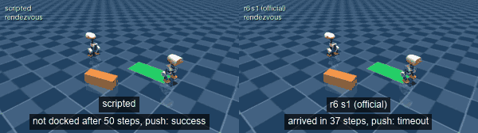

Success, start 0 (uniform; docked in 21 steps, push succeeded):
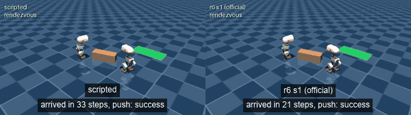

**What goes wrong in start 149** (from about 10 frames of the clip, not the full video): both ducks dock behind the box, but early in the push one duck drifts off to the side and stops, leaving the other to push alone. The lone duck moves the box onto the target and keeps it there until the 100-step limit without the episode counting as a success, so the box seems to end just outside the success tolerance (most likely its angle or how far along the target it sits; the frames cannot tell which). The scripted pair on the same start ends with the same one-pusher pattern but meets the tolerance.

## Clips (scripted left, trained s1 right; then the same push policy)

**start006**

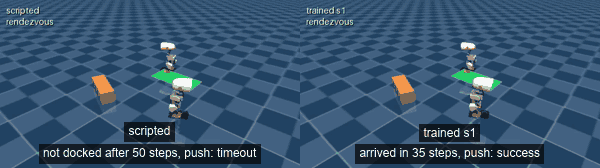

**start009**

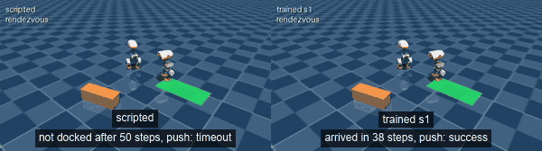

**start010**

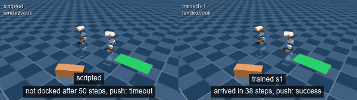

**start012**

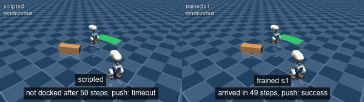

**start015**

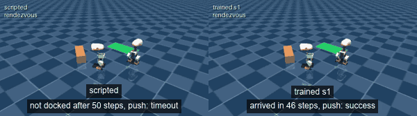

**start016**

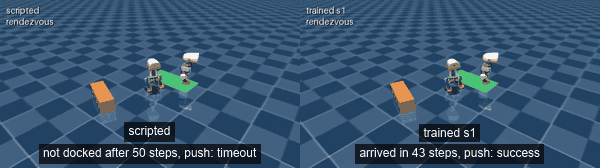

**start018**

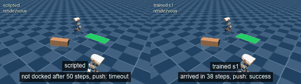

**start020**

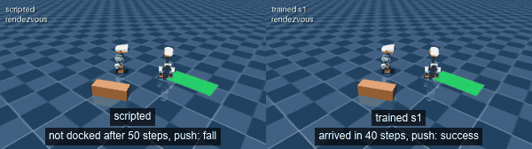

**start027**

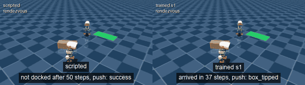

**start031**

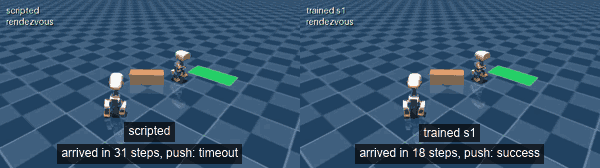

Per-episode results: `runs/d2-rendezvous-r6-dock-payout/eval_<controller>/results.json` (git-ignored); the tables above come from them, and `results/<controller>/results.md` has the full per-kind breakdown.
