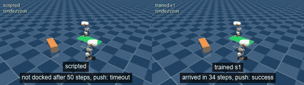
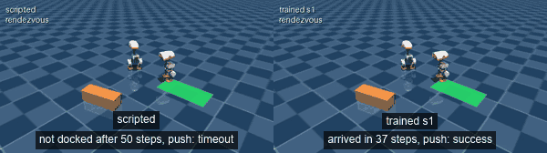
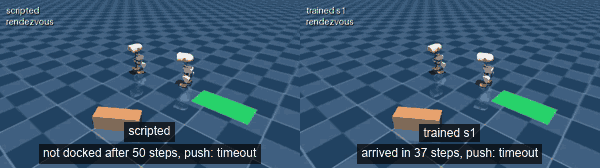
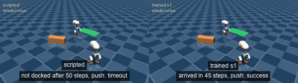
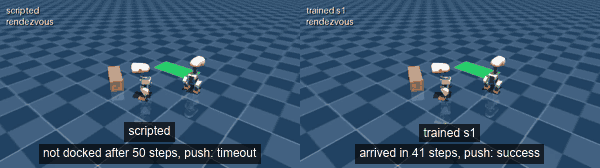
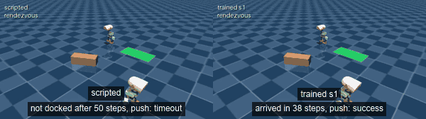

# D2 rendezvous, r7-long-payout: r6's setup trained for 3M steps, checkpoints picked on the check set

*Written 2026-11-24 03:33 by `scripts/rl/run_r7_long_payout.py`.*

## Steps

| step | status | finished |
|---|---|---|
| init | done | 2026-11-23 23:39:19 |
| scripted | done | 2026-11-23 23:41:38 |
| s1 | done | 2026-11-24 01:31:12 |
| s2 | done | 2026-11-24 03:25:09 |
| eval | done | 2026-11-24 03:30:43 |
| gifs | done | 2026-11-24 03:33:43 |

## Setup

- **Why this run:** r6 (docking payout) docked 87.0% (s1) and 75.0% (s2) on the 200 test starts with no collapse, and s1 was still improving at its last eval (2M steps). Does training longer help?
- **The change:** PPO length 2M -> 3M duck steps per seed (`experiments/d2-rendezvous/r7-long-payout.yaml`).
- **Also different from r6 (bookkeeping, not behavior):** every eval's checkpoint is kept, and evals during training (and so best.zip) use the check set (`experiments/test_sets/rendezvous_check.json`), never the test set.
- **No BC training:** PPO starts from r6's BC policy (`runs/d2-rendezvous-r6-dock-payout/bc/bc.zip`, sha256 `c285844e97d3ed35...`). r6's longer BC made no measurable difference, and reusing it keeps this comparison about PPO length.
- **Same as r6:** the reward (distance and heading shaping, holding bonus, approach term, docking payout 0.5 x steps left, collision and timeout penalties), the curriculum (15-20 cm starts widening to 60-80 cm at 60% docking per worker), observations, 50-step episodes, PPO settings (configs/copush.yaml: 8 envs, n_steps 256, ent_coef 0.01), seeds 1 and 2, early stop (0 dockings at 400k PPO steps aborts; s2 is skipped if s1 aborts), the push policy after handoff (`runs/d2-steering-night5/l2-s2/model.zip`, sha256 `ab82e344b275ce61...`) and the pipeline.
- **Test set:** `experiments/test_sets/rendezvous_large.json`, 200 starts, full pipeline (rendezvous up to 50 steps, then the push policy for 100 steps). Evaluated: each seed's check-set pick, its 2M checkpoint (r6's length) and its final checkpoint.
- **Measurable rule:** against scripted, the paired 95% interval (seeds averaged per start) excludes 0 and both seed rates are on the same side of scripted's; against r6 and for 2M vs 3M, the paired interval alone.

## Docking on the check set, every eval (every kept checkpoint)

Rendezvous alone, 50 steps, the training ending, 200 check-set starts. Step 0 is r6's BC policy. **bold** = the seed's check-set pick (best.zip).

| duck steps | s1 docked (95% interval) | s1 pos / heading error | s2 docked (95% interval) | s2 pos / heading error |
|---|---|---|---|---|
| 0 | 34.5% (28.3% to 41.3%) | 6.4 cm / 31.4 deg | 34.5% (28.3% to 41.3%) | 6.4 cm / 31.4 deg |
| 200000 | 53.5% (46.6% to 60.3%) | 5.6 cm / 22.3 deg | 30.5% (24.5% to 37.2%) | 7.3 cm / 25.4 deg |
| 400000 | 64.5% (57.7% to 70.8%) | 5.3 cm / 17.9 deg | 39.5% (33.0% to 46.4%) | 8.5 cm / 24.4 deg |
| 600000 | 55.0% (48.1% to 61.7%) | 7.2 cm / 20.6 deg | 29.0% (23.2% to 35.6%) | 12.3 cm / 28.5 deg |
| 800000 | 52.5% (45.6% to 59.3%) | 8.9 cm / 21.2 deg | 39.0% (32.5% to 45.9%) | 8.8 cm / 23.2 deg |
| 1000000 | 53.5% (46.6% to 60.3%) | 9.5 cm / 21.2 deg | 41.5% (34.9% to 48.4%) | 7.4 cm / 18.6 deg |
| 1200000 | 55.0% (48.1% to 61.7%) | 10.1 cm / 22.4 deg | 47.5% (40.7% to 54.4%) | 6.6 cm / 18.8 deg |
| 1400000 | 70.0% (63.3% to 75.9%) | 4.9 cm / 11.6 deg | 58.5% (51.6% to 65.1%) | 4.8 cm / 13.8 deg |
| 1600000 | 76.0% (69.6% to 81.4%) | 3.9 cm / 8.6 deg | 73.0% (66.5% to 78.7%) | 4.2 cm / 13.3 deg |
| 1800000 | 77.5% (71.2% to 82.7%) | 3.8 cm / 9.1 deg | 70.5% (63.8% to 76.4%) | 3.1 cm / 7.5 deg |
| 2000000 | 78.5% (72.3% to 83.6%) | 2.8 cm / 7.8 deg | 69.0% (62.3% to 75.0%) | 3.5 cm / 9.0 deg |
| 2200000 | 82.0% (76.1% to 86.7%) | 3.5 cm / 11.1 deg | 69.5% (62.8% to 75.5%) | 3.6 cm / 8.6 deg |
| 2400000 | **82.0% (76.1% to 86.7%)** | 3.6 cm / 9.1 deg | **78.0% (71.8% to 83.2%)** | 3.2 cm / 7.4 deg |
| 2600000 | 80.5% (74.5% to 85.4%) | 3.4 cm / 8.5 deg | 69.5% (62.8% to 75.5%) | 3.5 cm / 7.5 deg |
| 2800000 | 81.5% (75.5% to 86.3%) | 2.9 cm / 9.3 deg | 66.5% (59.7% to 72.7%) | 4.3 cm / 10.3 deg |
| 3000000 | 81.5% (75.5% to 86.3%) | 3.1 cm / 9.5 deg | 63.5% (56.6% to 69.9%) | 4.4 cm / 11.8 deg |
| 3002368 | 80.5% (74.5% to 85.4%) | 2.8 cm / 9.7 deg | 61.5% (54.6% to 68.0%) | 4.3 cm / 11.3 deg |

**Did docking stay stable?**

- **s1:** check-set docking peaked at 164/200 (step 2200000) and was 161/200 at the last eval (step 3002368), lowest after the peak 161/200 (step 2600000): stayed near its peak (the last eval's 95% interval overlaps the peak's): no collapse.
- **s2:** check-set docking peaked at 156/200 (step 2400000) and was 123/200 at the last eval (step 3002368), lowest after the peak 123/200 (step 3002368): fell measurably after its peak (the last eval's 95% interval is below the peak's): collapsed.

**Curriculum** (training episodes' docking rate per level between evals; level 0 = 15-20 cm, 3 = 60-80 cm)

- **s1:** level 0 by step 200000, level 1 by step 1000000, level 2 by step 1400000, level 3 by step 1800000; whole run: level 0 5761/9652 (59.7%), level 1 3826/5260 (72.7%), level 2 4114/5123 (80.3%), level 3 15582/17981 (86.7%).
- **s2:** level 0 by step 200000, level 1 by step 1000000, level 2 by step 1400000, level 3 by step 1800000; whole run: level 0 4887/9648 (50.7%), level 1 3407/5139 (66.3%), level 2 3580/4919 (72.8%), level 3 13432/17359 (77.4%).

## Results on the 200 test starts (full pipeline)

| controller | docked in 50 steps | end-to-end push success | position error at handoff | heading error at handoff |
|---|---|---|---|---|
| scripted | 48.0% (41.2% to 54.9%) | 65.0% (58.2% to 71.3%) | 4.9 cm (4.3 to 5.5) | 26.9 deg (22.8 to 31.0) |
| r6 dock payout s1 (official: final 2M checkpoint, picked on the check set) | 87.0% (81.6% to 91.0%) | 90.0% (85.1% to 93.4%) | 2.6 cm (2.1 to 3.0) | 5.9 deg (4.2 to 7.5) |
| r6 dock payout s2 (official: final 2M checkpoint, picked on the check set) | 75.0% (68.6% to 80.5%) | 85.5% (80.0% to 89.7%) | 3.7 cm (2.9 to 4.4) | 7.5 deg (5.6 to 9.5) |
| **r7 s1, check-set pick (step 2400000)** | 86.0% (80.5% to 90.1%) | 86.0% (80.5% to 90.1%) | 3.1 cm (2.4 to 3.7) | 8.3 deg (6.0 to 10.7) |
| r7 s1, 2M checkpoint (step 2000000) | 84.5% (78.8% to 88.9%) | 87.0% (81.6% to 91.0%) | 2.8 cm (2.3 to 3.3) | 7.5 deg (5.2 to 9.8) |
| r7 s1, final checkpoint (step 3002368) | 86.0% (80.5% to 90.1%) | 84.0% (78.3% to 88.4%) | 2.5 cm (2.1 to 3.0) | 7.0 deg (4.8 to 9.1) |
| **r7 s2, check-set pick (step 2400000)** | 79.5% (73.4% to 84.5%) | 85.0% (79.4% to 89.3%) | 3.4 cm (2.7 to 4.1) | 7.1 deg (4.7 to 9.4) |
| r7 s2, 2M checkpoint (step 2000000) | 78.5% (72.3% to 83.6%) | 86.5% (81.1% to 90.6%) | 3.6 cm (2.8 to 4.3) | 7.8 deg (5.5 to 10.2) |
| r7 s2, final checkpoint (step 3002368) | 69.5% (62.8% to 75.5%) | 80.0% (73.9% to 85.0%) | 4.3 cm (3.4 to 5.2) | 9.7 deg (6.2 to 13.1) |

Errors: mean over the starts of the two ducks' mean, with a 95% interval for that mean. Rows with the same step are the same checkpoint.

**By start kind** (end-to-end push success)

| controller | uniform | near_symmetric | wrong_side |
|---|---|---|---|
| scripted | 70.0% (62.5% to 76.6%) | 45.0% (25.8% to 65.8%) | 45.0% (25.8% to 65.8%) |
| r6 dock payout s1 (official: final 2M checkpoint, picked on the check set) | 91.2% (85.8% to 94.7%) | 90.0% (69.9% to 97.2%) | 80.0% (58.4% to 91.9%) |
| r6 dock payout s2 (official: final 2M checkpoint, picked on the check set) | 86.9% (80.8% to 91.3%) | 85.0% (64.0% to 94.8%) | 75.0% (53.1% to 88.8%) |
| **r7 s1, check-set pick (step 2400000)** | 90.0% (84.4% to 93.8%) | 60.0% (38.7% to 78.1%) | 80.0% (58.4% to 91.9%) |
| r7 s1, 2M checkpoint (step 2000000) | 86.9% (80.8% to 91.3%) | 90.0% (69.9% to 97.2%) | 85.0% (64.0% to 94.8%) |
| r7 s1, final checkpoint (step 3002368) | 83.8% (77.3% to 88.7%) | 85.0% (64.0% to 94.8%) | 85.0% (64.0% to 94.8%) |
| **r7 s2, check-set pick (step 2400000)** | 85.6% (79.4% to 90.2%) | 80.0% (58.4% to 91.9%) | 85.0% (64.0% to 94.8%) |
| r7 s2, 2M checkpoint (step 2000000) | 85.6% (79.4% to 90.2%) | 85.0% (64.0% to 94.8%) | 95.0% (76.4% to 99.1%) |
| r7 s2, final checkpoint (step 3002368) | 79.4% (72.5% to 84.9%) | 90.0% (69.9% to 97.2%) | 75.0% (53.1% to 88.8%) |

## r7 check-set picks against scripted (same 200 starts, paired, fixed rule)

- docked in 50 steps: r7 (seeds averaged) minus scripted +34.8 points (+27.7 to +41.8); r7 seeds 86.0, 79.5 vs scripted 48.0: **measurably higher**
- end-to-end push success: r7 (seeds averaged) minus scripted +20.5 points (+13.4 to +27.6); r7 seeds 86.0, 85.0 vs scripted 65.0: **measurably higher**
- heading error at handoff: r7 (seeds averaged) minus scripted -19.2 deg (-23.1 to -15.4); r7 seeds 8.3, 7.1 vs scripted 26.9: **measurably lower**
- position error at handoff: r7 (seeds averaged) minus scripted -1.7 cm (-2.4 to -1.0); r7 seeds 3.1, 3.4 vs scripted 4.9: **measurably lower**

## r7 check-set picks against r6 official (seeds averaged, same 200 starts, paired)

- docked in 50 steps: r7 (seeds averaged) minus r6 +1.8 points (-2.8 to +6.3); r7 seeds 86.0, 79.5 vs r6 81.0: **no measurable difference**
- end-to-end push success: r7 (seeds averaged) minus r6 -2.2 points (-5.9 to +1.4); r7 seeds 86.0, 85.0 vs r6 87.8: **no measurable difference**
- heading error at handoff: r7 (seeds averaged) minus r6 +1.0 deg (-0.8 to +2.8); r7 seeds 8.3, 7.1 vs r6 6.7: **no measurable difference**
- position error at handoff: r7 (seeds averaged) minus r6 +0.1 cm (-0.4 to +0.6); r7 seeds 3.1, 3.4 vs r6 3.1: **no measurable difference**

## r7 final checkpoints (3M) against r6 official (2M, seeds averaged, paired)

- docked in 50 steps: r7 (seeds averaged) minus r6 -3.2 points (-8.3 to +1.8); r7 seeds 86.0, 69.5 vs r6 81.0: **no measurable difference**
- end-to-end push success: r7 (seeds averaged) minus r6 -5.8 points (-10.2 to -1.3); r7 seeds 84.0, 80.0 vs r6 87.8: **measurably lower**
- heading error at handoff: r7 (seeds averaged) minus r6 +1.6 deg (-0.8 to +4.0); r7 seeds 7.0, 9.7 vs r6 6.7: **no measurable difference**
- position error at handoff: r7 (seeds averaged) minus r6 +0.3 cm (-0.4 to +0.9); r7 seeds 2.5, 4.3 vs r6 3.1: **no measurable difference**

## Did steps 2M to 3M help? r7's final checkpoints against its own 2M checkpoints (same seeds, paired)

- docked in 50 steps: r7 (seeds averaged) minus r7 at 2M -3.8 points (-8.7 to +1.2); r7 seeds 86.0, 69.5 vs r7 at 2M 81.5: **no measurable difference**
- end-to-end push success: r7 (seeds averaged) minus r7 at 2M -4.8 points (-9.3 to -0.2); r7 seeds 84.0, 80.0 vs r7 at 2M 86.8: **measurably lower**
- heading error at handoff: r7 (seeds averaged) minus r7 at 2M +0.6 deg (-1.6 to +2.9); r7 seeds 7.0, 9.7 vs r7 at 2M 7.7: **no measurable difference**
- position error at handoff: r7 (seeds averaged) minus r7 at 2M +0.2 cm (-0.4 to +0.8); r7 seeds 2.5, 4.3 vs r7 at 2M 3.2: **no measurable difference**
- s1 alone: docked 169 -> 172 of 200, push success 174 -> 168 of 200 (2M -> final).
- s2 alone: docked 157 -> 139 of 200, push success 173 -> 160 of 200 (2M -> final).

## Failures and collisions (test set)

| controller | push endings | falls in rendezvous | duck-box hits (episodes) | duck-duck hits (episodes) | push share duck A (mean) |
|---|---|---|---|---|---|
| scripted | box_tipped 2, fall 5, success 130, timeout 63 | 1 | 494 (120) | 150 (21) | 58.8% |
| r6 dock payout s1 (official: final 2M checkpoint, picked on the check set) | box_tipped 1, fall 1, success 180, timeout 18 | 4 | 335 (48) | 117 (19) | 62.2% |
| r6 dock payout s2 (official: final 2M checkpoint, picked on the check set) | box_tipped 1, fall 1, success 171, timeout 27 | 1 | 111 (29) | 138 (19) | 61.0% |
| **r7 s1, check-set pick (step 2400000)** | box_tipped 2, fall 2, success 172, timeout 24 | 2 | 403 (51) | 161 (16) | 60.8% |
| r7 s1, 2M checkpoint (step 2000000) | box_tipped 2, fall 3, success 174, timeout 21 | 2 | 528 (42) | 179 (22) | 61.6% |
| r7 s1, final checkpoint (step 3002368) | box_tipped 3, fall 4, success 168, timeout 25 | 4 | 539 (44) | 108 (18) | 60.6% |
| **r7 s2, check-set pick (step 2400000)** | box_tipped 1, fall 3, success 170, timeout 26 | 4 | 325 (41) | 102 (18) | 62.5% |
| r7 s2, 2M checkpoint (step 2000000) | box_tipped 2, fall 4, success 173, timeout 21 | 2 | 258 (33) | 97 (21) | 62.5% |
| r7 s2, final checkpoint (step 3002368) | fall 8, success 160, timeout 32 | 7 | 566 (36) | 152 (23) | 61.5% |

**Addendum, 2026-11-25 (push share and cooperative success):** the mean push share in the table above hides a split. In about half of every controller's successes one duck does under 25% of the pushing, so "duck A does about 60%" does not mean the pushing is shared. Cooperative success (task success and each duck at least 25% of the contact impulse; see [r6's addendum](../r6-dock-payout/SUMMARY.md#cooperative-success-addendum-2026-11-25)) on the same 200 starts: r7 seed 1 pick 43.0% (36.3 to 49.9), r7 seed 2 pick 42.5% (35.9 to 49.4), r6 seed 1 47.0% (40.2 to 53.9), r6 seed 2 46.0% (39.2 to 52.9), scripted 36.5% (30.1 to 43.4). Paired, seeds averaged: r6 minus r7 is +3.8 points (+0.6 to +6.9), seeds +4.0 and +3.5, a small measurable difference in r6's favor (task success: +2.2, -1.4 to +5.9, no measurable difference); r7 minus scripted is +6.2 (+0.7 to +11.8), measurable. The r6 against r7 difference is one of many comparisons and its interval nearly reaches 0, so treat it as weak. Numbers: [cooperative-success/cooperative.md](../cooperative-success/cooperative.md). The table above is unchanged.

## Clips (scripted left, r7 s1 check-set pick right; then the same push policy)

**start006**

**start009**

**start010**

**start012**

**start015**

**start018**

Per-episode results: `runs/d2-rendezvous-r7-long-payout/eval_<seed>_<pick|mid|final>/results.json` (git-ignored); `results/` has each eval's results.md, each seed's check-set evals (evals.jsonl) and best.json. Checkpoints: `runs/d2-rendezvous-r7-long-payout/sN/checkpoints/` (all kept).
