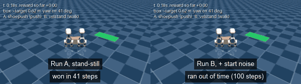
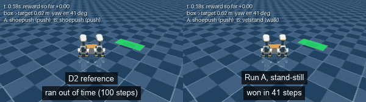
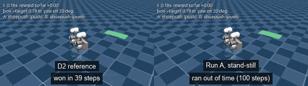
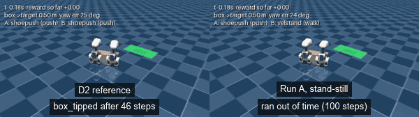
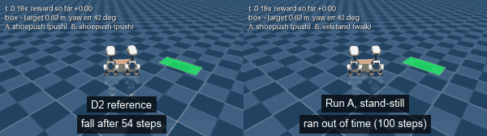
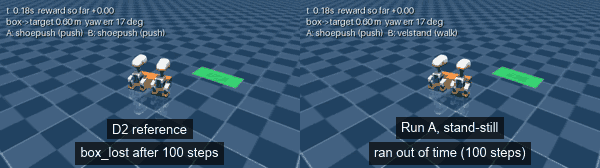
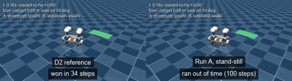

# D2 steering overnight: summary

*Written 2026-11-16 02:02 by `scripts/rl/overnight_steering.py`.*

## Steps

| step | status | finished |
|---|---|---|
| zero_shot | done | 2026-11-16 00:57:51 |
| run_a | done | 2026-11-16 01:40:01 |
| run_b | done | 2026-11-16 01:59:51 |
| eval | done | 2026-11-16 02:01:57 |
| gifs | done | 2026-11-16 02:02:35 |

## Setup

- **Warm start (both runs):** `runs/decentral-p2-d2/model.zip`, sha256 `944fffa81e7bcaa1ad21faa7d7bab75c422c2d6af13541a2d1272139704f21d5` (matches policies/manifest.json, policies-v1 stage1-d2)
- **Training seed:** Run A 1, Run B 1 (ppo.seed)
- **Stand-still threshold:** 0.02 m/s (the default; a commanded forward speed below it holds that duck on velstand at zero speed)
- **Start noise (Run B and the noisy set):** heading 5 deg per duck, spacing 0.02 m, setback 0.01 m per duck, Gaussian, clipped at 3x, drawn from each episode's seed
- **Start-noise resamples on the noisy set:** 1 redraws for 200 starts (0.5% of draws)
- **Sets:** `experiments/test_sets/stage1_large.json` (no noise) and `experiments/test_sets/stage1_noisy_large.json` (start noise), one episode per start, 95% intervals (Wilson for rates; paired normal interval and exact McNemar test for differences).

## Stage 1 starts, no noise (stage1_large.json)

**Success (200 starts)**

| policy | overall | < -15 deg | -15 to +15 deg | > +15 deg |
|---|---|---|---|---|
| reference | 66% (60% to 73%) | 97% (90% to 99%) | 87% (76% to 93%) | 15% (8% to 26%) |
| run_a | 84% (78% to 88%) | 96% (88% to 98%) | 82% (71% to 89%) | 74% (63% to 83%) |
| run_b | 77% (71% to 82%) | 90% (80% to 95%) | 85% (75% to 92%) | 56% (44% to 67%) |

**Differences (percentage points, same starts)**

| comparison | where | difference | 95% interval | McNemar p | verdict |
|---|---|---|---|---|---|
| run_a minus reference | overall (n=200) | +17.5 | +10.4 to +24.6 | 0.000 | up |
| run_a minus reference | long-turn side (> +15 deg) (n=66) | +59.1 | +45.1 to +73.1 | 0.000 | up |
| run_b minus run_a | overall (n=200) | -7.0 | -13.7 to -0.3 | 0.059 | borderline (the interval and the exact test disagree) |
| run_b minus run_a | long-turn side (> +15 deg) (n=66) | -18.2 | -33.4 to -3.0 | 0.036 | down |

**Pivots on the long-turn starts** (a pivot: 3 or more steps with exactly one duck held while the other works; rotation: the box's turn toward the needed direction during those steps)

| policy | episodes with a pivot | won with / without a pivot | steps with one duck held (mean, pivot episodes) | box rotation during them (deg, mean) | A holds alone / B holds alone (steps) |
|---|---|---|---|---|---|
| reference | 0% (0% to 6%) | 0/0 / 10/66 | n/a | n/a | 0 / 0 |
| run_a | 100% (94% to 100%) | 49/66 / 0/0 | 23.8 | +33.4 | 127 / 1444 |
| run_b | 100% (94% to 100%) | 37/66 / 0/0 | 31.2 | +43.8 | 344 / 1714 |

**Behavior (all starts)** (permanent holder: a duck held on 80% or more of an episode's steps; both idle: both held on 30% or more)

| policy | idle share | overshoots | time-outs | falls | box lost | push share A | lazy duck | permanent holder (A / B) | both idle |
|---|---|---|---|---|---|---|---|---|---|
| reference | 15% (+-1) | 18 | 43 | 16 | 8 | 49% | 1 | 0 / 0 | 0 |
| run_a | 10% (+-3) | 0 | 30 | 1 | 1 | 64% | 79 | 0 / 11 | 29 |
| run_b | 10% (+-3) | 0 | 45 | 1 | 0 | 64% | 65 | 1 / 6 | 37 |

## Stage 1 starts with duck start noise (stage1_noisy_large.json)

**Success (200 starts)**

| policy | overall | < -15 deg | -15 to +15 deg | > +15 deg |
|---|---|---|---|---|
| reference | 62% (56% to 69%) | 91% (82% to 96%) | 84% (73% to 91%) | 13% (7% to 24%) |
| run_a | 78% (72% to 84%) | 89% (80% to 95%) | 75% (63% to 84%) | 72% (60% to 81%) |
| run_b | 82% (76% to 86%) | 94% (85% to 98%) | 82% (71% to 89%) | 69% (57% to 78%) |

**Differences (percentage points, same starts)**

| comparison | where | difference | 95% interval | McNemar p | verdict |
|---|---|---|---|---|---|
| run_a minus reference | overall (n=200) | +16.0 | +8.1 to +23.9 | 0.000 | up |
| run_a minus reference | long-turn side (> +15 deg) (n=67) | +58.2 | +44.9 to +71.5 | 0.000 | up |
| run_b minus run_a | overall (n=200) | +3.0 | -3.8 to +9.8 | 0.471 | no measurable difference |
| run_b minus run_a | long-turn side (> +15 deg) (n=67) | -3.0 | -16.1 to +10.2 | 0.824 | no measurable difference |

**Pivots on the long-turn starts** (a pivot: 3 or more steps with exactly one duck held while the other works; rotation: the box's turn toward the needed direction during those steps)

| policy | episodes with a pivot | won with / without a pivot | steps with one duck held (mean, pivot episodes) | box rotation during them (deg, mean) | A holds alone / B holds alone (steps) |
|---|---|---|---|---|---|
| reference | 0% (0% to 5%) | 0/0 / 9/67 | n/a | n/a | 0 / 0 |
| run_a | 100% (95% to 100%) | 48/67 / 0/0 | 27.5 | +31.4 | 358 / 1485 |
| run_b | 100% (95% to 100%) | 46/67 / 0/0 | 30.0 | +40.1 | 182 / 1827 |

**Behavior (all starts)** (permanent holder: a duck held on 80% or more of an episode's steps; both idle: both held on 30% or more)

| policy | idle share | overshoots | time-outs | falls | box lost | push share A | lazy duck | permanent holder (A / B) | both idle |
|---|---|---|---|---|---|---|---|---|---|
| reference | 16% (+-2) | 23 | 59 | 13 | 3 | 51% | 0 | 0 / 0 | 0 |
| run_a | 10% (+-3) | 0 | 37 | 5 | 1 | 66% | 87 | 0 / 14 | 28 |
| run_b | 6% (+-2) | 0 | 32 | 4 | 1 | 65% | 67 | 0 / 10 | 22 |

## Clips

Start 185 of the no-noise set (> +15 deg side), the same start in both.

## Read (fixed rules)

Run A minus the reference is the effect of the stand-still action; Run B minus Run A is the effect of the start noise. "Up" or "down" only when the 95% interval excludes 0 and the exact test agrees (p < 0.05); anything else is "no measurable difference".
- **Stand-still (A vs reference), no-noise set:** overall +17.5 points (+10.4 to +24.6): **up**; long-turn side +59.1 (+45.1 to +73.1): **up**.
- **Start noise (B vs A), no-noise set:** overall -7.0 points (-13.7 to -0.3): **borderline (the interval and the exact test disagree)**; long-turn side -18.2 (-33.4 to -3.0): **down**.
- *reference, no-noise set:* pivots on 0 of 66 long-turn starts; no sign of reward hacking.
- *run_a, no-noise set:* pivots on 66 of 66 long-turn starts; **possible reward hacking:** both ducks idle in 29 of 200 episodes.
- *run_b, no-noise set:* pivots on 66 of 66 long-turn starts; **possible reward hacking:** both ducks idle in 37 of 200 episodes.
- **Stand-still (A vs reference), noisy set:** overall +16.0 points (+8.1 to +23.9): **up**; long-turn side +58.2 (+44.9 to +71.5): **up**.
- **Start noise (B vs A), noisy set:** overall +3.0 points (-3.8 to +9.8): **no measurable difference**; long-turn side -3.0 (-16.1 to +10.2): **no measurable difference**.
- *reference, noisy set:* pivots on 0 of 67 long-turn starts; no sign of reward hacking.
- *run_a, noisy set:* pivots on 67 of 67 long-turn starts; **possible reward hacking:** both ducks idle in 28 of 200 episodes.
- *run_b, noisy set:* pivots on 67 of 67 long-turn starts; **possible reward hacking:** both ducks idle in 22 of 200 episodes.

## The five "both idle" clips (Run A, no-noise set)

Added by hand after the night. Run A had 29 episodes where both ducks were held on 30% or more of the steps; all 29 are time-outs at 100 steps. Five of them, the D2 reference on the left and Run A on the right, same start, 2x speed. In the clip text `velstand (walk)` is a held duck and `shoepush (push)` a pushing one.

**Start 197** (< -15 deg side; highest both-held share, on an easy side (box turned the other way)): Run A timeout at 100 steps, both ducks held 67% of the steps (duck A 72%, duck B 70%), longest stretch with exactly one duck held 3 steps. Reference: success after 39 steps.

**Start 37** (> +15 deg side; long-turn side): Run A timeout at 100 steps, both ducks held 63% of the steps (duck A 63%, duck B 80%), longest stretch with exactly one duck held 5 steps. Reference: box_tipped after 46 steps.

**Start 87** (> +15 deg side; long-turn side, the longest stretches with one duck held (24 steps)): Run A timeout at 100 steps, both ducks held 56% of the steps (duck A 56%, duck B 84%), longest stretch with exactly one duck held 24 steps. Reference: fall after 54 steps.

**Start 0** (> +15 deg side; long-turn side, mild turn): Run A timeout at 100 steps, both ducks held 60% of the steps (duck A 60%, duck B 79%), longest stretch with exactly one duck held 6 steps. Reference: box_lost after 100 steps.

**Start 48** (> +15 deg side; borderline both-held share (36%)): Run A timeout at 100 steps, both ducks held 36% of the steps (duck A 55%, duck B 64%), longest stretch with exactly one duck held 5 steps. Reference: success after 34 steps.

**Review note (from watching the clips, not measured):** the 29 "both idle" episodes are near-misses that time out at 100 steps: the box is touching the target zone or passing through it, rather than the ducks standing around. Night 2 tests this directly with a 150-step time limit (a diagnostic only, `diag_150`): how many of these time-outs become successes when the episode is allowed to run longer.

## Rejected approaches (after night 2)

Both kept for the record in [negative-results/](negative-results/).

- **Night 3, both-held penalty (reward v1.4)** ([negative-results/night3-v1.4-penalty/](negative-results/night3-v1.4-penalty/SUMMARY.md)): rejected, because both-idle stalls did not drop (9.0 and 8.5 episodes on average, Run A and Run C, no-noise set) and success on the noisy set went measurably down.
- **Night 4, bounded exploration** ([negative-results/night4-bounded-exploration/](negative-results/night4-bounded-exploration/SUMMARY.md)): rejected, because Run E was measurably worse than night 2's Run A (-17.2 points overall on the no-noise set, -26.5 on the noisy set) with about 3x the both-idle stalls.

