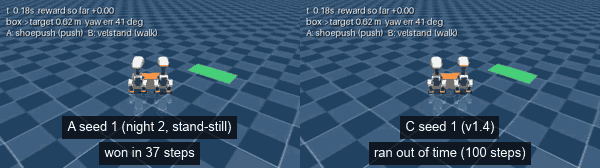
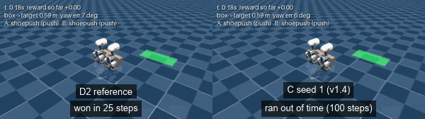
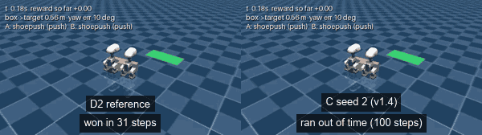

# D2 steering, night 3: the both-held penalty (reward v1.4)

*Written 2026-11-17 02:24 by `scripts/rl/overnight_steering_3.py`.*

## Steps

| step | status | finished |
|---|---|---|
| c_s1 | done | 2026-11-17 00:53:28 |
| c_s2 | done | 2026-11-17 02:16:45 |
| eval | done | 2026-11-17 02:23:30 |
| gifs | done | 2026-11-17 02:24:33 |

## Setup

- **The one change:** reward v1.4 = v1.1 plus -0.05 per env step while both ducks are held (both command a forward speed below the stand-still threshold) and the episode is not in a success state. Night 2's Run A (reward v1.1) is the comparison; everything else is identical. (The log calls it v1.4 because v1.2 and v1.3 already existed; see docs/REWARD_LOG.md.)
- **Warm start (both runs):** `/Users/ashwinaggarwal/CS_Projects/GenAI/Microduck-CoPush-steering/runs/decentral-p2-d2/model.zip`, sha256 `944fffa81e7bcaa1ad21faa7d7bab75c422c2d6af13541a2d1272139704f21d5` (matches policies/manifest.json, policies-v1 stage1-d2)
- **Seeds:** C trained with seed 1 and seed 2 (stage.py `--seed`), like night 2's A
- **Budget:** a fixed 2,000,000 duck steps per run, no early stopping; the 50-start check set is evaluated every checkpoint (200k duck steps) for the log only; checkpoints every 200k, only final policies kept; no start noise in training
- **Stand-still threshold:** 0.02 m/s (the default, as in night 2)
- **Sets:** `stage1_large.json` (no noise) and `stage1_noisy_large.json` (start noise), 200 starts each, one deterministic episode per start, 100-step limit.
- **Rule for "measurable":** a difference counts only if its 95% interval (paired, same starts, seeds averaged) excludes 0 **and** the seed rates of the two groups do not overlap; otherwise it is "no measurable difference".

| run | seed (from results.json) | trained | stopped early | wall time |
|---|---|---|---|---|
| c_s1 | 1 | 2002944 of 2000000 duck steps | no | 61 min |
| c_s2 | 2 | 2002944 of 2000000 duck steps | no | 83 min |

## Stage 1 starts, no noise (100-step limit)

**Success (200 starts, 95% intervals)**

| policy | overall | < -15 deg | -15 to +15 deg | > +15 deg |
|---|---|---|---|---|
| D2 reference | 66% (60% to 73%) | 97% (90% to 99%) | 87% (76% to 93%) | 15% (8% to 26%) |
| A seed 1 (night 2, stand-still) | 94% (90% to 97%) | 99% (92% to 100%) | 96% (88% to 98%) | 89% (80% to 95%) |
| A seed 2 (night 2, stand-still) | 96% (92% to 98%) | 100% (95% to 100%) | 97% (90% to 99%) | 91% (82% to 96%) |
| C seed 1 (v1.4) | 92% (88% to 95%) | 96% (88% to 98%) | 91% (82% to 96%) | 91% (82% to 96%) |
| C seed 2 (v1.4) | 92% (87% to 95%) | 99% (92% to 100%) | 88% (78% to 94%) | 89% (80% to 95%) |

**Seed spread** (success per seed; spread = the gap between seed 1 and seed 2)

| group | overall, seed 1 / seed 2 | spread | long-turn side, seed 1 / seed 2 | spread |
|---|---|---|---|---|
| A (night 2, v1.1) | 94% / 96% | 1.5 pts | 89% / 91% | 1.5 pts |
| C (night 3, v1.4) | 92% / 92% | 0.5 pts | 91% / 89% | 1.5 pts |

**Comparisons** (percentage points; seed rates in brackets)

| comparison | what it measures | where | difference | 95% interval | seed rates (first group; second group) | verdict |
|---|---|---|---|---|---|---|
| C (seeds averaged) minus A (night 2, seeds averaged) | the hold-penalty effect | overall (n=200) | -3.0 | -6.0 to -0.0 | 92%, 92%; 94%, 96% | down |
| C (seeds averaged) minus A (night 2, seeds averaged) | the hold-penalty effect | long-turn side (> +15 deg) (n=66) | +0.0 | -6.3 to +6.3 | 91%, 89%; 89%, 91% | no measurable difference (inside the 95% interval and the seed spread) |
| C (seeds averaged) minus the D2 reference | penalty + stand-still together | overall (n=200) | +25.8 | +19.0 to +32.5 | 92%, 92%; 66% | up |
| C (seeds averaged) minus the D2 reference | penalty + stand-still together | long-turn side (> +15 deg) (n=66) | +75.0 | +64.6 to +85.4 | 91%, 89%; 15% | up |

**Stall and behavior metrics** (all starts; both idle: both ducks held on 30% or more of an episode's steps; holding steps: total steps a duck is held, over all episodes)

| policy | time-outs | both idle | holding steps, duck A / duck B | falls | overshoots | idle share | long-turn starts with a pivot |
|---|---|---|---|---|---|---|---|
| D2 reference | 43 | 0 | 0 / 0 | 16 | 18 | 15% (+-1) | 0/66 |
| A seed 1 (night 2, stand-still) | 10 | 10 | 1186 / 2825 | 1 | 0 | 4% (+-2) | 66/66 |
| A seed 2 (night 2, stand-still) | 7 | 8 | 824 / 4317 | 1 | 0 | 4% (+-2) | 66/66 |
| C seed 1 (v1.4) | 15 | 12 | 1398 / 3332 | 0 | 0 | 5% (+-2) | 66/66 |
| C seed 2 (v1.4) | 16 | 5 | 1135 / 2338 | 0 | 0 | 2% (+-1) | 66/66 |

**Verdict, no-noise set (fixed rules)**

- *Does "both idle" drop meaningfully?* **NO.** Both-idle episodes per seed: A 10 / 8, C 12 / 5 (averages 9.0 and 8.5). Rule: both C seeds below both A seeds and the C average at most half the A average.
- *Does the pivot behavior survive?* **YES.** Long-turn starts with a pivot per seed: A 66 / 66, C 66 / 66 (averages 66.0 and 66.0 of 66). Rule: the C average is at least 80% of the A average.

## Stage 1 starts with duck start noise (100-step limit)

**Success (200 starts, 95% intervals)**

| policy | overall | < -15 deg | -15 to +15 deg | > +15 deg |
|---|---|---|---|---|
| D2 reference | 62% (56% to 69%) | 91% (82% to 96%) | 84% (73% to 91%) | 13% (7% to 24%) |
| A seed 1 (night 2, stand-still) | 96% (92% to 98%) | 100% (94% to 100%) | 91% (82% to 96%) | 97% (90% to 99%) |
| A seed 2 (night 2, stand-still) | 95% (91% to 97%) | 97% (90% to 99%) | 96% (88% to 98%) | 93% (84% to 97%) |
| C seed 1 (v1.4) | 90% (84% to 93%) | 95% (87% to 98%) | 87% (76% to 93%) | 87% (76% to 93%) |
| C seed 2 (v1.4) | 93% (89% to 96%) | 97% (90% to 99%) | 94% (86% to 98%) | 88% (78% to 94%) |

**Seed spread** (success per seed; spread = the gap between seed 1 and seed 2)

| group | overall, seed 1 / seed 2 | spread | long-turn side, seed 1 / seed 2 | spread |
|---|---|---|---|---|
| A (night 2, v1.1) | 96% / 95% | 1.0 pts | 97% / 93% | 4.5 pts |
| C (night 3, v1.4) | 90% / 93% | 3.5 pts | 87% / 88% | 1.5 pts |

**Comparisons** (percentage points; seed rates in brackets)

| comparison | what it measures | where | difference | 95% interval | seed rates (first group; second group) | verdict |
|---|---|---|---|---|---|---|
| C (seeds averaged) minus A (night 2, seeds averaged) | the hold-penalty effect | overall (n=200) | -4.2 | -7.3 to -1.2 | 90%, 93%; 96%, 95% | down |
| C (seeds averaged) minus A (night 2, seeds averaged) | the hold-penalty effect | long-turn side (> +15 deg) (n=67) | -7.5 | -13.8 to -1.1 | 87%, 88%; 97%, 93% | down |
| C (seeds averaged) minus the D2 reference | penalty + stand-still together | overall (n=200) | +28.7 | +21.9 to +35.6 | 90%, 93%; 62% | up |
| C (seeds averaged) minus the D2 reference | penalty + stand-still together | long-turn side (> +15 deg) (n=67) | +73.9 | +63.6 to +84.2 | 87%, 88%; 13% | up |

**Stall and behavior metrics** (all starts; both idle: both ducks held on 30% or more of an episode's steps; holding steps: total steps a duck is held, over all episodes)

| policy | time-outs | both idle | holding steps, duck A / duck B | falls | overshoots | idle share | long-turn starts with a pivot |
|---|---|---|---|---|---|---|---|
| D2 reference | 59 | 0 | 0 / 0 | 13 | 23 | 16% (+-2) | 0/67 |
| A seed 1 (night 2, stand-still) | 7 | 7 | 1015 / 2821 | 0 | 0 | 4% (+-2) | 67/67 |
| A seed 2 (night 2, stand-still) | 10 | 8 | 819 / 4575 | 0 | 0 | 4% (+-1) | 67/67 |
| C seed 1 (v1.4) | 19 | 15 | 1640 / 3754 | 0 | 0 | 6% (+-2) | 67/67 |
| C seed 2 (v1.4) | 14 | 3 | 781 / 2618 | 0 | 0 | 1% (+-1) | 67/67 |

**Verdict, noisy set (fixed rules)**

- *Does "both idle" drop meaningfully?* **NO.** Both-idle episodes per seed: A 7 / 8, C 15 / 3 (averages 7.5 and 9.0). Rule: both C seeds below both A seeds and the C average at most half the A average.
- *Does the pivot behavior survive?* **YES.** Long-turn starts with a pivot per seed: A 67 / 67, C 67 / 67 (averages 67.0 and 67.0 of 67). Rule: the C average is at least 80% of the A average.

## Clips

Left: A seed 1 (or the D2 reference), right: the run named. Stall clips are the run's time-out with the largest share of steps with both ducks held, on the no-noise set.

**a s1 vs c s1** (start 185):

**stall c s1** (start 195):

**stall c s2** (start 75):

