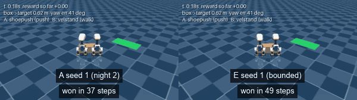
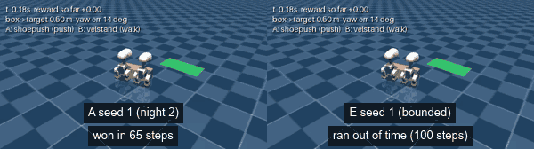
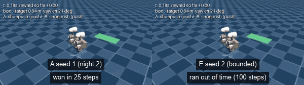

# D2 steering, night 4: bounded exploration (Run E)

*Written 2026-11-17 05:36 by `scripts/rl/overnight_steering_4.py`.*

## Conclusion

- **Bounded exploration (std cap 0.5, identity soft bound) is rejected.** E is measurably worse than A (-17.2 points overall on the no-noise set, -26.5 on the noisy set) with about 3x the both-idle stalls.
- **The train/eval mismatch hypothesis is not supported.** A's sampled vs deterministic gap is -3.2 to +4.0 points, and sampling does not reduce both-idle stalls.
- **Likely cause (untested):** the std collapsed to about 0.14 while about 40% of the speed outputs stayed saturated beyond |raw| > 3.
- **Stalls appear to be an action-space limit:** a held duck cannot turn, and the smallest move is a walk.

*(Written after the night from the results below; the generated sections follow.)*

## Steps

| step | status | finished |
|---|---|---|
| stoch_eval | done | 2026-11-17 03:12:17 |
| e_s1 | done | 2026-11-17 04:16:56 |
| e_s2 | done | 2026-11-17 05:22:18 |
| eval | done | 2026-11-17 05:35:18 |
| gifs | done | 2026-11-17 05:36:14 |

## Setup

- **The one change:** the bounded action head (`copush/bounded_policy.py`). Night 2's Run A is the comparison; everything else is identical (reward v1.1, stand-still threshold, budget, box starts, no start noise in training).
- **Mean bound:** mean = raw on [-1, 1], else sign(raw) * (1 + 0.5 * tanh((|raw| - 1) / 0.5)), so it never leaves +-1.5. Inside [-1, 1] it is the identity, so the clipped deterministic action is unchanged. **Pre-launch check:** the warm start with this head, deterministic on stage1_large, gave 133/200, exactly the D2 reference, with all 200 episodes identical.
- **Std cap:** std = exp(min(log_std, log 0.5)), set to 0.5 at warm start; the stored log_std is also clamped after every rollout.
- **ent_coef:** before (the warm start's) 0.01; after 0.0 (set in the config).
- **Warm start (both runs):** `runs/decentral-p2-d2/model.zip`, sha256 `944fffa81e7bcaa1ad21faa7d7bab75c422c2d6af13541a2d1272139704f21d5` (matches policies/manifest.json, policies-v1 stage1-d2)
- **Seeds:** E trained with seed 1 and seed 2 (stage.py `--seed`), like night 2's A. Sampled evaluation: sampling seeds 1, 2, 3 (torch seeded per episode from the sampling seed and the episode seed).
- **Budget:** a fixed 2,000,000 duck steps per run, no early stopping; the 50-start check set is evaluated every checkpoint (200k duck steps) for the log only; checkpoints every 200k, only final policies kept
- **Stand-still threshold:** 0.02 m/s (the default, as in night 2)
- **Sets:** `stage1_large.json` (no noise) and `stage1_noisy_large.json` (start noise), 200 starts each, 100-step limit. Deterministic = one episode per start with the policy mean (the headline); sampled = one episode per start per sampling seed.
- **Rule for "measurable":** a difference counts only if its 95% interval (paired, same starts, seeds averaged) excludes 0 **and** the seed rates of the two groups do not overlap; otherwise it is "no measurable difference".

| run | seed (from results.json) | trained | stopped early | ent_coef | wall time |
|---|---|---|---|---|---|
| e_s1 | 1 | 2002944 of 2000000 duck steps | no | 0.0 | 65 min |
| e_s2 | 2 | 2002944 of 2000000 duck steps | no | 0.0 | 65 min |

## Training curves: policy std and raw speed outputs

*From `<run>/std.jsonl`, logged after every rollout (shown at each checkpoint). std = the effective std after the cap. |raw| > 3 = the share of the rollout's speed outputs whose unbounded mean is beyond 3 (the night 2 and 3 stall means were -1 to -8). below hold = the share whose raw speed output is under the hold cutoff (-0.867).*

**E seed 1 (bounded)**

| duck steps | std speed | std turn | cap | |raw speed| > 3 | raw speed below hold |
|---|---|---|---|---|---|
| 4,096 | 0.500 | 0.500 | 0.5 | 42.92% | 42.8% |
| 200,704 | 0.435 | 0.454 | 0.5 | 36.91% | 48.5% |
| 401,408 | 0.344 | 0.402 | 0.5 | 38.43% | 50.8% |
| 602,112 | 0.285 | 0.311 | 0.5 | 37.35% | 54.7% |
| 802,816 | 0.278 | 0.268 | 0.5 | 38.28% | 46.8% |
| 1,003,520 | 0.235 | 0.223 | 0.5 | 40.55% | 39.5% |
| 1,200,128 | 0.205 | 0.211 | 0.5 | 45.92% | 31.2% |
| 1,400,832 | 0.196 | 0.187 | 0.5 | 36.06% | 36.6% |
| 1,601,536 | 0.174 | 0.176 | 0.5 | 33.03% | 48.2% |
| 1,802,240 | 0.159 | 0.175 | 0.5 | 36.82% | 47.9% |
| 2,002,944 | 0.152 | 0.185 | 0.5 | 42.65% | 43.3% |

Max std (speed) over all 489 rollouts: 0.5000 (cap 0.5): **stayed at or under the cap**.

**E seed 2 (bounded)**

| duck steps | std speed | std turn | cap | |raw speed| > 3 | raw speed below hold |
|---|---|---|---|---|---|
| 4,096 | 0.500 | 0.500 | 0.5 | 39.58% | 42.4% |
| 200,704 | 0.435 | 0.441 | 0.5 | 38.57% | 47.3% |
| 401,408 | 0.364 | 0.395 | 0.5 | 39.67% | 46.7% |
| 602,112 | 0.274 | 0.331 | 0.5 | 33.11% | 48.7% |
| 802,816 | 0.234 | 0.298 | 0.5 | 46.61% | 40.7% |
| 1,003,520 | 0.186 | 0.280 | 0.5 | 42.63% | 43.8% |
| 1,200,128 | 0.159 | 0.250 | 0.5 | 41.24% | 43.6% |
| 1,400,832 | 0.156 | 0.242 | 0.5 | 42.26% | 41.0% |
| 1,601,536 | 0.148 | 0.223 | 0.5 | 44.53% | 33.8% |
| 1,802,240 | 0.136 | 0.217 | 0.5 | 34.77% | 43.3% |
| 2,002,944 | 0.131 | 0.211 | 0.5 | 38.16% | 42.7% |

Max std (speed) over all 489 rollouts: 0.5000 (cap 0.5): **stayed at or under the cap**.

## Stage 1 starts, no noise (deterministic, 100-step limit, headline)

**Success (200 starts, 95% intervals)**

| policy | overall | < -15 deg | -15 to +15 deg | > +15 deg |
|---|---|---|---|---|
| D2 reference | 66% (60% to 73%) | 97% (90% to 99%) | 87% (76% to 93%) | 15% (8% to 26%) |
| A seed 1 (night 2) | 94% (90% to 97%) | 99% (92% to 100%) | 96% (88% to 98%) | 89% (80% to 95%) |
| A seed 2 (night 2) | 96% (92% to 98%) | 100% (95% to 100%) | 97% (90% to 99%) | 91% (82% to 96%) |
| E seed 1 (bounded) | 76% (70% to 82%) | 87% (76% to 93%) | 75% (63% to 84%) | 68% (56% to 78%) |
| E seed 2 (bounded) | 80% (73% to 85%) | 84% (73% to 91%) | 70% (58% to 80%) | 85% (74% to 92%) |

**Seed spread** (success per seed; spread = the gap between seed 1 and seed 2)

| group | overall, seed 1 / seed 2 | spread | long-turn side, seed 1 / seed 2 | spread |
|---|---|---|---|---|
| A (night 2) | 94% / 96% | 1.5 pts | 89% / 91% | 1.5 pts |
| E (night 4, bounded) | 76% / 80% | 3.0 pts | 68% / 85% | 16.7 pts |

**Comparisons** (percentage points; seed rates in brackets)

| comparison | what it measures | where | difference | 95% interval | seed rates (first group; second group) | verdict |
|---|---|---|---|---|---|---|
| E (seeds averaged) minus A (night 2, seeds averaged) | the bounded-exploration effect | overall (n=200) | -17.2 | -21.5 to -13.0 | 76%, 80%; 94%, 96% | down |
| E (seeds averaged) minus A (night 2, seeds averaged) | the bounded-exploration effect | long-turn side (> +15 deg) (n=66) | -13.6 | -20.8 to -6.4 | 68%, 85%; 89%, 91% | down |
| E (seeds averaged) minus the D2 reference | bounded exploration + stand-still together | overall (n=200) | +11.5 | +4.1 to +18.9 | 76%, 80%; 66% | up |
| E (seeds averaged) minus the D2 reference | bounded exploration + stand-still together | long-turn side (> +15 deg) (n=66) | +61.4 | +49.1 to +73.7 | 68%, 85%; 15% | up |

**Stall and behavior metrics** (deterministic; both idle: both ducks held on 30% or more of an episode's steps; holding steps: total steps a duck is held, over all episodes)

| policy | time-outs | both idle | holding steps, duck A / duck B | falls | overshoots | idle share | long-turn starts with a pivot |
|---|---|---|---|---|---|---|---|
| D2 reference | 43 | 0 | 0 / 0 | 16 | 18 | 15% (+-1) | 0/66 |
| A seed 1 (night 2) | 10 | 10 | 1186 / 2825 | 1 | 0 | 4% (+-2) | 66/66 |
| A seed 2 (night 2) | 7 | 8 | 824 / 4317 | 1 | 0 | 4% (+-2) | 66/66 |
| E seed 1 (bounded) | 43 | 33 | 2938 / 5172 | 3 | 0 | 14% (+-3) | 66/66 |
| E seed 2 (bounded) | 40 | 32 | 3211 / 5471 | 1 | 1 | 15% (+-3) | 66/66 |

## Stage 1 starts with duck start noise (deterministic, 100-step limit, headline)

**Success (200 starts, 95% intervals)**

| policy | overall | < -15 deg | -15 to +15 deg | > +15 deg |
|---|---|---|---|---|
| D2 reference | 62% (56% to 69%) | 91% (82% to 96%) | 84% (73% to 91%) | 13% (7% to 24%) |
| A seed 1 (night 2) | 96% (92% to 98%) | 100% (94% to 100%) | 91% (82% to 96%) | 97% (90% to 99%) |
| A seed 2 (night 2) | 95% (91% to 97%) | 97% (90% to 99%) | 96% (88% to 98%) | 93% (84% to 97%) |
| E seed 1 (bounded) | 74% (68% to 80%) | 80% (69% to 88%) | 73% (61% to 82%) | 70% (58% to 80%) |
| E seed 2 (bounded) | 64% (57% to 70%) | 61% (49% to 71%) | 60% (48% to 71%) | 70% (58% to 80%) |

**Seed spread** (success per seed; spread = the gap between seed 1 and seed 2)

| group | overall, seed 1 / seed 2 | spread | long-turn side, seed 1 / seed 2 | spread |
|---|---|---|---|---|
| A (night 2) | 96% / 95% | 1.0 pts | 97% / 93% | 4.5 pts |
| E (night 4, bounded) | 74% / 64% | 11.0 pts | 70% / 70% | 0.0 pts |

**Comparisons** (percentage points; seed rates in brackets)

| comparison | what it measures | where | difference | 95% interval | seed rates (first group; second group) | verdict |
|---|---|---|---|---|---|---|
| E (seeds averaged) minus A (night 2, seeds averaged) | the bounded-exploration effect | overall (n=200) | -26.5 | -31.1 to -21.9 | 74%, 64%; 96%, 95% | down |
| E (seeds averaged) minus A (night 2, seeds averaged) | the bounded-exploration effect | long-turn side (> +15 deg) (n=67) | -24.6 | -32.8 to -16.5 | 70%, 70%; 97%, 93% | down |
| E (seeds averaged) minus the D2 reference | bounded exploration + stand-still together | overall (n=200) | +6.5 | -1.6 to +14.6 | 74%, 64%; 62% | no measurable difference (inside the 95% interval) |
| E (seeds averaged) minus the D2 reference | bounded exploration + stand-still together | long-turn side (> +15 deg) (n=67) | +56.7 | +44.4 to +69.0 | 70%, 70%; 13% | up |

**Stall and behavior metrics** (deterministic; both idle: both ducks held on 30% or more of an episode's steps; holding steps: total steps a duck is held, over all episodes)

| policy | time-outs | both idle | holding steps, duck A / duck B | falls | overshoots | idle share | long-turn starts with a pivot |
|---|---|---|---|---|---|---|---|
| D2 reference | 59 | 0 | 0 / 0 | 13 | 23 | 16% (+-2) | 0/67 |
| A seed 1 (night 2) | 7 | 7 | 1015 / 2821 | 0 | 0 | 4% (+-2) | 67/67 |
| A seed 2 (night 2) | 10 | 8 | 819 / 4575 | 0 | 0 | 4% (+-1) | 67/67 |
| E seed 1 (bounded) | 48 | 38 | 3182 / 5623 | 2 | 2 | 15% (+-3) | 67/67 |
| E seed 2 (bounded) | 66 | 53 | 4388 / 7178 | 6 | 4 | 21% (+-3) | 67/67 |

## Deterministic vs sampled (the train/eval gap)

*Gap = sampled success (mean over the sampling seeds) minus deterministic success, per start, with a 95% interval. A positive gap means the mean action does worse than the policy it was trained as. A's numbers come from step 1 (stoch_eval), E's from step 4 (eval).*

| policy | set | where | deterministic | sampled, per sampling seed | gap (sampled - det) | 95% interval | both idle, det / sampled |
|---|---|---|---|---|---|---|---|
| A seed 1 (night 2) | no noise | overall (n=200) | 94% | 92% / 92% / 91% | -3.2 | -5.9 to -0.4 | 10 / 12 / 12 / 14 |
| A seed 1 (night 2) | no noise | long-turn (n=66) | 89% | 88% / 88% / 88% | -1.5 | -6.7 to +3.7 | 7 / 8 / 8 / 7 |
| A seed 2 (night 2) | no noise | overall (n=200) | 96% | 98% / 96% / 98% | +1.0 | -1.4 to +3.4 | 8 / 5 / 8 / 4 |
| A seed 2 (night 2) | no noise | long-turn (n=66) | 91% | 98% / 92% / 94% | +4.0 | -1.5 to +9.6 | 7 / 2 / 5 / 4 |
| E seed 1 (bounded) | no noise | overall (n=200) | 76% | 70% / 78% / 80% | -0.5 | -5.6 to +4.6 | 33 / 47 / 31 / 34 |
| E seed 1 (bounded) | no noise | long-turn (n=66) | 68% | 67% / 73% / 70% | +1.5 | -7.3 to +10.4 | 15 / 19 / 16 / 16 |
| E seed 2 (bounded) | no noise | overall (n=200) | 80% | 68% / 78% / 77% | -5.3 | -10.5 to -0.2 | 32 / 56 / 40 / 42 |
| E seed 2 (bounded) | no noise | long-turn (n=66) | 85% | 82% / 79% / 80% | -4.5 | -10.7 to +1.6 | 10 / 12 / 13 / 12 |
| A seed 1 (night 2) | noisy | overall (n=200) | 96% | 92% / 90% / 92% | -4.7 | -7.4 to -1.9 | 7 / 12 / 16 / 12 |
| A seed 1 (night 2) | noisy | long-turn (n=67) | 97% | 88% / 88% / 90% | -8.5 | -13.9 to -3.0 | 2 / 5 / 7 / 5 |
| A seed 2 (night 2) | noisy | overall (n=200) | 95% | 96% / 94% / 98% | +1.0 | -1.9 to +3.9 | 8 / 5 / 8 / 1 |
| A seed 2 (night 2) | noisy | long-turn (n=67) | 93% | 97% / 94% / 100% | +4.5 | -1.6 to +10.5 | 4 / 3 / 2 / 0 |
| E seed 1 (bounded) | noisy | overall (n=200) | 74% | 76% / 80% / 78% | +3.3 | -2.0 to +8.7 | 38 / 28 / 27 / 31 |
| E seed 1 (bounded) | noisy | long-turn (n=67) | 70% | 76% / 76% / 76% | +6.0 | -2.4 to +14.3 | 15 / 8 / 11 / 11 |
| E seed 2 (bounded) | noisy | overall (n=200) | 64% | 74% / 74% / 74% | +10.3 | +4.1 to +16.5 | 53 / 40 / 41 / 40 |
| E seed 2 (bounded) | noisy | long-turn (n=67) | 70% | 79% / 75% / 73% | +5.5 | -3.3 to +14.2 | 14 / 12 / 14 / 10 |

## Verdict (fixed rules)

- **E vs A, no-noise set:** overall -17.2 points (-21.5 to -13.0): **down**; long-turn side -13.6 (-20.8 to -6.4): **down**.
- *Does "both idle" drop meaningfully, no-noise set?* **NO.** Per seed: A 10 / 8, E 33 / 32 (averages 9.0 and 32.5). Rule: both E seeds below both A seeds and the E average at most half the A average.
- *Does the pivot survive, no-noise set?* **YES.** Long-turn starts with a pivot: A 66 / 66, E 66 / 66 of 66. Rule: the E average at least 80% of the A average.
- *Is E's train/eval gap closed, no-noise set?* **NO.** Sampled minus deterministic, overall: E seed 1 (bounded) -0.5 (-5.6 to +4.6); E seed 2 (bounded) -5.3 (-10.5 to -0.2). Rule: every E seed's 95% interval includes 0.
- **E vs A, noisy set:** overall -26.5 points (-31.1 to -21.9): **down**; long-turn side -24.6 (-32.8 to -16.5): **down**.
- *Does "both idle" drop meaningfully, noisy set?* **NO.** Per seed: A 7 / 8, E 38 / 53 (averages 7.5 and 45.5). Rule: both E seeds below both A seeds and the E average at most half the A average.
- *Does the pivot survive, noisy set?* **YES.** Long-turn starts with a pivot: A 67 / 67, E 67 / 67 of 67. Rule: the E average at least 80% of the A average.
- *Is E's train/eval gap closed, noisy set?* **NO.** Sampled minus deterministic, overall: E seed 1 (bounded) +3.3 (-2.0 to +8.7); E seed 2 (bounded) +10.3 (+4.1 to +16.5). Rule: every E seed's 95% interval includes 0.
- *E seed 1 (bounded): is the share of speed outputs with |raw| > 3 falling by the end?* **not falling** (42.92% at the first checkpoint, 42.65% at the last (drop +0.27 points); linear fit over 11 checkpoints -0.58 points per million duck steps). Rule: falling needs the last checkpoint at least 5 points below the first AND a downward linear fit. Std stayed under the cap (max 0.500).
- *E seed 2 (bounded): is the share of speed outputs with |raw| > 3 falling by the end?* **not falling** (39.58% at the first checkpoint, 38.16% at the last (drop +1.42 points); linear fit over 11 checkpoints +0.24 points per million duck steps). Rule: falling needs the last checkpoint at least 5 points below the first AND a downward linear fit. Std stayed under the cap (max 0.500).

## Clips

Left: A seed 1 (night 2), right: the run named. Stall clips are the E run's time-out with the largest share of steps with both ducks held, on the no-noise set.

**a s1 vs e s1** (start 185):

**stall e s1** (start 149):

**stall e s2** (start 43):

