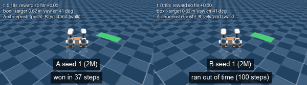
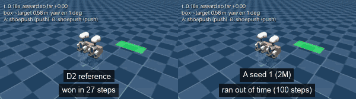
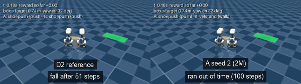
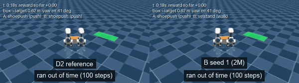
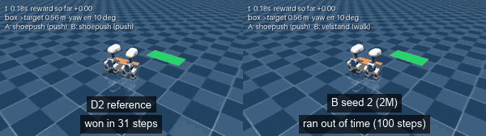

# D2 steering, night 2: fixed budget, two seeds

*Written 2026-11-16 19:54 by `scripts/rl/overnight_steering_2.py`.*

## Steps

| step | status | finished |
|---|---|---|
| diag_150 | done | 2026-11-16 14:01:48 |
| a_s1 | done | 2026-11-16 15:19:26 |
| b_s1 | done | 2026-11-16 16:33:50 |
| a_s2 | done | 2026-11-16 17:46:15 |
| b_s2 | done | 2026-11-16 19:36:11 |
| eval | done | 2026-11-16 19:52:47 |
| gifs | done | 2026-11-16 19:54:47 |

## Setup

- **Warm start (all four runs):** `runs/decentral-p2-d2/model.zip`, sha256 `944fffa81e7bcaa1ad21faa7d7bab75c422c2d6af13541a2d1272139704f21d5` (matches policies/manifest.json, policies-v1 stage1-d2)
- **Seeds:** A and B each trained with seed 1 and seed 2 (stage.py `--seed`, which sets ppo.seed); the same seeds for A and B
- **Budget:** a fixed 2,000,000 duck steps (1M simulator steps) for every run, no early stopping; the 50-start check set is evaluated every checkpoint (200k duck steps) for the log only; checkpoints every 200k, only final policies kept
- **Stand-still threshold:** 0.02 m/s (the default)
- **Start noise (B and the noisy set):** heading 5 deg per duck, spacing 0.02 m, setback 0.01 m per duck, Gaussian, clipped at 3x, drawn from each episode's seed; redraw rate on the noisy set 0.5% (1 of 201 draws)
- **Sets:** `stage1_large.json` (no noise) and `stage1_noisy_large.json` (start noise), 200 starts each, one deterministic episode per start. **Headline = the 100-step time limit.** The 150-step limit is a diagnostic only and is kept apart below.
- **Rule for "measurable":** a difference counts only if its 95% interval (paired, on the same starts, seeds averaged) excludes 0 **and** the seed rates of the two groups do not overlap; otherwise it is "no measurable difference".

| run | seed (from results.json) | trained | stopped early | wall time |
|---|---|---|---|---|
| a_s1 | 1 | 2002944 of 2000000 duck steps | no | 78 min |
| b_s1 | 1 | 2002944 of 2000000 duck steps | no | 74 min |
| a_s2 | 2 | 2002944 of 2000000 duck steps | no | 72 min |
| b_s2 | 2 | 2002944 of 2000000 duck steps | no | 110 min |

## Stage 1 starts, no noise (100-step limit, headline)

**Success (200 starts, 95% intervals)**

| policy | overall | < -15 deg | -15 to +15 deg | > +15 deg |
|---|---|---|---|---|
| D2 reference | 66% (60% to 73%) | 97% (90% to 99%) | 87% (76% to 93%) | 15% (8% to 26%) |
| last night's A (early-stopped, 1.3M) | 84% (78% to 88%) | 96% (88% to 98%) | 82% (71% to 89%) | 74% (63% to 83%) |
| last night's B (early-stopped, 0.6M) | 77% (71% to 82%) | 90% (80% to 95%) | 85% (75% to 92%) | 56% (44% to 67%) |
| A seed 1 (2M) | 94% (90% to 97%) | 99% (92% to 100%) | 96% (88% to 98%) | 89% (80% to 95%) |
| A seed 2 (2M) | 96% (92% to 98%) | 100% (95% to 100%) | 97% (90% to 99%) | 91% (82% to 96%) |
| B seed 1 (2M) | 88% (83% to 92%) | 93% (84% to 97%) | 94% (86% to 98%) | 77% (66% to 86%) |
| B seed 2 (2M) | 87% (82% to 91%) | 99% (92% to 100%) | 84% (73% to 91%) | 79% (67% to 87%) |

**Seed spread** (success per seed; spread = the gap between the two seeds)

| group | overall, seed 1 / seed 2 | spread | long-turn side, seed 1 / seed 2 | spread |
|---|---|---|---|---|
| A (stand-still) | 94% / 96% | 1.5 pts | 89% / 91% | 1.5 pts |
| B (stand-still + start noise) | 88% / 87% | 1.0 pts | 77% / 79% | 1.5 pts |

**Comparisons** (percentage points; seed rates in brackets)

| comparison | what it measures | where | difference | 95% interval | seed rates (first group; second group) | verdict |
|---|---|---|---|---|---|---|
| A (2M, seeds averaged) minus the D2 reference | the stand-still effect | overall (n=200) | +28.7 | +22.3 to +35.2 | 94%, 96%; 66% | up |
| A (2M, seeds averaged) minus the D2 reference | the stand-still effect | long-turn side (> +15 deg) (n=66) | +75.0 | +65.0 to +85.0 | 89%, 91%; 15% | up |
| B (2M) minus A (2M) | the start-noise effect, same budget | overall (n=200) | -7.8 | -11.8 to -3.7 | 88%, 87%; 94%, 96% | down |
| B (2M) minus A (2M) | the start-noise effect, same budget | long-turn side (> +15 deg) (n=66) | -12.1 | -22.3 to -2.0 | 77%, 79%; 89%, 91% | down |
| A (2M) minus last night's A (early-stopped) | the longer, fixed budget | overall (n=200) | +11.2 | +6.4 to +16.1 | 94%, 96%; 84% | up |
| A (2M) minus last night's A (early-stopped) | the longer, fixed budget | long-turn side (> +15 deg) (n=66) | +15.9 | +6.6 to +25.2 | 89%, 91%; 74% | up |
| B (2M) minus last night's B (early-stopped) | the longer, fixed budget | overall (n=200) | +10.5 | +4.4 to +16.6 | 88%, 87%; 77% | up |
| B (2M) minus last night's B (early-stopped) | the longer, fixed budget | long-turn side (> +15 deg) (n=66) | +22.0 | +8.4 to +35.5 | 77%, 79%; 56% | up |

**Stall and behavior metrics** (all starts; both idle: both ducks held on 30% or more of an episode's steps; holding steps: total steps a duck is held, over all episodes)

| policy | time-outs | both idle | holding steps, duck A / duck B | falls | overshoots | idle share | long-turn starts with a pivot |
|---|---|---|---|---|---|---|---|
| D2 reference | 43 | 0 | 0 / 0 | 16 | 18 | 15% (+-1) | 0/66 |
| last night's A (early-stopped, 1.3M) | 30 | 29 | 2465 / 3684 | 1 | 0 | 10% (+-3) | 66/66 |
| last night's B (early-stopped, 0.6M) | 45 | 37 | 2697 / 3959 | 1 | 0 | 10% (+-3) | 66/66 |
| A seed 1 (2M) | 10 | 10 | 1186 / 2825 | 1 | 0 | 4% (+-2) | 66/66 |
| A seed 2 (2M) | 7 | 8 | 824 / 4317 | 1 | 0 | 4% (+-2) | 66/66 |
| B seed 1 (2M) | 22 | 21 | 1644 / 3295 | 2 | 0 | 8% (+-2) | 66/66 |
| B seed 2 (2M) | 23 | 23 | 1731 / 4329 | 2 | 0 | 9% (+-3) | 66/66 |

## Stage 1 starts with duck start noise (100-step limit, headline)

**Success (200 starts, 95% intervals)**

| policy | overall | < -15 deg | -15 to +15 deg | > +15 deg |
|---|---|---|---|---|
| D2 reference | 62% (56% to 69%) | 91% (82% to 96%) | 84% (73% to 91%) | 13% (7% to 24%) |
| last night's A (early-stopped, 1.3M) | 78% (72% to 84%) | 89% (80% to 95%) | 75% (63% to 84%) | 72% (60% to 81%) |
| last night's B (early-stopped, 0.6M) | 82% (76% to 86%) | 94% (85% to 98%) | 82% (71% to 89%) | 69% (57% to 78%) |
| A seed 1 (2M) | 96% (92% to 98%) | 100% (94% to 100%) | 91% (82% to 96%) | 97% (90% to 99%) |
| A seed 2 (2M) | 95% (91% to 97%) | 97% (90% to 99%) | 96% (88% to 98%) | 93% (84% to 97%) |
| B seed 1 (2M) | 89% (84% to 93%) | 94% (85% to 98%) | 93% (84% to 97%) | 81% (70% to 88%) |
| B seed 2 (2M) | 88% (83% to 92%) | 98% (92% to 100%) | 85% (75% to 92%) | 81% (70% to 88%) |

**Seed spread** (success per seed; spread = the gap between the two seeds)

| group | overall, seed 1 / seed 2 | spread | long-turn side, seed 1 / seed 2 | spread |
|---|---|---|---|---|
| A (stand-still) | 96% / 95% | 1.0 pts | 97% / 93% | 4.5 pts |
| B (stand-still + start noise) | 89% / 88% | 1.0 pts | 81% / 81% | 0.0 pts |

**Comparisons** (percentage points; seed rates in brackets)

| comparison | what it measures | where | difference | 95% interval | seed rates (first group; second group) | verdict |
|---|---|---|---|---|---|---|
| A (2M, seeds averaged) minus the D2 reference | the stand-still effect | overall (n=200) | +33.0 | +26.2 to +39.8 | 96%, 95%; 62% | up |
| A (2M, seeds averaged) minus the D2 reference | the stand-still effect | long-turn side (> +15 deg) (n=67) | +81.3 | +72.3 to +90.4 | 97%, 93%; 13% | up |
| B (2M) minus A (2M) | the start-noise effect, same budget | overall (n=200) | -7.0 | -10.5 to -3.5 | 89%, 88%; 96%, 95% | down |
| B (2M) minus A (2M) | the start-noise effect, same budget | long-turn side (> +15 deg) (n=67) | -14.2 | -21.6 to -6.7 | 81%, 81%; 97%, 93% | down |
| A (2M) minus last night's A (early-stopped) | the longer, fixed budget | overall (n=200) | +17.0 | +11.5 to +22.5 | 96%, 95%; 78% | up |
| A (2M) minus last night's A (early-stopped) | the longer, fixed budget | long-turn side (> +15 deg) (n=67) | +23.1 | +12.0 to +34.2 | 97%, 93%; 72% | up |
| B (2M) minus last night's B (early-stopped) | the longer, fixed budget | overall (n=200) | +7.0 | +2.1 to +11.9 | 89%, 88%; 82% | up |
| B (2M) minus last night's B (early-stopped) | the longer, fixed budget | long-turn side (> +15 deg) (n=67) | +11.9 | +2.6 to +21.3 | 81%, 81%; 69% | up |

**Stall and behavior metrics** (all starts; both idle: both ducks held on 30% or more of an episode's steps; holding steps: total steps a duck is held, over all episodes)

| policy | time-outs | both idle | holding steps, duck A / duck B | falls | overshoots | idle share | long-turn starts with a pivot |
|---|---|---|---|---|---|---|---|
| D2 reference | 59 | 0 | 0 / 0 | 13 | 23 | 16% (+-2) | 0/67 |
| last night's A (early-stopped, 1.3M) | 37 | 28 | 2668 / 3777 | 5 | 0 | 10% (+-3) | 67/67 |
| last night's B (early-stopped, 0.6M) | 32 | 22 | 1859 / 3638 | 4 | 0 | 6% (+-2) | 67/67 |
| A seed 1 (2M) | 7 | 7 | 1015 / 2821 | 0 | 0 | 4% (+-2) | 67/67 |
| A seed 2 (2M) | 10 | 8 | 819 / 4575 | 0 | 0 | 4% (+-1) | 67/67 |
| B seed 1 (2M) | 21 | 21 | 1631 / 3473 | 1 | 0 | 8% (+-3) | 67/67 |
| B seed 2 (2M) | 22 | 20 | 1578 / 4554 | 2 | 0 | 9% (+-2) | 67/67 |

## DIAGNOSTIC ONLY: the 150-step time limit

*Kept apart from the headline numbers above. It asks whether the 100-step time-outs are near-misses: how many become successes when an episode may run 50 steps longer. The policy is not trained for a 150-step limit, and nothing here is a result to compare with other stages.*

**Step 1: last night's Run A**

| policy | success at 100 steps | success at 150 steps | time-outs at 100 | of those, successes at 150 | both-idle episodes (100) | of those, successes at 150 |
|---|---|---|---|---|---|---|
| last night's A (early-stopped, 1.3M), no-noise set | 84% (78% to 88%) | 84% (78% to 88%) | 30 | 0 (0%) | 29 | 0 |
| last night's A (early-stopped, 1.3M), noisy set | 78% (72% to 84%) | 80% (74% to 85%) | 37 | 3 (8%) | 28 | 0 |

**Step 6: every policy**

| policy | success at 100 steps | success at 150 steps | time-outs at 100 | of those, successes at 150 | both-idle episodes (100) | of those, successes at 150 |
|---|---|---|---|---|---|---|
| D2 reference, no-noise set | 66% (60% to 73%) | 68% (61% to 74%) | 43 | 3 (7%) | 0 | 0 |
| last night's A (early-stopped, 1.3M), no-noise set | 84% (78% to 88%) | 84% (78% to 88%) | 30 | 0 (0%) | 29 | 0 |
| last night's B (early-stopped, 0.6M), no-noise set | 77% (71% to 82%) | 77% (71% to 82%) | 45 | 0 (0%) | 37 | 0 |
| A seed 1 (2M), no-noise set | 94% (90% to 97%) | 94% (90% to 97%) | 10 | 0 (0%) | 10 | 0 |
| A seed 2 (2M), no-noise set | 96% (92% to 98%) | 96% (92% to 98%) | 7 | 0 (0%) | 7 | 0 |
| B seed 1 (2M), no-noise set | 88% (83% to 92%) | 88% (83% to 92%) | 22 | 0 (0%) | 21 | 0 |
| B seed 2 (2M), no-noise set | 87% (82% to 91%) | 87% (82% to 91%) | 23 | 0 (0%) | 23 | 0 |
| D2 reference, noisy set | 62% (56% to 69%) | 64% (57% to 70%) | 59 | 2 (3%) | 0 | 0 |
| last night's A (early-stopped, 1.3M), noisy set | 78% (72% to 84%) | 80% (74% to 85%) | 37 | 3 (8%) | 28 | 0 |
| last night's B (early-stopped, 0.6M), noisy set | 82% (76% to 86%) | 82% (76% to 87%) | 32 | 1 (3%) | 22 | 0 |
| A seed 1 (2M), noisy set | 96% (92% to 98%) | 96% (92% to 98%) | 7 | 0 (0%) | 7 | 0 |
| A seed 2 (2M), noisy set | 95% (91% to 97%) | 95% (91% to 97%) | 10 | 0 (0%) | 8 | 0 |
| B seed 1 (2M), noisy set | 89% (84% to 93%) | 89% (84% to 93%) | 21 | 0 (0%) | 21 | 0 |
| B seed 2 (2M), noisy set | 88% (83% to 92%) | 88% (83% to 92%) | 22 | 0 (0%) | 20 | 0 |

## Clips

Left: the D2 reference (or A seed 1), right: the run named. Stall clips are the run's time-out with the largest share of steps with both ducks held, on the no-noise set.

**a s1 vs b s1** (start 185):

**stall a s1** (start 171):

**stall a s2** (start 10):

**stall b s1** (start 185):

**stall b s2** (start 75):

## Read (fixed rules)

A (2M) vs the reference is the stand-still effect; B vs A (same budget) is the start-noise effect; new A vs last night's A is the effect of the longer fixed budget. A difference inside the 95% interval or inside the seed spread is "no measurable difference". Pivot, stall and diagnostic counts are in the tables above.
- **Stand-still (A vs reference), no-noise set:** overall +28.7 points (+22.3 to +35.2): **up**; long-turn side +75.0 (+65.0 to +85.0): **up**.
- **Start noise (B vs A), no-noise set:** overall -7.8 points (-11.8 to -3.7): **down**; long-turn side -12.1 (-22.3 to -2.0): **down**.
- **Longer fixed budget (A vs last night's A), no-noise set:** overall +11.2 points (+6.4 to +16.1): **up**; long-turn side +15.9 (+6.6 to +25.2): **up**.
- *last night's A (early-stopped, 1.3M), no-noise set:* flagged for stalling: both ducks idle in 29 of 200 episodes (see the 150-step diagnostic for whether these are near-misses).
- *last night's B (early-stopped, 0.6M), no-noise set:* flagged for stalling: both ducks idle in 37 of 200 episodes (see the 150-step diagnostic for whether these are near-misses).
- *A seed 2 (2M), no-noise set:* flagged for stalling: a duck is held on 80% or more of the steps in 83 of 200 episodes (see the 150-step diagnostic for whether these are near-misses).
- *B seed 1 (2M), no-noise set:* flagged for stalling: both ducks idle in 21 of 200 episodes (see the 150-step diagnostic for whether these are near-misses).
- *B seed 2 (2M), no-noise set:* flagged for stalling: a duck is held on 80% or more of the steps in 44 of 200 episodes; both ducks idle in 23 of 200 episodes (see the 150-step diagnostic for whether these are near-misses).
- **Stand-still (A vs reference), noisy set:** overall +33.0 points (+26.2 to +39.8): **up**; long-turn side +81.3 (+72.3 to +90.4): **up**.
- **Start noise (B vs A), noisy set:** overall -7.0 points (-10.5 to -3.5): **down**; long-turn side -14.2 (-21.6 to -6.7): **down**.
- **Longer fixed budget (A vs last night's A), noisy set:** overall +17.0 points (+11.5 to +22.5): **up**; long-turn side +23.1 (+12.0 to +34.2): **up**.
- *last night's A (early-stopped, 1.3M), noisy set:* flagged for stalling: both ducks idle in 28 of 200 episodes (see the 150-step diagnostic for whether these are near-misses).
- *last night's B (early-stopped, 0.6M), noisy set:* flagged for stalling: both ducks idle in 22 of 200 episodes (see the 150-step diagnostic for whether these are near-misses).
- *A seed 2 (2M), noisy set:* flagged for stalling: a duck is held on 80% or more of the steps in 87 of 200 episodes (see the 150-step diagnostic for whether these are near-misses).
- *B seed 1 (2M), noisy set:* flagged for stalling: both ducks idle in 21 of 200 episodes (see the 150-step diagnostic for whether these are near-misses).
- *B seed 2 (2M), noisy set:* flagged for stalling: a duck is held on 80% or more of the steps in 49 of 200 episodes (see the 150-step diagnostic for whether these are near-misses).
