# D2 steering, night 5: training on wider duck start noise (L1, L2)

*Written 2026-11-17 18:00 by `scripts/rl/overnight_steering_5.py`.*

## Steps

| step | status | finished |
|---|---|---|
| sets | done | 2026-11-17 12:02:09 |
| a_eval | done | 2026-11-17 12:04:22 |
| l1_s1 | done | 2026-11-17 13:47:14 |
| l2_s1 | done | 2026-11-17 14:51:52 |
| l1_s2 | done | 2026-11-17 15:54:04 |
| l2_s2 | done | 2026-11-17 17:45:41 |
| eval | done | 2026-11-17 17:55:21 |
| gifs | done | 2026-11-17 18:00:22 |

## Setup

- **The one change:** duck start noise in training, at level L1 or L2 (std, with a hard limit per term; Gaussian, drawn from each episode's seed, redrawn if a start fails the start check). Everything else is night 2's Run A: reward v1.1, the standard policy head, the warm start's hyperparameters, stand-still threshold 0.02 m/s, stage 1 box starts, a fixed 2,000,000 duck steps, no early stopping.
- **L1:** heading 10 deg (+-25), spacing 3 cm (+-6), setback 1.5 cm (+4.5 back / -2 forward)
- **L2:** heading 15 deg (+-30), spacing 4 cm (+-8), setback 2 cm (+6 back / -1 forward)
- **For scale, the noisy set (and night 2's B):** heading 5 deg, spacing 2 cm, setback 1 cm, clipped at 3 std.
- **Warm starts:** each seed from the MATCHING night 2 A seed: seed 1: `runs/d2-steering/night2/a-s1/model.zip` (sha256 `a07734b2116fd051...`, ent_coef 0.01); seed 2: `runs/d2-steering/night2/a-s2/model.zip` (sha256 `11cf12722264f1b3...`, ent_coef 0.01)
- **Sets (200 starts each, deterministic, 100-step limit):** clean = `stage1_large.json`; noisy = `stage1_noisy_large.json` (its own 200 box poses); L1 and L2 = `stage1_L1_large.json` / `stage1_L2_large.json`, the SAME box poses and per-start seeds (10000 + i) as clean, so clean, L1 and L2 differences are paired per start.
- **Rule for "measurable":** a difference counts only if its 95% interval (paired, same starts, seeds averaged) excludes 0 **and** the seed rates of the two groups do not overlap; otherwise "no measurable difference".

**Reset-only check made while building** (scripts/rl/start_noise_check.py, 500 resets each, no policy):

| level | std (limit) | redraw rate | out of redraws | duck down at first step | result |
|---|---|---|---|---|---|
| L1 | heading 10 deg (+-25), spacing 3 cm (+-6), setback 1.5 cm (+4.5 back / -2 forward) | 2.2% (11 of 511 draws) | 0 | 0 | pass |
| L2 as first specified | heading 15 deg (+-30), spacing 4 cm (+-8), setback 2 cm (+6 / -2) | 7.4% (40 of 540) | 0 | 0 | FAIL (> 5%) |
| L2, heading limit lowered by the rule | +-25 / +-20 / +-15 / +-10 deg | 7.7% / 7.2% / 6.5% / 0.0% | 0 | 0 | passes only at +-10 deg |
| **L2 used** | heading 15 deg (+-30), spacing 4 cm (+-8), setback 2 cm (+6 back / **-1 forward**) | 0.0% (0 of 500) | 0 | 0 | pass |

Almost every L2 redraw was a duck turned more than 15 deg AND placed 1.5 to 2 cm forward, which nudges the box while settling. The 5-degree heading rule only passed at +-10 deg, narrower than L1's +-25, so (decided before launch) L2 keeps heading +-30 and tightens only the forward setback limit to 1 cm.

| run | warm start | seed (results.json) | trained | stopped early | wall time |
|---|---|---|---|---|---|
| l1_s1 | `runs/d2-steering/night2/a-s1/model.zip` | 1 | 2002944 of 2000000 duck steps | no | 103 min |
| l2_s1 | `runs/d2-steering/night2/a-s1/model.zip` | 1 | 2002944 of 2000000 duck steps | no | 65 min |
| l1_s2 | `runs/d2-steering/night2/a-s2/model.zip` | 2 | 2002944 of 2000000 duck steps | no | 62 min |
| l2_s2 | `runs/d2-steering/night2/a-s2/model.zip` | 2 | 2002944 of 2000000 duck steps | no | 112 min |

## Verdict (fixed rules)

**(1) How much does A drop on L1 and L2?** (A seeds averaged, each wide set minus clean, paired per start)

- A on L1, overall (n=200): 88%, 89% vs clean 94%, 96%: -6.8 points (-10.5 to -3.0): **measurable drop**
- A on L1, long-turn (n=66): 82%, 85% vs clean 89%, 91%: -6.8 points (-14.4 to +0.8): **no measurable difference**
- A on L2, overall (n=200): 81%, 82% vs clean 94%, 96%: -13.5 points (-17.9 to -9.1): **measurable drop**
- A on L2, long-turn (n=66): 67%, 67% vs clean 89%, 91%: -23.5 points (-33.0 to -14.0): **measurable drop**

**(2) Do L1 / L2 training beat A on the wide sets?** (seeds averaged, paired against A on the same set)

- L1 training vs A, on the L1 set, overall: +2.2 points (-0.6 to +5.1; seed rates 90%, 92% vs 88%, 89%): **no measurable difference (inside the 95% interval)**
- L1 training vs A, on the L1 set, long-turn: +2.3 points (-2.7 to +7.2; seed rates 83%, 88% vs 82%, 85%): **no measurable difference (inside the 95% interval and the seed spread)**
- L1 training vs A, on the L2 set, overall: +5.0 points (+1.1 to +8.9; seed rates 86%, 87% vs 81%, 82%): **up**
- L1 training vs A, on the L2 set, long-turn: +8.3 points (-0.5 to +17.2; seed rates 76%, 74% vs 67%, 67%): **no measurable difference (inside the 95% interval)**
- L2 training vs A, on the L1 set, overall: +0.8 points (-2.8 to +4.3; seed rates 88%, 90% vs 88%, 89%): **no measurable difference (inside the 95% interval and the seed spread)**
- L2 training vs A, on the L1 set, long-turn: +2.3 points (-4.9 to +9.4; seed rates 82%, 89% vs 82%, 85%): **no measurable difference (inside the 95% interval and the seed spread)**
- L2 training vs A, on the L2 set, overall: +6.5 points (+2.4 to +10.6; seed rates 88%, 88% vs 81%, 82%): **up**
- L2 training vs A, on the L2 set, long-turn: +14.4 points (+5.5 to +23.3; seed rates 79%, 83% vs 67%, 67%): **up**

**(3) Do they lose anything on clean and noisy?**

- L1 training vs A, on the clean set, overall: +0.8 points (-1.6 to +3.1; seed rates 95%, 97% vs 94%, 96%): **no measurable difference (inside the 95% interval and the seed spread)**
- L1 training vs A, on the clean set, long-turn: +2.3 points (-2.7 to +7.2; seed rates 92%, 92% vs 89%, 91%): **no measurable difference (inside the 95% interval)**
- L1 training vs A, on the noisy set, overall: -0.5 points (-3.2 to +2.2; seed rates 95%, 95% vs 96%, 95%): **no measurable difference (inside the 95% interval and the seed spread)**
- L1 training vs A, on the noisy set, long-turn: -3.7 points (-8.1 to +0.6; seed rates 93%, 90% vs 97%, 93%): **no measurable difference (inside the 95% interval and the seed spread)**
- L2 training vs A, on the clean set, overall: -0.2 points (-2.8 to +2.3; seed rates 92%, 98% vs 94%, 96%): **no measurable difference (inside the 95% interval and the seed spread)**
- L2 training vs A, on the clean set, long-turn: +0.8 points (-5.0 to +6.5; seed rates 86%, 95% vs 89%, 91%): **no measurable difference (inside the 95% interval and the seed spread)**
- L2 training vs A, on the noisy set, overall: -2.8 points (-5.9 to +0.4; seed rates 92%, 93% vs 96%, 95%): **no measurable difference (inside the 95% interval)**
- L2 training vs A, on the noisy set, long-turn: -6.0 points (-12.4 to +0.5; seed rates 91%, 87% vs 97%, 93%): **no measurable difference (inside the 95% interval)**

**(4) Did a direct jump to L2 work, or should night 6 step L1 then L2?**

- **The direct jump worked**: L2 training is measurably better than A on the L2 set and not measurably worse on clean. Rule: worked = L2 vs A on the L2 set is "up" AND L2 vs A on clean is not "down"; step = L1 is up on L1 while L2 is not up on L2.

## Push share (is one duck doing all the work?)

Push share = the fraction of the episode's total pushing done by duck A (duck B's share is 1 minus this), from the per-episode files in `runs/d2-steering/night5/results/`. 200 starts per seed, both seeds pooled.

| set | policy | duck A's push share, mean (seed 1 / seed 2) | spread (std over episodes) | successes where one duck pushes > 80% | of those, duck A / duck B |
|---|---|---|---|---|---|
| clean | A (night 2) | 0.68 (0.64 / 0.71) | 0.28 | 40% (153 of 381) | 153 / 0 |
| clean | L1 training | 0.72 (0.68 / 0.76) | 0.26 | 46% (176 of 384) | 176 / 0 |
| clean | L2 training | 0.70 (0.64 / 0.77) | 0.28 | 44% (167 of 380) | 163 / 4 |
| noisy | A (night 2) | 0.68 (0.65 / 0.71) | 0.28 | 43% (163 of 382) | 162 / 1 |
| noisy | L1 training | 0.72 (0.68 / 0.76) | 0.27 | 46% (174 of 380) | 174 / 0 |
| noisy | L2 training | 0.71 (0.65 / 0.77) | 0.29 | 46% (170 of 371) | 167 / 3 |
| L1 | A (night 2) | 0.67 (0.64 / 0.70) | 0.29 | 41% (144 of 354) | 144 / 0 |
| L1 | L1 training | 0.71 (0.68 / 0.75) | 0.28 | 46% (168 of 363) | 168 / 0 |
| L1 | L2 training | 0.70 (0.63 / 0.77) | 0.30 | 45% (162 of 357) | 158 / 4 |
| L2 | A (night 2) | 0.69 (0.66 / 0.73) | 0.28 | 38% (125 of 327) | 125 / 0 |
| L2 | L1 training | 0.74 (0.70 / 0.78) | 0.27 | 47% (162 of 347) | 161 / 1 |
| L2 | L2 training | 0.72 (0.66 / 0.78) | 0.28 | 45% (159 of 353) | 157 / 2 |

This is a role split, not lopsided cooperation: duck A pushes and steers, and duck B holds still as the pivot the box turns around. On L2 starts with the L2-trained policies, B is held for 97% of the first ten steps on long-turn starts, 39% on middle starts and 2% on easy starts (see the placement check below). So duck A does about 70% of the pushing on average, on every set and for every policy, and in about 40 to 47% of successes one duck does more than 80% of it, almost always duck A (at most 4 successes per policy and set are led by duck B). Wider-noise training keeps the same split (A 0.67 to 0.69, L1 and L2 training 0.70 to 0.74).

## Placement check (first ten steps, L2 set)

The policy has no separate fix-then-push phase: it corrects while pushing. The box starts moving at step 2 and covers 13.6 cm of the 67.6 cm average starting distance by step 10. Duck A removes three-quarters of a large heading error while already pushing (19.5 to 4.2 degrees by step 3; 5.1 by step 10). Duck B's error grows on purpose, because it is held as the pivot.

L2-trained policies (both seeds), 399 L2 starts that last more than 10 steps, replayed deterministically (all 400 episodes identical to the evaluation above). Error = mean absolute error against each duck's noise-free spot on the box (9.5 cm behind the box centre on the push side, 10 cm either side, facing the push direction), moved with the box; each step is 0.2 s.

| duck | starting error | heading, step 0 to 10 | position, step 0 to 10 |
|---|---|---|---|
| A | large (top third) | 19.5 to 5.1 deg, shrinks (mostly by step 3) | 3.7 to 3.6 cm, flat |
| A | small (bottom third) | 2.6 to 3.7 deg, flat | 0.8 to 3.5 cm, grows |
| B | large (top third) | 20.3 to 27.1 deg, grows | 3.5 to 7.7 cm, grows |
| B | small (bottom third) | 2.8 to 14.1 deg, grows | 0.8 to 5.3 cm, grows |

Both ducks' positions settle about 3.5 cm from the start spot, probably the pose they push from rather than a placement error (the start spot is only a reference).

| start type | duck B held, steps 1 to 10 | B's heading error, step 0 to 10 |
|---|---|---|
| long-turn (> +15 deg) | 97% | 11.5 to 35.2 deg |
| middle (-15 to +15 deg) | 39% | 10.4 to 16.8 deg |
| easy (< -15 deg) | 2% | 10.5 to 8.8 deg |

Duck A is never held in these steps. Full data (all thirds, every step, the stalled episodes one by one): `runs/d2-steering/night5/placement/report.md`, git-ignored; regenerate with `scripts/rl.sh scripts/rl/placement.py`.

## What it means and next step

- **Wider start noise is worth training on.** The night 2 policy (A) drops 13.5 points on L2 starts. Training on L2 directly recovers +6.5 points overall and +14.4 on the long-turn side, with nothing measurable lost on clean or noisy starts. No gradual step through L1 was needed.
- **What still fails:** mostly both ducks holding still. On L2 starts, 38 of the L2-trained runs' 47 failures are time-outs with both ducks held on 30% or more of the steps. They stop about 70% of the way to the target, then sit idle for the rest of the episode (median stop at step 38 of 100). Of the 38, 10 end with the box inside the target and fail on the 15-degree angle test or the 1-second hold, and 18 more end within 5 cm of it. A held duck cannot turn, so it has no small correction move.
- **Next (night 6):** let a held duck turn in place (speed zero, the turn command passes through), trained on L2 starts, warm-started from the L2 seeds.
- **Later:** a separate approach skill to bring each duck from anywhere to its docking spot, so the two chain into fully random starts.
- **Also worth watching:** duck A does about 70% of the pushing because B's job on turning starts is to anchor, not to push.

## clean (stage1_large)

**Success (200 starts, 95% intervals)**

| policy | overall | < -15 deg | -15 to +15 deg | > +15 deg |
|---|---|---|---|---|
| A seed 1 (night 2) | 94% (90% to 97%) | 99% (92% to 100%) | 96% (88% to 98%) | 89% (80% to 95%) |
| A seed 2 (night 2) | 96% (92% to 98%) | 100% (95% to 100%) | 97% (90% to 99%) | 91% (82% to 96%) |
| L1 seed 1 | 95% (91% to 97%) | 99% (92% to 100%) | 94% (86% to 98%) | 92% (83% to 97%) |
| L1 seed 2 | 97% (94% to 99%) | 99% (92% to 100%) | 100% (95% to 100%) | 92% (83% to 97%) |
| L2 seed 1 | 92% (88% to 95%) | 100% (95% to 100%) | 91% (82% to 96%) | 86% (76% to 93%) |
| L2 seed 2 | 98% (94% to 99%) | 99% (92% to 100%) | 99% (92% to 100%) | 95% (87% to 98%) |

**Seed spread** (spread = the gap between seed 1 and seed 2)

| group | overall, seed 1 / seed 2 | spread | long-turn side, seed 1 / seed 2 | spread |
|---|---|---|---|---|
| A | 94% / 96% | 1.5 pts | 89% / 91% | 1.5 pts |
| L1 | 95% / 97% | 2.0 pts | 92% / 92% | 0.0 pts |
| L2 | 92% / 98% | 5.0 pts | 86% / 95% | 9.1 pts |

**Paired differences against A** (seeds averaged)

| comparison | where | difference | 95% interval | seed rates | verdict |
|---|---|---|---|---|---|
| L1 minus A | overall (n=200) | +0.8 | -1.6 to +3.1 | 95%, 97%; 94%, 96% | no measurable difference (inside the 95% interval and the seed spread) |
| L1 minus A | long-turn (n=66) | +2.3 | -2.7 to +7.2 | 92%, 92%; 89%, 91% | no measurable difference (inside the 95% interval) |
| L2 minus A | overall (n=200) | -0.2 | -2.8 to +2.3 | 92%, 98%; 94%, 96% | no measurable difference (inside the 95% interval and the seed spread) |
| L2 minus A | long-turn (n=66) | +0.8 | -5.0 to +6.5 | 86%, 95%; 89%, 91% | no measurable difference (inside the 95% interval and the seed spread) |

**Stalls and failures** (both idle: both ducks held on 30% or more of an episode's steps)

| policy | time-outs | both idle | falls (rate) | box lost | overshoots | long-turn starts with a pivot |
|---|---|---|---|---|---|---|
| A seed 1 (night 2) | 10 | 10 | 1 (0%) | 0 | 0 | 66/66 |
| A seed 2 (night 2) | 7 | 8 | 1 (0%) | 0 | 0 | 66/66 |
| L1 seed 1 | 8 | 8 | 2 (1%) | 0 | 0 | 66/66 |
| L1 seed 2 | 4 | 4 | 0 (0%) | 2 | 0 | 66/66 |
| L2 seed 1 | 14 | 15 | 0 (0%) | 1 | 0 | 66/66 |
| L2 seed 2 | 5 | 5 | 0 (0%) | 0 | 0 | 66/66 |

## noisy (stage1_noisy_large)

**Success (200 starts, 95% intervals)**

| policy | overall | < -15 deg | -15 to +15 deg | > +15 deg |
|---|---|---|---|---|
| A seed 1 (night 2) | 96% (92% to 98%) | 100% (94% to 100%) | 91% (82% to 96%) | 97% (90% to 99%) |
| A seed 2 (night 2) | 95% (91% to 97%) | 97% (90% to 99%) | 96% (88% to 98%) | 93% (84% to 97%) |
| L1 seed 1 | 95% (91% to 97%) | 97% (90% to 99%) | 96% (88% to 98%) | 93% (84% to 97%) |
| L1 seed 2 | 95% (91% to 97%) | 97% (90% to 99%) | 99% (92% to 100%) | 90% (80% to 95%) |
| L2 seed 1 | 92% (88% to 95%) | 95% (87% to 98%) | 91% (82% to 96%) | 91% (82% to 96%) |
| L2 seed 2 | 93% (89% to 96%) | 98% (92% to 100%) | 94% (86% to 98%) | 87% (76% to 93%) |

**Seed spread** (spread = the gap between seed 1 and seed 2)

| group | overall, seed 1 / seed 2 | spread | long-turn side, seed 1 / seed 2 | spread |
|---|---|---|---|---|
| A | 96% / 95% | 1.0 pts | 97% / 93% | 4.5 pts |
| L1 | 95% / 95% | 0.0 pts | 93% / 90% | 3.0 pts |
| L2 | 92% / 93% | 0.5 pts | 91% / 87% | 4.5 pts |

**Paired differences against A** (seeds averaged)

| comparison | where | difference | 95% interval | seed rates | verdict |
|---|---|---|---|---|---|
| L1 minus A | overall (n=200) | -0.5 | -3.2 to +2.2 | 95%, 95%; 96%, 95% | no measurable difference (inside the 95% interval and the seed spread) |
| L1 minus A | long-turn (n=67) | -3.7 | -8.1 to +0.6 | 93%, 90%; 97%, 93% | no measurable difference (inside the 95% interval and the seed spread) |
| L2 minus A | overall (n=200) | -2.8 | -5.9 to +0.4 | 92%, 93%; 96%, 95% | no measurable difference (inside the 95% interval) |
| L2 minus A | long-turn (n=67) | -6.0 | -12.4 to +0.5 | 91%, 87%; 97%, 93% | no measurable difference (inside the 95% interval) |

**Stalls and failures** (both idle: both ducks held on 30% or more of an episode's steps)

| policy | time-outs | both idle | falls (rate) | box lost | overshoots | long-turn starts with a pivot |
|---|---|---|---|---|---|---|
| A seed 1 (night 2) | 7 | 7 | 0 (0%) | 1 | 0 | 67/67 |
| A seed 2 (night 2) | 10 | 8 | 0 (0%) | 0 | 0 | 67/67 |
| L1 seed 1 | 7 | 7 | 1 (0%) | 2 | 0 | 67/67 |
| L1 seed 2 | 8 | 8 | 0 (0%) | 2 | 0 | 67/67 |
| L2 seed 1 | 13 | 13 | 2 (1%) | 0 | 0 | 67/67 |
| L2 seed 2 | 10 | 8 | 1 (0%) | 3 | 0 | 67/67 |

## L1 (stage1_L1_large)

**Success (200 starts, 95% intervals)**

| policy | overall | < -15 deg | -15 to +15 deg | > +15 deg |
|---|---|---|---|---|
| A seed 1 (night 2) | 88% (83% to 92%) | 94% (86% to 98%) | 88% (78% to 94%) | 82% (71% to 89%) |
| A seed 2 (night 2) | 89% (84% to 93%) | 99% (92% to 100%) | 84% (73% to 91%) | 85% (74% to 92%) |
| L1 seed 1 | 90% (84% to 93%) | 97% (90% to 99%) | 88% (78% to 94%) | 83% (73% to 90%) |
| L1 seed 2 | 92% (87% to 95%) | 99% (92% to 100%) | 90% (80% to 95%) | 88% (78% to 94%) |
| L2 seed 1 | 88% (83% to 92%) | 96% (88% to 98%) | 88% (78% to 94%) | 82% (71% to 89%) |
| L2 seed 2 | 90% (85% to 93%) | 99% (92% to 100%) | 82% (71% to 89%) | 89% (80% to 95%) |

**Seed spread** (spread = the gap between seed 1 and seed 2)

| group | overall, seed 1 / seed 2 | spread | long-turn side, seed 1 / seed 2 | spread |
|---|---|---|---|---|
| A | 88% / 89% | 1.0 pts | 82% / 85% | 3.0 pts |
| L1 | 90% / 92% | 2.5 pts | 83% / 88% | 4.5 pts |
| L2 | 88% / 90% | 1.5 pts | 82% / 89% | 7.6 pts |

**Paired differences against A** (seeds averaged)

| comparison | where | difference | 95% interval | seed rates | verdict |
|---|---|---|---|---|---|
| L1 minus A | overall (n=200) | +2.2 | -0.6 to +5.1 | 90%, 92%; 88%, 89% | no measurable difference (inside the 95% interval) |
| L1 minus A | long-turn (n=66) | +2.3 | -2.7 to +7.2 | 83%, 88%; 82%, 85% | no measurable difference (inside the 95% interval and the seed spread) |
| L2 minus A | overall (n=200) | +0.8 | -2.8 to +4.3 | 88%, 90%; 88%, 89% | no measurable difference (inside the 95% interval and the seed spread) |
| L2 minus A | long-turn (n=66) | +2.3 | -4.9 to +9.4 | 82%, 89%; 82%, 85% | no measurable difference (inside the 95% interval and the seed spread) |

**Stalls and failures** (both idle: both ducks held on 30% or more of an episode's steps)

| policy | time-outs | both idle | falls (rate) | box lost | overshoots | long-turn starts with a pivot |
|---|---|---|---|---|---|---|
| A seed 1 (night 2) | 20 | 17 | 4 (2%) | 0 | 2 | 65/66 |
| A seed 2 (night 2) | 18 | 13 | 4 (2%) | 0 | 0 | 66/66 |
| L1 seed 1 | 15 | 15 | 5 (2%) | 1 | 0 | 65/66 |
| L1 seed 2 | 14 | 10 | 2 (1%) | 0 | 0 | 66/66 |
| L2 seed 1 | 17 | 15 | 5 (2%) | 1 | 1 | 65/66 |
| L2 seed 2 | 16 | 14 | 3 (2%) | 1 | 0 | 65/66 |

## L2 (stage1_L2_large)

**Success (200 starts, 95% intervals)**

| policy | overall | < -15 deg | -15 to +15 deg | > +15 deg |
|---|---|---|---|---|
| A seed 1 (night 2) | 81% (75% to 86%) | 96% (88% to 98%) | 81% (70% to 88%) | 67% (55% to 77%) |
| A seed 2 (night 2) | 82% (77% to 87%) | 94% (86% to 98%) | 87% (76% to 93%) | 67% (55% to 77%) |
| L1 seed 1 | 86% (81% to 91%) | 96% (88% to 98%) | 88% (78% to 94%) | 76% (64% to 84%) |
| L1 seed 2 | 87% (82% to 91%) | 97% (90% to 99%) | 90% (80% to 95%) | 74% (63% to 83%) |
| L2 seed 1 | 88% (83% to 92%) | 96% (88% to 98%) | 91% (82% to 96%) | 79% (67% to 87%) |
| L2 seed 2 | 88% (83% to 92%) | 96% (88% to 98%) | 85% (75% to 92%) | 83% (73% to 90%) |

**Seed spread** (spread = the gap between seed 1 and seed 2)

| group | overall, seed 1 / seed 2 | spread | long-turn side, seed 1 / seed 2 | spread |
|---|---|---|---|---|
| A | 81% / 82% | 1.5 pts | 67% / 67% | 0.0 pts |
| L1 | 86% / 87% | 0.5 pts | 76% / 74% | 1.5 pts |
| L2 | 88% / 88% | 0.5 pts | 79% / 83% | 4.5 pts |

**Paired differences against A** (seeds averaged)

| comparison | where | difference | 95% interval | seed rates | verdict |
|---|---|---|---|---|---|
| L1 minus A | overall (n=200) | +5.0 | +1.1 to +8.9 | 86%, 87%; 81%, 82% | up |
| L1 minus A | long-turn (n=66) | +8.3 | -0.5 to +17.2 | 76%, 74%; 67%, 67% | no measurable difference (inside the 95% interval) |
| L2 minus A | overall (n=200) | +6.5 | +2.4 to +10.6 | 88%, 88%; 81%, 82% | up |
| L2 minus A | long-turn (n=66) | +14.4 | +5.5 to +23.3 | 79%, 83%; 67%, 67% | up |

**Stalls and failures** (both idle: both ducks held on 30% or more of an episode's steps)

| policy | time-outs | both idle | falls (rate) | box lost | overshoots | long-turn starts with a pivot |
|---|---|---|---|---|---|---|
| A seed 1 (night 2) | 32 | 25 | 4 (2%) | 2 | 0 | 66/66 |
| A seed 2 (night 2) | 29 | 21 | 3 (2%) | 3 | 0 | 66/66 |
| L1 seed 1 | 24 | 22 | 1 (0%) | 2 | 0 | 66/66 |
| L1 seed 2 | 25 | 22 | 0 (0%) | 1 | 0 | 66/66 |
| L2 seed 1 | 21 | 21 | 2 (1%) | 0 | 0 | 66/66 |
| L2 seed 2 | 19 | 18 | 3 (2%) | 2 | 1 | 66/66 |

## Clips (L2 set)

Left: the matching A seed (night 2); right: the run named. Same start, same noise. Successes and failures are the run's; starts where the run and A disagree are picked first.

**L1 seed 1, success, start 10** (run: success; A: timeout)

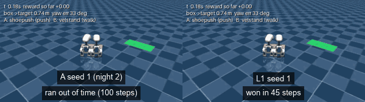

**L1 seed 1, success, start 17** (run: success; A: timeout)

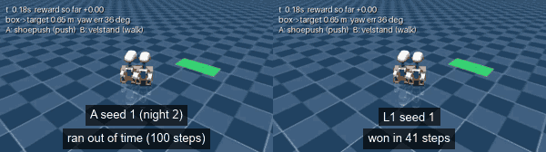

**L1 seed 1, failure, start 25** (run: timeout; A: success)

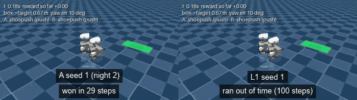

**L1 seed 1, failure, start 54** (run: timeout; A: success)

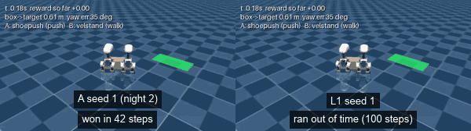

**L2 seed 1, success, start 10** (run: success; A: timeout)

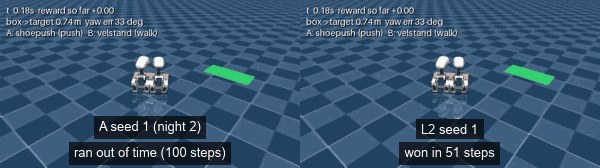

**L2 seed 1, success, start 17** (run: success; A: timeout)

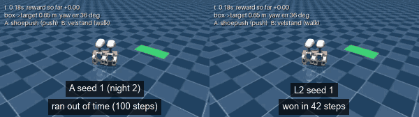

**L2 seed 1, failure, start 11** (run: timeout; A: success)

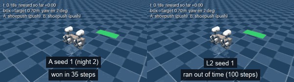

**L2 seed 1, failure, start 58** (run: timeout; A: success)

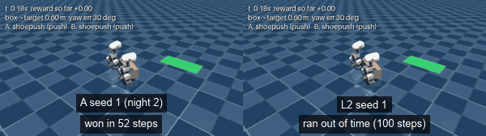

**L1 seed 2, success, start 14** (run: success; A: timeout)

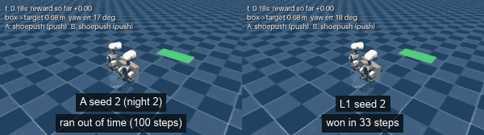

**L1 seed 2, success, start 19** (run: success; A: timeout)

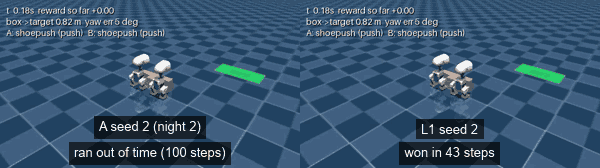

**L1 seed 2, failure, start 25** (run: timeout; A: success)

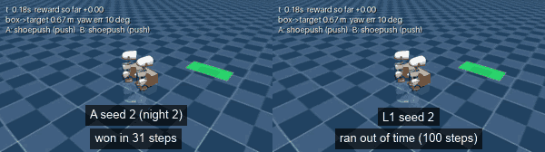

**L1 seed 2, failure, start 31** (run: timeout; A: success)

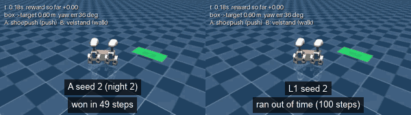

**L2 seed 2, success, start 4** (run: success; A: timeout)

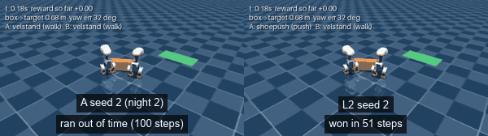

**L2 seed 2, success, start 14** (run: success; A: timeout)

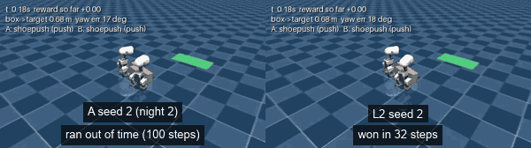

**L2 seed 2, failure, start 25** (run: timeout; A: success)

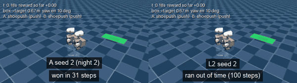

**L2 seed 2, failure, start 31** (run: timeout; A: success)

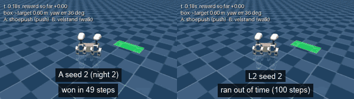

## Cooperative success (addendum, 2026-11-25): L2 seed 2

**Why:** success only checks that the box reaches the target, not who pushed. From 2026-11-25 a success counts as cooperative only if each duck's share of the contact impulse (contact force on the box, added up over the episode) is at least 25% (`copush/cooperation.py`, `metrics.cooperative_share`). Nothing above was changed. This covers L2 seed 2 only (`runs/d2-steering-night5/l2-s2/model.zip`), the push policy the rendezvous hands off to; the other night 5 policies were not recomputed.

200 starts per set, 95% intervals (from [cooperative.md](../../d2-rendezvous/cooperative-success/cooperative.md)):

| set | **cooperative success (contact impulse, 25%)** | task success | cooperative success (along the line, 25%) | successes with one duck under 25% |
|---|---|---|---|---|
| clean | **50.5% (43.6 to 57.4)** | 97.5% (94.3 to 98.9) | 50.5% (43.6 to 57.4) | 94 of 195 (48.2%) |
| noisy | **47.5% (40.7 to 54.4)** | 93.0% (88.6 to 95.8) | 47.5% (40.7 to 54.4) | 91 of 186 (48.9%) |
| L1 | **45.0% (38.3 to 51.9)** | 90.0% (85.1 to 93.4) | 45.5% (38.7 to 52.4) | 90 of 180 (50.0%) |
| L2 | **43.5% (36.8 to 50.4)** | 88.0% (82.8 to 91.8) | 43.0% (36.3 to 49.9) | 89 of 176 (50.6%) |

- About half of this policy's successes are one duck pushing with the other under 25%. This is the role split described under "Push share" above, now counted against success.
- The threshold barely matters between 10 and 30% (clean: 101 cooperative successes of 200 at 10, 20, 25 and 30%, 97 at 40%), and the two measures disagree on 2 of the 737 successes.
- The rerun matched the saved night 5 evaluation on all 800 episodes (ending, steps, push share).

**Known issue:** the box (0.15 kg) is light enough for one duck to push alone, so the task does not force cooperation, and the frozen push policy learned a pusher/steadier role split: one duck pushes, the other steadies the box and often does not push at all. A heavier-box fix for the push policy is planned on a separate branch.
