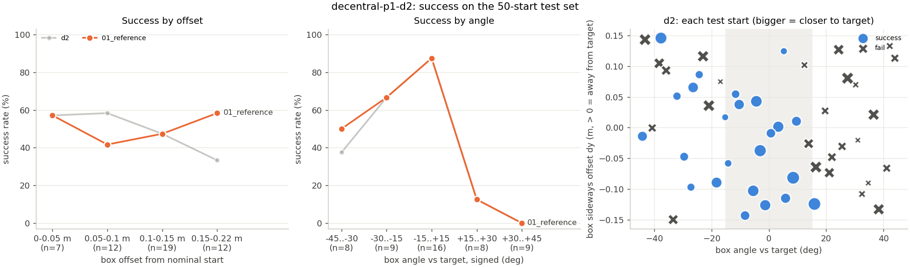

# Test set results: decentral-p1-d2

50 fixed held-out starts ([experiments/test_sets/stage1.json](../../../test_sets/stage1.json)), box offset up to +-0.15 m (x) / +-0.15 m (y) and +-45 deg, both ducks against the box. One deterministic episode per start, reward v1.1.

| controller | success | falls | box lost | push share A / B | mean return | mean steps | final dist (m) | ends | monitor flags (episodes) |
|---|---|---|---|---|---|---|---|---|---|
| 01_reference | 50% (25/50) | 0/50 | 1/50 | 50 / 50% | +2.50 | 65 | 0.74 | box_tipped 1, success 25, timeout 24 | reward_vs_dist 2 |
| d2 | 48% (24/50) | 3/50 | 0/50 | 50 / 50% | +2.32 | 67 | 0.68 | fall 3, success 24, timeout 23 | bad_part_duck_a 2, bad_part_duck_b 5, contact_share 11, fall_duck_b 4, reward_vs_dist 9 |

Success by difficulty (successes / starts in the bucket):

| controller | offset 0-0.05 m | offset 0.05-0.1 m | offset 0.1-0.15 m | offset 0.15-0.22 m | angle 0-15 deg | angle 15-30 deg | angle 30-45 deg |
|---|---|---|---|---|---|---|---|
| 01_reference | 4/7 | 5/12 | 9/19 | 7/12 | 14/16 | 7/17 | 4/17 |
| d2 | 4/7 | 7/12 | 9/19 | 4/12 | 14/16 | 7/17 | 3/17 |

Success by signed angle (box yaw minus nominal, deg):

| controller | -45 to -30 | -30 to -15 | -15 to +15 | +15 to +30 | +30 to +45 |
|---|---|---|---|---|---|
| 01_reference | 4/8 | 6/9 | 14/16 | 1/8 | 0/9 |
| d2 | 3/8 | 6/9 | 14/16 | 1/8 | 0/9 |

