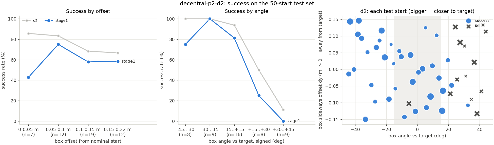

# Test set results: decentral-p2-d2

50 fixed held-out starts ([experiments/test_sets/stage1.json](../../../test_sets/stage1.json)), box offset up to +-0.15 m (x) / +-0.15 m (y) and +-45 deg, both ducks against the box. One deterministic episode per start, reward v1.1.

| controller | success | falls | box lost | push share A / B | mean return | mean steps | final dist (m) | ends | monitor flags (episodes) |
|---|---|---|---|---|---|---|---|---|---|
| stage1 | 60% (30/50) | 3/50 | 0/50 | 46 / 54% | +6.46 | 57 | 0.41 | fall 3, success 30, timeout 17 | bad_part_duck_a 8, bad_part_duck_b 2, contact_share 19, fall_duck_a 5, fall_duck_b 1, reward_vs_dist 3 |
| d2 | 74% (37/50) | 5/50 | 2/50 | 51 / 49% | +9.57 | 45 | 0.20 | box_lost 1, box_tipped 1, fall 5, success 37, timeout 6 | bad_part_duck_a 6, bad_part_duck_b 3, contact_share 17, edge 1, fall_duck_a 4, fall_duck_b 2, reward_vs_dist 2 |

Success by difficulty (successes / starts in the bucket):

| controller | offset 0-0.05 m | offset 0.05-0.1 m | offset 0.1-0.15 m | offset 0.15-0.22 m | angle 0-15 deg | angle 15-30 deg | angle 30-45 deg |
|---|---|---|---|---|---|---|---|
| stage1 | 3/7 | 9/12 | 11/19 | 7/12 | 13/16 | 11/17 | 6/17 |
| d2 | 6/7 | 10/12 | 13/19 | 8/12 | 15/16 | 13/17 | 9/17 |

Success by signed angle (box yaw minus nominal, deg):

| controller | -45 to -30 | -30 to -15 | -15 to +15 | +15 to +30 | +30 to +45 |
|---|---|---|---|---|---|
| stage1 | 6/8 | 9/9 | 13/16 | 2/8 | 0/9 |
| d2 | 8/8 | 9/9 | 15/16 | 4/8 | 1/9 |

