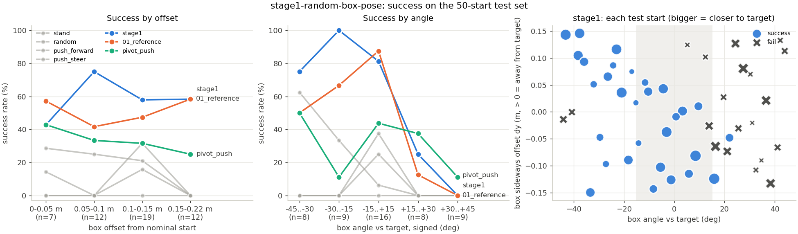

# Stage 1: random box starts, ducks still against the box

**Status:** done (2026-11-12). Trained 980k steps (early stop), 66 min.

## Goal and the one change

01_reference always starts from the same box pose. This stage asks whether it can push the box
home from any pose in a range around that start. The one change from 01_reference is
`env.box_start`: each episode offsets the box from its nominal pose by a uniform draw within
±0.15 m in x, ±0.15 m in y and ±45° in yaw. The ducks are then placed against the long face
of the box, so they start touching it. Everything else (reward v1.1, PPO settings, 8 envs, layout,
target) comes from 01_reference. The resolved config differs from 01_reference's saved
config only in `env.box_start` (checked with a diff).

Training warm-starts from `runs/overnight-20261112/runs/01_reference/model.zip`.

## Why this final range

Before training, I ran probes with the warm-start policy and the scripted controllers:

- ±0.10 m / ±30°: 01_reference already succeeds 70% of the time (28/40), so this range is too easy to teach anything.
- ±0.15 m / ±45°: 01_reference gets 45% and pivot_push 35% (80 starts). Most of the
  difficulty is in the angle (30 to 45° starts: ref 5/26, pivot 4/26). Offset matters much less.

So ±0.15 m / ±45° is hard for every existing controller but not hopeless: the reference starts near
45%, which leaves room to show learning. Wider angles would mostly test a different skill
(getting back around the box), which belongs to a later stage.

## Auto-widen

The range starts at 20% of the final size and widens one step (20 → 40 → 60 → 80 → 100%)
whenever success on the current range reaches 70%. Each check runs 20 deterministic episodes on held-out
seeds 10001 to 10020, every 20k steps. On the full range, training stops early once success is 80% or
more for 3 checks in a row.

| step | range | success on it |
|---|---|---|
| 20k | 20% | 100% |
| 40k | 40% | 90% |
| 60k | 60% | 85% |
| 80k | 80% | 70% → widened to full range |
| 100k to 960k | 100% | 60 to 85%, mostly 70 to 80% |
| 940k, 960k, 980k | 100% | 80%, 85%, 80% → early stop |

The range reached its maximum at step 80k. After that, the full-range checks stayed flat at about
75% for 800k steps, and the early stop fired on a streak of noisy checks. Full history:
[results/training.json](results/training.json).

## Test set (50 fixed held-out starts)

The starts are in [../test_sets/stage1.json](../test_sets/stage1.json). They're drawn from the final range by
Latin hypercube sampling, so each axis is evenly covered. A plain uniform draw put 28 of 50
starts above 30°. The starts were never used in training. Every start is checked to have both ducks touching
the box within 1 s of push_forward. Full table: [results/test_set.md](results/test_set.md).

| controller | success | falls | box lost | push share A / B | final dist (m) |
|---|---|---|---|---|---|
| stand | 0% | 0 | 0 | - | 0.68 |
| random | 12% | 3 | 1 | 51 / 49% | 1.56 |
| push_forward | 8% | 4 | 1 | 50 / 50% | 1.71 |
| push_steer | 18% | 7 | 1 | 46 / 54% | 0.83 |
| pivot_push | 32% | 6 | 1 | 63 / 37% | 0.59 |
| 01_reference (no retraining) | 50% | 0 | 1 | 50 / 50% | 0.74 |
| **stage1** | **60%** | 3 | 0 | 46 / 54% | 0.41 |

In a paired comparison on the same starts, stage 1 wins 8 that 01_reference loses, and loses 3 that 01_reference wins. Against
pivot_push it's 17 against 3.



## Where it still fails

- **One turning direction.** Box turned more than 15° clockwise (negative angle): stage 1 wins 15/17. Turned the
  other way: 2/17 (+15 to +30°: 2/8; +30 to +45°: 0/9). 01_reference has the same split
  (10/17 against 1/17), so stage 1 inherited this blind spot and fixed the easier half only. Offset size
  barely matters.
- **Overshoot.** 11 of the 20 failures end 1.1 to 1.5 m from the target, farther than the
  starting distance (about 0.7 m). The box is pushed past the target or swings away rather than stalling.
  In the failure clip (start 49, +38°), stage 1 gets the box within 0.28 m of the target at 8 s with 12° of yaw
  error, then keeps pushing it past.
- **Falls are new.** Stage 1 has 3 falls (all duck A, all on positive-angle starts). 01_reference has none.
  The monitor also flags `bad_part_duck_a` (duck A pushes with its trunk or head more than its hips) in 8
  episodes and `contact_share` (one duck carries 80% or more of the contact) in 19.

## Why the training checks said 80% and the test set says 60%

The 20 fixed check starts are easier than the test set. 12 of the 20 have |angle| ≤ 15°, and only 4 are on
the hard positive side. The test set has 16 and 17. Weighting stage 1's test-set rates by that mix predicts
about 69%. The rest comes from stopping on a lucky streak of 20-episode checks (the standard error per check is about ±9%).
**For stage 2, the widen checks should use a fixed set spread evenly over the range (like the test set), with
more episodes.**

## Videos

Not committed; they're in `runs/stage1-random-box-pose/`:

- `videos/side_by_side/start28_pivot_push_vs_stage1.mp4`: the hardest start where stage 1 wins and
  pivot_push fails (dx +0.12, dy +0.14 m, −43°). pivot_push is on the left.
- `videos/side_by_side/start49_01_reference_vs_stage1.mp4`: a failure, the near mirror of start 28
  (dx +0.10, dy −0.13 m, +38°). Both time out; stage 1 overshoots.
- `videos/step_980000_final.mp4`: the final policy on the video seed. The training videos all use one fixed seed,
  which is an easy start, so they say little about this stage (`step_10000_baseline.mp4` already succeeds).
- `videos/step_310000_new_behavior.mp4`, `videos/step_820000_new_behavior.mp4`: the two evals that timed
  out on the video seed, with the `bad_part_duck_a` and `contact_share` flags.
- Training log: `train.log`. Final model: `model.zip`.

## Next step

Fix the turning-direction blind spot before stage 2 widens anything else. Two cheap things to try:
mirror augmentation (flip y and yaw, and swap the ducks, for half the episodes), and widen and stop checks on a
fixed, evenly spread validation set (not the test set) with more episodes. Stage 2 (ducks start apart from the box) has not been started.

## Reproduce

```sh
C=experiments/stage1-random-box-pose/config.yaml
scripts/rl.sh scripts/rl/stage.py --config $C
scripts/rl.sh scripts/rl/test_set.py eval --config $C
scripts/rl.sh scripts/rl/test_set.py side-by-side --config $C --left pivot_push --right stage1
scripts/rl.sh scripts/rl/test_set.py side-by-side --config $C --left 01_reference --right stage1 --start 49
```
