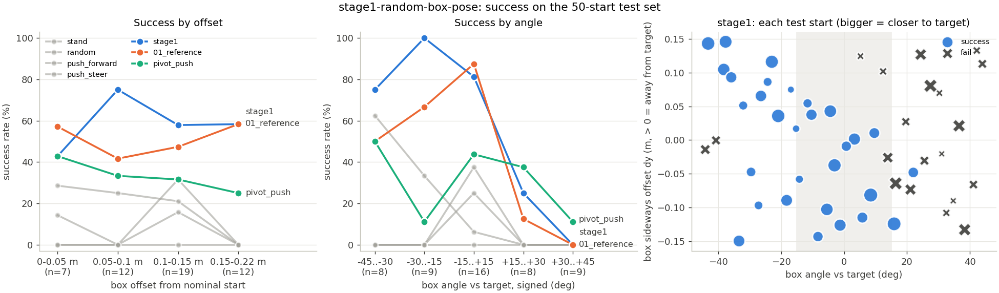

# Test set results: stage1-random-box-pose

50 fixed held-out starts ([experiments/test_sets/stage1.json](../../test_sets/stage1.json)), box offset up to +-0.15 m (x) / +-0.15 m (y) and +-45 deg, both ducks against the box. One deterministic episode per start, reward v1.1.

| controller | success | falls | box lost | push share A / B | mean return | mean steps | final dist (m) | ends | monitor flags (episodes) |
|---|---|---|---|---|---|---|---|---|---|
| stand | 0% (0/50) | 0/50 | 0/50 | - | -3.00 | 100 | 0.68 | timeout 50 | none |
| random | 12% (6/50) | 3/50 | 1/50 | 51 / 49% | -11.55 | 89 | 1.56 | box_lost 1, fall 3, success 6, timeout 40 | bad_part_duck_a 5, bad_part_duck_b 7, contact_share 14, fall_duck_a 3, fall_duck_b 6, reward_vs_dist 1 |
| push_forward | 8% (4/50) | 4/50 | 1/50 | 50 / 50% | -13.70 | 91 | 1.71 | box_tipped 1, fall 4, success 4, timeout 41 | bad_part_duck_a 4, bad_part_duck_b 7, contact_share 9, fall_duck_a 4, fall_duck_b 4, reward_vs_dist 4 |
| push_steer | 18% (9/50) | 7/50 | 1/50 | 46 / 54% | -3.93 | 82 | 0.83 | box_lost 1, fall 7, success 9, timeout 33 | bad_part_duck_a 13, bad_part_duck_b 2, contact_share 26, fall_duck_a 13, fall_duck_b 4, reward_vs_dist 10, spin 2 |
| pivot_push | 32% (16/50) | 6/50 | 1/50 | 63 / 37% | +0.35 | 74 | 0.59 | box_tipped 1, fall 6, success 16, timeout 27 | bad_part_duck_a 7, bad_part_duck_b 3, contact_share 45, fall_duck_a 7, fall_duck_b 6, reward_vs_dist 10 |
| 01_reference | 50% (25/50) | 0/50 | 1/50 | 50 / 50% | +2.50 | 65 | 0.74 | box_tipped 1, success 25, timeout 24 | reward_vs_dist 2 |
| stage1 | 60% (30/50) | 3/50 | 0/50 | 46 / 54% | +6.46 | 57 | 0.41 | fall 3, success 30, timeout 17 | bad_part_duck_a 8, bad_part_duck_b 2, contact_share 19, fall_duck_a 5, fall_duck_b 1, reward_vs_dist 3 |

Success by difficulty (successes / starts in the bucket):

| controller | offset 0-0.05 m | offset 0.05-0.1 m | offset 0.1-0.15 m | offset 0.15-0.22 m | angle 0-15 deg | angle 15-30 deg | angle 30-45 deg |
|---|---|---|---|---|---|---|---|
| stand | 0/7 | 0/12 | 0/19 | 0/12 | 0/16 | 0/17 | 0/17 |
| random | 0/7 | 0/12 | 6/19 | 0/12 | 6/16 | 0/17 | 0/17 |
| push_forward | 1/7 | 0/12 | 3/19 | 0/12 | 4/16 | 0/17 | 0/17 |
| push_steer | 2/7 | 3/12 | 4/19 | 0/12 | 1/16 | 3/17 | 5/17 |
| pivot_push | 3/7 | 4/12 | 6/19 | 3/12 | 7/16 | 4/17 | 5/17 |
| 01_reference | 4/7 | 5/12 | 9/19 | 7/12 | 14/16 | 7/17 | 4/17 |
| stage1 | 3/7 | 9/12 | 11/19 | 7/12 | 13/16 | 11/17 | 6/17 |

Success by signed angle (box yaw minus nominal, deg):

| controller | -45 to -30 | -30 to -15 | -15 to +15 | +15 to +30 | +30 to +45 |
|---|---|---|---|---|---|
| stand | 0/8 | 0/9 | 0/16 | 0/8 | 0/9 |
| random | 0/8 | 0/9 | 6/16 | 0/8 | 0/9 |
| push_forward | 0/8 | 0/9 | 4/16 | 0/8 | 0/9 |
| push_steer | 5/8 | 3/9 | 1/16 | 0/8 | 0/9 |
| pivot_push | 4/8 | 1/9 | 7/16 | 3/8 | 1/9 |
| 01_reference | 4/8 | 6/9 | 14/16 | 1/8 | 0/9 |
| stage1 | 6/8 | 9/9 | 13/16 | 2/8 | 0/9 |

