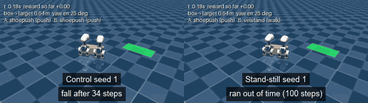

# Central steering: learn the long clockwise turn

**Question:** the Stage 1 central controller wins only 5% of the 66 held-out starts where the box
begins more than +15 degrees from the target. It turns about 40 degrees before pushing, but these
starts need roughly 55 degrees. Does giving the central controller a real stand-still action let it
hold one duck as a pivot and finish the turn?

**Status:** done (2026-11-21). With a real stand-still action, the two central-policy seeds win
**96% and 98%** of 200 held-out starts, against **66% and 68%** for matched continued-training
controls. On the long-turn side, they win **92% and 97%**, against **21% and 18%**. The matched
difference is +30.2 points overall (+24.2 to +36.3) and +75.0 on the long-turn side (+65.2 to
+84.8). Full generated report: [SUMMARY.md](SUMMARY.md).

Run or resume it with:

```sh
scripts/rl.sh scripts/rl/overnight_central_steering.py --dry-run
scripts/rl.sh scripts/rl/overnight_central_steering.py
```

## Experiment

Both groups warm-start from the released Stage 1 central policy and train for a fixed 1,000,000
additional simulator steps on the unchanged Stage 1 box-start range. There are two PPO seeds per
group and no early stopping.

| group | one change | config |
|---|---|---|
| control | none; measures the effect of the extra training budget | [control/config.yaml](control/config.yaml) |
| stand-still | a commanded forward speed below 0.02 m/s holds that duck on velstand | [stand-still/config.yaml](stand-still/config.yaml) |

The matched control fills the gap in Stage 1b: its two runs each received extra training, so their
improvements could not be separated from the effect of the proposed change.

## Result

| policy | overall | < -15 deg | -15 to +15 deg | > +15 deg |
|---|---|---|---|---|
| Stage 1, before more training | 60% (54 to 67) | 84% | 90% | 8% |
| control seed 1 | 66% (59 to 72) | 91% | 85% | 21% |
| control seed 2 | 68% (61 to 74) | 99% | 87% | 18% |
| **stand-still seed 1** | **96% (92 to 98)** | 97% | 99% | **92%** |
| **stand-still seed 2** | **98% (96 to 99)** | 99% | 100% | **97%** |

The policy learned the intended maneuver: both stand-still seeds pivot on all 66 long-turn starts,
while neither control pivots. The stand-still seeds have no overshoots, only one fall across 400
episodes, and 7 and 3 time-outs. Simply enabling the action without retraining does not work: the
Stage 1 policy falls from 60% to 20% overall and stays at 8% on the long-turn side.

The role split is strong and worth tracking as the range widens. Duck A does 77% to 80% of the
pushing, both ducks touch the box on 42% to 50% of steps, and one duck has under 20% of contact in
97 and 111 of 200 episodes. On turning starts this is often the intended anchor-and-pusher behavior,
not one duck quitting, but it should not grow into a permanent one-duck solution.

Control left, stand-still right, same +39.8-degree start: the control times out; stand-still pivots
and wins in 56 steps.


One remaining failure (+25.8 degrees): the control falls and stand-still times out near the target.



## Fixed evaluation rules

- Evaluate every policy on the same 200 starts in `experiments/test_sets/stage1_large.json`.
- Report success overall and for all three angle sides with 95% intervals.
- Compare the mean of the two stand-still seeds with the mean of the two control seeds, paired by
  start. Call a change measurable only when the paired 95% interval excludes zero and the two
  groups' seed-rate ranges do not overlap.
- Also report pivots, turn before push, falls, box loss, overshoots, time-outs, both-held stalls and
  push share, plus one success and one failure clip.

## Next step

Keep stand-still and widen the box-angle range beyond ±45 degrees with auto-widen. Evaluate every
new range on its own 200-start set and re-run the Stage 1 set as a forgetting check. Continue
reporting the anchor/pusher role split, both-held stalls and the few remaining near-target time-outs.
