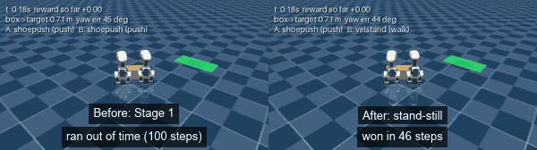
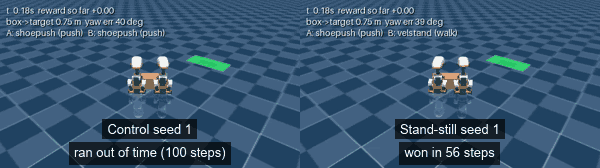

# Central steering: learn the long clockwise turn

**Question:** the Stage 1 central controller wins only 8% (5 of 66) of the held-out starts where the box
begins more than +15 degrees from the target. It turns about 40 degrees before pushing, but these
starts need roughly 55 degrees. Does giving the central controller a real stand-still action let it
hold one duck as a pivot and finish the turn?

**Status:** done (2026-11-21). With a real stand-still action, the two central-policy seeds win
**96% and 98%** of 200 held-out starts, against **66% and 68%** for matched continued-training
controls. On the long-turn side, they win **92% and 97%**, against **21% and 18%**. The matched
difference is +30.2 points overall (+24.2 to +36.3) and +75.0 on the long-turn side (+65.2 to
+84.8). Full generated report: [SUMMARY.md](SUMMARY.md).

Run or resume it with:

```sh
scripts/rl.sh scripts/rl/overnight_central_steering.py --dry-run
scripts/rl.sh scripts/rl/overnight_central_steering.py
```

## Experiment

Both groups warm-start from the released Stage 1 central policy and train for a fixed 1,000,000
additional simulator steps on the unchanged Stage 1 box-start range. There are two PPO seeds per
group and no early stopping.

| group | one change | config |
|---|---|---|
| control | none; measures the effect of the extra training budget | [control/config.yaml](control/config.yaml) |
| stand-still | a commanded forward speed below 0.02 m/s holds that duck on velstand | [stand-still/config.yaml](stand-still/config.yaml) |

The matched control fills the gap in Stage 1b: its two runs each received extra training, so their
improvements could not be separated from the effect of the proposed change.

## Result

| policy | overall | < -15 deg | -15 to +15 deg | > +15 deg |
|---|---|---|---|---|
| Stage 1, before more training | 60% (54 to 67) | 84% | 90% | 8% |
| control seed 1 | 66% (59 to 72) | 91% | 85% | 21% |
| control seed 2 | 68% (61 to 74) | 99% | 87% | 18% |
| **stand-still seed 1** | **96% (92 to 98)** | 97% | 99% | **92%** |
| **stand-still seed 2** | **98% (96 to 99)** | 99% | 100% | **97%** |

The policy learned the intended maneuver: both stand-still seeds pivot on all 66 long-turn starts,
while neither control pivots. The stand-still seeds have no overshoots, only one fall across 400
episodes, and 7 and 3 time-outs. Simply enabling the action without retraining does not work: the
Stage 1 policy falls from 60% to 20% overall and stays at 8% on the long-turn side.

The role split is strong and worth tracking as the range widens. Duck A does 77% to 80% of the
pushing, both ducks touch the box on 42% to 50% of steps, and one duck has under 20% of contact in
97 and 111 of 200 episodes. On turning starts this is often the intended anchor-and-pusher behavior,
not one duck quitting, but it should not grow into a permanent one-duck solution.

### Before and after

Original Stage 1 left, trained stand-still right, same +44.8-degree start. Stage 1 runs out of time;
stand-still holds one duck as the pivot and wins in 46 steps.



### Against the matched control

Control left, stand-still right, same +39.8-degree start: the control times out; stand-still pivots
and wins in 56 steps.



One remaining failure (+25.8 degrees): the control falls and stand-still times out near the target.


## Fixed evaluation rules

- Evaluate every policy on the same 200 starts in `experiments/test_sets/stage1_large.json`.
- Report success overall and for all three angle sides with 95% intervals.
- Compare the mean of the two stand-still seeds with the mean of the two control seeds, paired by
  start. Call a change measurable only when the paired 95% interval excludes zero and the two
  groups' seed-rate ranges do not overlap.
- Also report pivots, turn before push, falls, box loss, overshoots, time-outs, both-held stalls and
  push share, plus one success and one failure clip.

## Small duck start noise

**Completed 2026-11-26; reviewed 2026-11-27. Keep the original clean-trained stand-still policies.**
Small-noise adaptation produced no measurable improvement on noisy starts. Clean success was lower
after this continuation, mostly in seed 2; without an equal-budget clean continuation control, the
drop cannot be attributed to noise itself. This two-seed result is retained below.

The original central stand-still seeds trained on clean duck placements. The new
[start-noise config](start-noise/config.yaml) adapts each matching seed for 1M additional simulator
steps with Gaussian heading noise (5° standard deviation per duck), spacing noise (2 cm standard
deviation between ducks) and setback noise (1 cm standard deviation per duck), clipped at 3σ.
Invalid starts are redrawn by the existing environment. Box starts stay at Stage 1's ±45° range,
reward v1.1 and stand-still remain enabled. Checkpoints are every 100k steps; no early stopping.
This is an adaptation comparison against the prior policies, without an extra-training clean
control: changes cannot be attributed to noise alone or to the central architecture.

Run or resume `scripts/rl/overnight_steering_noise.py` with the RL Python environment from this
checkout. It trains seeds 1 and 2 from `runs/steering/stand-still-s1/model.zip` and `stand-still-s2`,
then evaluates both old and new seeds on `stage1_large.json` (clean/forgetting) and
`stage1_noisy_large.json` (the D2 small-noise benchmark), 200 starts each. The separate
`stage1_noisy_checks.json` is used only for training diagnostics. Per-side success, 95% intervals,
paired differences and failure/teamwork metrics are written under `start-noise/results/`.
Success and failure videos go under `runs/steering-start-noise/videos/`.

The run uses a separate `steering` worktree. Its logs, completion markers and input hashes are in
`runs/steering-start-noise/`; models and training state are in `runs/steering/start-noise-s1/` and
`start-noise-s2/`. Checkpoint/restart behavior is inherited from `stage.py`.

### Results

Both seeds finished 1,001,472 additional simulator steps (PPO rounds the 1M budget to full rollouts).
Each row below is 200 held-out episodes; intervals are Wilson 95% intervals. The original policies
were trained with clean duck starts. Noise adaptation used the small Gaussian noise specified above.

| policy | clean success (95% CI) | noisy success (95% CI) |
|---|---|---|
| original seed 1 | 96.0% (92.3–98.0), 192/200 | 94.0% (89.8–96.5), 188/200 |
| noise-adapted seed 1 | 94.5% (90.4–96.9), 189/200 | 93.0% (88.6–95.8), 186/200 |
| original seed 2 | 98.5% (95.7–99.5), 197/200 | 91.0% (86.2–94.2), 182/200 |
| noise-adapted seed 2 | 92.5% (88.0–95.4), 185/200 | 89.5% (84.5–93.0), 179/200 |

Full per-difficulty success rates with intervals and sample sizes:
[clean/forgetting](start-noise/results/clean/ci_report.md) and
[noisy](start-noise/results/noisy/ci_report.md). Those generated reports round rates to whole
percentages; the table above preserves half-point precision.

For the following paired comparisons, compute the mean adapted-minus-original success over the
two matching seeds at each start, then apply `ci_report.mean_ci` across starts (normal 95% interval).
These intervals describe held-out-start variation for these two seeds, not uncertainty across all
possible training seeds. A measurable verdict also requires non-overlapping seed-rate ranges.

| set / difficulty | starts | change (points) | paired 95% interval | verdict |
|---|---|---|---|---|
| clean overall (forgetting) | 200 | -3.75 | -6.77 to -0.73 | lower in these runs |
| clean < -15° | 67 | 0.00 | -4.17 to +4.17 | no measurable difference |
| clean -15° to +15° | 67 | -0.75 | -3.29 to +1.80 | no measurable difference |
| clean > +15° | 66 | -10.61 | -18.09 to -3.12 | lower in these runs |
| noisy overall | 200 | -1.25 | -4.75 to +2.25 | no measurable difference |
| noisy < -15° | 66 | -3.03 | -7.70 to +1.64 | no measurable difference |
| noisy -15° to +15° | 67 | +0.75 | -3.67 to +5.16 | no measurable difference |
| noisy > +15° | 67 | -1.49 | -9.82 to +6.84 | no measurable difference |

The clean-set decline is mostly seed 2: -6.0 points (paired 95% CI -10.1 to -1.9), versus
-1.5 points for seed 1 (-5.3 to +2.3; no measurable difference). The pooled interval describes
these two runs and does not establish that start-noise training generally harms clean performance.

On the noisy set, failures and role split are:

| policy | falls | box lost/tipped | timeouts | overshoots | push share A | both touch |
|---|---|---|---|---|---|---|
| original seed 1 | 2/200 | 2/200 | 8/200 | 0/200 | 76% | 49% |
| noise-adapted seed 1 | 2/200 | 5/200 | 7/200 | 0/200 | 81% | 40% |
| original seed 2 | 2/200 | 0/200 | 16/200 | 0/200 | 80% | 41% |
| noise-adapted seed 2 | 1/200 | 9/200 | 11/200 | 0/200 | 79% | 45% |

The adapted policies lose/tip the box more often in these observations; the pushing remains
dominated by duck A. On the clean set, losses/tips rise from 0 to 3 episodes for each seed and
timeouts rise from 7/3 to 8/12. Full diagnostics and per-episode data:
[clean](start-noise/results/clean/comparison.md), [noisy](start-noise/results/noisy/comparison.md).

Two clips show the same noisy +44.6° start (ID 32), with different training seeds:

- Success, seed 2: original times out, adapted wins in 49 steps.
  [Video](../../runs/steering-start-noise/videos/success/start32_side_by_side.mp4)
  ([GIF](../../runs/steering-start-noise/videos/success/start32_side_by_side.gif)).
- Failure, seed 1: original wins in 59 steps, adapted times out.
  [Video](../../runs/steering-start-noise/videos/failure/start32_side_by_side.mp4)
  ([GIF](../../runs/steering-start-noise/videos/failure/start32_side_by_side.gif)).

Videos remain local under ignored `runs/`. They are examples, not representative success rates.
Input hashes were checked against the frozen run manifest before reporting.

**Interpretation and next step:** the original central policies already score 91–94% on this noisy
benchmark. Keep them as the steering baseline; this additional noisy training does not improve it.
For comparison with D2, use the same clean/noisy sets, noise parameters and time limit, and document
the different training histories and budgets. A similar clean score alone cannot establish equal
robustness. Review box-loss and long-turn failures before proposing another training change; an
equal-budget clean continuation would be needed to isolate the effect of noise from more training.

## Released steering models

The four original matched-experiment models are available from the
[policies-v1 release](https://github.com/cornell-genai/Microduck-CoPush/releases/tag/policies-v1),
with matching `stand_s1.config.yaml`, `stand_s2.config.yaml`, `control_s1.config.yaml` and
`control_s2.config.yaml` resolved configs. Each trained for 1,001,472 additional simulator steps
from the released Stage 1 central policy. Original results were recorded in commit `a637d4c`.

| release asset | original local run | model SHA-256 |
|---|---|---|
| `stand_s1.zip` | `runs/steering/stand-still-s1/model.zip` | `6b69e13607175ccf128a5c298a1b156c512d8e58cc791df9990226608415a679` |
| `stand_s2.zip` | `runs/steering/stand-still-s2/model.zip` | `3233c1e397a85b37a435ae3f50a88827f88324c244e4567992efa9b7926eb616` |
| `control_s1.zip` | `runs/steering/control-s1/model.zip` | `6627e05d963b59264c7e0c6dc9b265c621ed516c925dbbe2e9b375f58d1e059b` |
| `control_s2.zip` | `runs/steering/control-s2/model.zip` | `e0b76864acce6a270383b7307fb4707a4dce732a9362c0f1677fa391b4f21535` |

Download the four models and configs with:

```sh
gh release download policies-v1 --repo cornell-genai/Microduck-CoPush \
  --pattern 'stand_s*' --pattern 'control_s*' --dir runs/steering-release
```

Load stand-still models with `env.stand_still.enabled: true` (threshold 0.02); the controls use
`false`. All four are central controllers and need the frozen walking/pushing ONNX policies.
These models and all results above used a **0.15 kg box and 100-step limit**. The team's new
**0.60 kg / 130-step** setup needs its own evaluation; these old scores do not describe it.

## Wider angles (separate work)

Keep stand-still and widen the box-angle range beyond ±45 degrees with auto-widen. Evaluate every
new range on its own 200-start set and re-run the Stage 1 set as a forgetting check. Continue
reporting the anchor/pusher role split, both-held stalls and the few remaining near-target time-outs.
